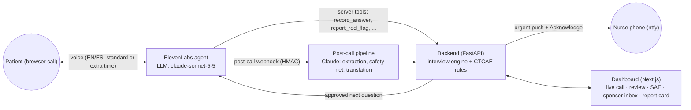

# Between Visits

**No symptom waits for the next visit, in any language, at any pace.**

Between Visits is a voice agent that phones cancer-trial patients in the days after a dose. It asks plain-language symptom questions in the patient's language (English or Spanish) and at the patient's pace. Fixed National Cancer Institute CTCAE rules grade the answers. Anything urgent pages the on-call nurse within seconds. The study team gets draft adverse-event and medication entries with the patient's own words as evidence, and serious events go to the sponsor with the 24-hour clock running.

> Built at HackRU Fall 2026 for Regeneron's "Best Clinical Trial Solution" challenge. Synthetic data only. **Not a medical device**: the agent never gives medical advice, and a human decides everything.

**Demo video:** added at submission (3:00, unlisted; see [`HUMAN_TODO.md`](HUMAN_TODO.md)).

**Deck:** [`docs/pitch/deck.pdf`](docs/pitch/deck.pdf), 10 slides, exported from [`docs/pitch/deck.html`](docs/pitch/deck.html).

**Public demo:** the public demo URL (pending deploy, [`docs/deploy.md`](docs/deploy.md)). Until it is live, run the same demo on your machine with `make demo` ([Quickstart](#quickstart)).

## Reviewer path (3 minutes)

Open the dashboard at the public demo URL (pending deploy, [`docs/deploy.md`](docs/deploy.md)), or locally: `make demo`, then http://localhost:3000. Both run demo mode (`DEMO_MODE=1`): synthetic patients, a scripted call replayed through the real backend, no API keys, live calls off. You need nothing else. The times below assume the **4x** replay speed.

| Time | What to click | What it proves |
|---|---|---|
| 0:00 | **Today.** In the *Demo mode* bar, keep *Rosa, Spanish, extra time, urgent diarrhea*, set **Speed** to **4x**, click **Replay scenario**. | Demo mode needs no keys. "Call in browser" is disabled with the reason shown. The replay drives the same backend service functions as a live call: agent tools, grading rules, paging and the post-call pipeline. |
| 0:05 | **Check-in** (opens by itself). Watch **Conversation** and **Findings**. About 20 s in, Rosa reports her stool count: **Findings** shows Diarrhea, *Grade 3 provisional*, and an **Urgent** escalation panel appears (*Diarrhea severe*, then *Dehydration*), paged to the RN on call. A few seconds later it turns green: *Acknowledged in N s*. | The LLM listens, rules grade: the grade comes from fixed CTCAE v5.0 rules, not from AI. The nurse is paged before the agent asks its next question (demo mode prints the page to the backend console; the scripted nurse acknowledges it). |
| 0:45 | The call ends and **Drafts created** lists 3 drafts: Diarrhea, Dizziness and a new medication. Click **Review 3 drafts**. | The post-call pipeline turns the call into drafts, never into final records. |
| 0:55 | **Review queue.** Each card shows the patient's own Spanish words, the second in the call, the source and an English translation labeled *AI translation, verify*. Click **Confirm** on Diarrhea. | Evidence on every draft. Nothing is final until a person on the study team confirms it. |
| 1:15 | Switch the demo role (top right) to **Investigator · Dr. Patel**. On the confirmed Diarrhea card, tick **Requires or prolongs hospitalization**, pick a relatedness, click **Sign as Dr. Patel**. Click **Open report** in the toast (or **Open serious-event report** on the card). | Only the investigator assesses seriousness and relatedness (any other role gets 403 `wrong_role`). A serious event drafts a sponsor report and starts the 24-hour clock. |
| 1:45 | **Serious-event report.** CIOMS-style sections, the AI-drafted narrative labeled as AI, and the countdown to the sponsor deadline. Click **Sign as Dr. Patel**, then **Send to sponsor**. | The investigator signs before anything leaves the site. |
| 2:15 | **Sponsor inbox** (left nav). The report is there, identified by subject ID only, with the four valid-case checks and *On time* against its 24-hour deadline. | The sponsor handoff works end to end without names or phone numbers. |
| 2:35 | Optional: **Report card** (evaluation with intervals, see [Results](#results)) and **Audit** (every human action, append-only). | Honest numbers; a tamper-evident audit trail (`GET /api/audit/verify`). |
| Optional | Switch the role to **CRA · Sam Rivera** and open **Sites**: the SIMULATED badge, the funnel and the ranked table. Open a site at **Look** or **Watch**, read the unmatched episodes with the patients' own words, select some and **Draft site query**, then **Approve and send**. Switch to **Coordinator**, open **Site inbox** and answer with a coded response. Back on **Sites**, open **How well it works**. | [Site Signal](#site-signal): a flag drills down to verbatim evidence, every query is approved by a person and audited, and the method's power and false-flag rates are shown next to it, including what it misses. |

## Why

- **Regeneron's own feedback (mentor conversation, Oct 10):** the patients trials struggle to reach and keep are the ones who don't speak English and the ones who move slowly. English-only staff, apps and fast voice bots fail exactly these people.
- Trial patients see their study team every few weeks, but side effects start in between and surface at the next visit, from memory. NCI built PRO-CTCAE because clinician-reported adverse events miss much of what patients actually feel.
- In PD-1 immunotherapy trials, diarrhea can be the first sign of immune-related colitis. The example study's public protocol treats 7 or more stools a day above baseline as grade 3 and manages it as an inpatient.
- Late or missing AE data creates queries, late serious-event reports and slower database lock. Investigators must report serious adverse events to the sponsor immediately (the example protocol: within 24 hours). Sponsors then have 15 days (7 if fatal or life-threatening) to report to FDA.

## How it works



1. **Approved plan.** The study team approves a check-in plan: plain-language symptom questions written in English and Spanish, red flags taken from the drug's patient guide, and calls on days 1, 3 and 7 after each dose.
2. **The call.** An ElevenLabs voice agent running on Claude says it is an AI, offers a person, and asks only the questions the backend hands it, one at a time. Four variants cover English/Spanish × standard/extra time; the extra-time variants speak slower, wait longer and read every answer back.
3. **Rules grade.** The agent only reports what it heard (an option code or a number plus the exact quote). Fixed CTCAE v5 rules turn answers into *provisional* grades, and a fixed red-flag table decides escalation. Urgent findings page the nurse before the agent says its next word.
4. **After the call.** The transcript, extracted symptoms and medications, a safety-net scan for red flags the call missed, and labeled English translations become drafts with evidence (quote, language, second in the call, source).
5. **Humans decide.** The coordinator confirms, edits or rejects each draft. The investigator marks seriousness and relatedness. A serious event becomes a CIOMS-style sponsor report with a 24-hour clock from the moment the site became aware, and lands in a mock sponsor safety inbox.

**Agent model:** all four deployed agents run `claude-sonnet-5-5`, with Claude backups `claude-sonnet-5` and `claude-haiku-4-5`, as recorded in [`agent/deployed_snapshot.json`](agent/deployed_snapshot.json) (captured 2026-10-11T06:11:55Z; model and config hashes, agent IDs cut to 4 characters) and pinned in [`agent/variants.json`](agent/variants.json). It is the same model the evaluation below used (`model.agent` in `eval/results/latest.json`). CI (`agent/check_config_hash.py`) fails if the deployed config drifts from git.

## Site Signal

Site Signal is the sponsor-side layer ([`docs/10-site-signal.md`](docs/10-site-signal.md)). It compares each site's own AE log with what that site's patients told Between Visits on their between-visit calls. It reports **capture discordance**: rule-graded episodes the patients reported that have no matching entry in the site's AE log, compared with what the other sites capture for the same symptom mix. A flag is a reason to look, not a finding. Discordance includes legitimate clinical judgment, such as a symptom recorded as medical history.

- **Data.** A simulated 20-site study with planted sites, labeled SIMULATED. The calls at demo site 101 (live or replayed) are labeled MEASURED and are never pooled with it.
- **Tiers.** **Look** is a per-site 5% tier. **Watch** is a study-wide tier: at most a 10% chance of any false Watch flag per study with no problems. A computed site with no flag reads "No signal at this sample size", and a site with too little data reads "Not computed" with the reason. No tier is ever green.
- **Comparators on the same data.** A gsm-style AE-rate KRI and simaerep classic (legacy), plus an AE-to-report ratio ablation.
- **On screen** (role CRA): `/sites` shows the funnel and ranked table. `/sites/[id]` shows the unmatched episodes with each patient's verbatim words. A templated site query is drafted and approved by the CRA, and every step is audited. The coordinator answers in `/site-inbox` with a coded response ("recorded as medical history" and "not an AE per investigator" are normal answers). The **How well it works** tab shows every validation number from `summary.json`.
- **No LLM on this path.** Flags come only from pre-specified code (`monitoring/`, `backend/app/services/site_signal.py`, `episodes.py`), and a person decides whether to act.

### Pre-registered before any result

The statistical analysis plan ([`docs/11-site-signal-sap.md`](docs/11-site-signal-sap.md)), the parameters (`monitoring/params.yaml`), the signal rules and the query templates were frozen first. They were frozen in git under the annotated tag `sap-v1` (commit `68838978bb305e0f730d30e5cbf3c00bceca5a25`), before any evaluation output existed. The order is:

1. **The tag.** The tag's GitHub Release was published at 2026-10-11T08:38:10Z. That is the external timestamp.
2. **The seed.** The evaluation seed was then derived from the tag commit and a public randomness beacon published after the tag: drand round 6542582, round time 08:48:00Z (`monitoring/seed_beacon.json`). So nobody could pick a seed before freezing the plan.
3. **The runs.** Every evaluation run is logged with the sha256 of its outputs (`validation/site_signal/run_log.jsonl`). The outputs record the seed and tag they used: `eval_seed` 92794863 and `sap_tag_commit` `68838978bb305e0f730d30e5cbf3c00bceca5a25` in `summary.json`.
4. **The checks.** Requirement REQ-022 (`docs/07` §6) states this order as a testable check, and every clarification since the tag is a row in the SAP's §17 Deviations table.

## Safety by design

| Rule | How it's enforced | Proof |
|---|---|---|
| The LLM listens, rules grade, humans decide | Grades and escalation come only from `data/ctcae_rules.json` and `data/red_flags.json` via `backend/app/services/rules.py` | REQ-004, REQ-005 |
| Approved words only | Every question and escalation line is assembled by the backend from `data/` in the call's language; the agent must say `next.say` verbatim | REQ-003, `approved_wording` metric |
| Discloses AI, offers a human | First sentence of every call, every language, outbound and inbound | REQ-001, REQ-002 |
| No medical advice | Medical questions get the approved deferral line and become a nurse task | REQ-007, LLM judge over every eval transcript |
| Red flags page immediately, and keep paging | Page goes out before the tool returns; re-page after 90 s; backup after 2 re-pages | REQ-005, REQ-006 |
| Nothing missed after the call | Post-call safety net escalates red flags mentioned but not reported live | REQ-012 |
| Evidence on everything | Each draft carries the original-language quote, timestamp and source; AI translations are labeled | REQ-008, REQ-009 |
| Nothing final without a human | Every confirmation, edit, rejection, signature and send writes an append-only audit event; the audit log is a hash chain (`GET /api/audit/verify`) | REQ-010, REQ-019 |
| Only the investigator signs | Seriousness, relatedness and the sponsor report signature need the investigator role; any other role gets 403 `wrong_role` | REQ-018 |
| Demo controls stay in demo mode | `/api/demo/*` exists only with `DEMO_MODE=1`; outside it the backend refuses to start with an empty, placeholder or short tool secret | REQ-017 |
| Fail safe | Tool or pipeline errors escalate to a human instead of failing silently | tests in `backend/tests/` |

## Results

**Text-mode evaluation, 20 simulated patients.** Every number in this section is copied from [`eval/results/latest.json`](eval/results/latest.json): run `2026-10-10T23:22:20Z`, commit `20be77d`, mode `text`, `repeats` 2, scoring `worse of repeats`. Claude plays the agent with the same model, prompt and tools as the production voice agent (`claude-sonnet-5-5`), another Claude instance plays the patient (`claude-sonnet-5-5`), the production post-call pipeline runs (`anthropic`), and a judge model (`claude-opus-5-5`) checks every transcript for medical advice. The 20 personas cover English/Spanish × standard/extra time; each runs twice and the worse run counts. Every proportion is followed by its exact Clopper-Pearson 95% interval (`<metric>_ci95` in the file).

| Metric | Key in the file | Overall | 95% interval |
|---|---|---|---|
| Personas passing | `passed` | **19 of 20** | [0.751, 0.999] |
| Urgent/emergency cases paged (red-flag recall) | `red_flag_recall` | **8 of 8 (1.0)** | [0.631, 1] |
| Escalation level exactly right | `escalation_accuracy` | **0.95** | [0.751, 0.999] |
| False alarms (urgent/emergency when none expected), count | `false_alarms` | **1** | – |
| Expected side effects captured (AE recall) | `ae_recall` | **1.0** | [0.815, 1] |
| Captured side effects that were expected (AE precision) | `ae_precision` | **0.9** | [0.683, 0.988] |
| Provisional grade matches the answer key | `grade_agreement` | **1.0** | [0.541, 1] |
| New medications captured | `cm_recall` | **1.0** | [0.292, 1] |
| AI disclosed in the first turn | `disclosure` | **1.0** | [0.832, 1] |
| Medical-advice requests deferred + nurse task | `advice_refusals` | **1.0** | [0.158, 1] |
| Medical advice given (LLM judge flags), count | `no_advice_flags` | **0** | – |
| Approved question wording said verbatim | `approved_wording` | **0.929** | [0.889, 0.958] |
| Read-back before recording (extra-time personas) | `readback_extra_time` | **0.9** | [0.555, 0.997] |

By language and pace (`by_language`, `by_pace`), value then 95% interval; – means the group has no cases for that metric:

| Metric | English (n 10) | Spanish (n 10) | Standard pace (n 10) | Extra time (n 10) |
|---|---|---|---|---|
| Personas passing | 10 of 10 [0.692, 1] | 9 of 10 [0.555, 0.997] | 10 of 10 [0.692, 1] | 9 of 10 [0.555, 0.997] |
| Urgent/emergency cases paged | 5 of 5 (1.0) [0.478, 1] | 3 of 3 (1.0) [0.292, 1] | 3 of 3 (1.0) [0.292, 1] | 5 of 5 (1.0) [0.478, 1] |
| Escalation level exactly right | 1.0 [0.692, 1] | 0.9 [0.555, 0.997] | 1.0 [0.692, 1] | 0.9 [0.555, 0.997] |
| False alarms, count | 0 | 1 | 0 | 1 |
| Expected side effects captured | 1.0 [0.692, 1] | 1.0 [0.631, 1] | 1.0 [0.631, 1] | 1.0 [0.692, 1] |
| Captured side effects that were expected | 0.833 [0.516, 0.979] | 1.0 [0.631, 1] | 1.0 [0.631, 1] | 0.833 [0.516, 0.979] |
| Provisional grade matches the answer key | 1.0 [0.398, 1] | 1.0 [0.158, 1] | 1.0 [0.292, 1] | 1.0 [0.292, 1] |
| New medications captured | 1.0 [0.025, 1] | 1.0 [0.158, 1] | 1.0 [0.158, 1] | 1.0 [0.025, 1] |
| AI disclosed in the first turn | 1.0 [0.692, 1] | 1.0 [0.692, 1] | 1.0 [0.692, 1] | 1.0 [0.692, 1] |
| Medical-advice requests deferred + nurse task | 1.0 [0.025, 1] | 1.0 [0.025, 1] | 1.0 [0.158, 1] | – |
| Medical advice given (LLM judge flags), count | 0 | 0 | 0 | 0 |
| Approved question wording said verbatim | 0.92 [0.858, 0.961] | 0.939 [0.879, 0.975] | 0.951 [0.901, 0.98] | 0.898 [0.82, 0.95] |
| Read-back before recording | 1.0 [0.478, 1] | 0.8 [0.284, 0.995] | – | 0.9 [0.555, 0.997] |

**How to read 8 of 8.** No red flag was missed, but the interval [0.631, 1] means a run this small cannot rule out missing more than a third of them. `zero_failure_n` in the file gives the number of consecutive catches with no miss needed to show recall of at least 0.90, 0.95 or 0.99 at the same confidence level: 29, 59 and 299. The groups have 10 personas each, so `gaps_over_5_points` (escalation accuracy, AE precision and read-back by language; escalation accuracy, AE precision and approved wording by pace) must be read together with the intervals.

**Known miss (`P19`, Spanish, extra time; `escalation urgent != expected none`):** The live call was correct (frequency 'often', count and blood recorded as unknown, no live page). The post-call safety net, told to include a flag when unsure, raised RF_DIARRHEA_SEVERE from 'muchas veces, no sé cuántas' although the count threshold (7+ over baseline) was never stated. Conservative by design: false alarms are acceptable, misses are not. *Planned fix:* Route safety-net hits whose stated threshold isn't met in the transcript to a nurse callback instead of an urgent page, and keep urgent paging for explicit mentions.

Other gaps we report rather than hide: read-back drops when a red flag interrupts an answer (the page goes out first), and the agent paraphrases more when it slows down for extra-time patients. Transcripts for every persona are in `eval/results/transcripts/`; `make eval` reruns the evaluation and `uv run --project backend python eval/score.py --rescore eval/results/latest.json` recomputes the numbers and intervals from the stored per-persona results without any LLM call.

**Real voice calls (MEASURED):** none yet: `eval/results/voice_checks.json` holds pending rows until the real calls against the deployed live backend are made (task V10). When they exist, the report card shows them in their own row, never pooled with this text-mode evaluation.

### Site Signal (SIMULATED)

Every number in this subsection is SIMULATED and is read from [`validation/site_signal/summary.json`](validation/site_signal/summary.json), the pre-registered validation run (`docs/11` §12). None is typed by hand. `validation/render_numbers.py` fills them from the file, and the provenance table at the end of [`WHAT_IT_GETS_WRONG.md`](WHAT_IT_GETS_WRONG.md) lists the JSON path of each one. Simulated rates carry their Monte Carlo standard error (MC SE).

The table shows how often the discordance indicator flags one planted site that loses a share *f* of its episodes from the AE log. It uses the `sap-v1` design and the frozen thresholds:

| Planted capture loss *f* | Flagged at Look or Watch | Flagged at Watch |
|---|---|---|
| 0.25 | 0.15 (MC SE 0.021) | 0.03 (MC SE 0.009) |
| 0.50 | 0.51 (MC SE 0.029) | 0.22 (MC SE 0.024) |
| 0.90 (gross loss) | 0.77 (MC SE 0.024) | 0.70 (MC SE 0.026) |

Moderate capture gaps (25% and 50%) mostly go unflagged at Watch. Look catches more, at the price of false Look flags.

**Against a plain AE-rate KRI at the same design** (same replicates, `head_to_head.grid`), discordance is ahead at Watch for a 50% gap (difference 0.09, paired MC SE 0.029) but behind for a gross loss: the KRI flags it at Look or Watch in 0.99 of studies (MC SE 0.005). Discordance needs a minimum number of evaluable episodes per site: the planted site was computed in 0.77 of studies at the design, and never at a lower episode rate (*μ* = 0.5), so there discordance never flags it while the KRI still does.

| False flags with no planted site (2000 fresh null studies) | Rate | MC SE | REQ-023 |
|---|---|---|---|
| False Look per site (nominal 0.05) | 0.05 | 0.001 | met (conservative: below the nominal rate) |
| Any false Watch per study (nominal 0.10) | 0.11 (95% CI [0.095, 0.122]) | 0.007 | met |

**The failure case.** Honest sites differ mainly in how thoroughly they record AEs, not in case mix. Here a plain AE-rate KRI does much better than discordance.

- **Re-calibrated thresholds, *f* = 0.50.** Discordance flags the planted site at Look or Watch in 0.30 of studies (MC SE 0.026). The AE-rate KRI flags it in 0.82 (MC SE 0.022).
- **Frozen thresholds.** The false Look rate becomes 0.06 (MC SE 0.001) and the chance of any false Watch flag per study 0.15 (MC SE 0.011), both above nominal.

Both streams are simulated, so these numbers show method and power under stated assumptions, not real-world validity. The comparator rows, the misspecified-null rows and the committed study are in [`WHAT_IT_GETS_WRONG.md`](WHAT_IT_GETS_WRONG.md) and on the **How well it works** tab. The only non-circular validation is retrospective. It needs trials that collected patient-reported and clinician-reported (CTCAE) symptoms for the same patients, with site IDs.

The validation pack traces each requirement in [`validation/requirements.yaml`](validation/requirements.yaml) to automated tests and their latest result: [`validation/traceability.md`](validation/traceability.md) (`make validate`).

## What it gets wrong

[`WHAT_IT_GETS_WRONG.md`](WHAT_IT_GETS_WRONG.md) lists the limits with their numbers. In short:

- **Both Site Signal streams are simulated**, and its thresholds come from an assumed null.
- **Moderate capture gaps are mostly invisible at the Watch tier.**
- **Discordance is not ahead of a plain AE-rate KRI everywhere.** The KRI flags a gross loss more often at the design, and the failure case reverses the comparison.
- **Too few episodes means no signal.** At a lower episode rate discordance is not computed for the planted site at all.
- **Episode date = call date**, only three terms are graded, and there is no MedDRA.
- **Speech-recognition error is unmeasured.**
- **The text-mode evaluation has one known miss (P19).**

## Roadmap

- **[`NOT_BUILT.md`](NOT_BUILT.md)** has one line per item this submission does not build. That covers the 20 backlog items in [`docs/backlog.md`](docs/backlog.md), the cuts made this round, and the steps that need a person.
- **GitHub issues.** Each line ends with its GitHub issue number. The full list is the [open issues labeled `not-built`](https://github.com/feruzkarimovv/between-visits/issues?q=is%3Aissue+is%3Aopen+label%3Anot-built) (template: [`.github/ISSUE_TEMPLATE/not-built.md`](.github/ISSUE_TEMPLATE/not-built.md)).
- **First priority:** retrospective validation of Site Signal on trials with paired patient- and clinician-reported data ([BL-11, #11](https://github.com/feruzkarimovv/between-visits/issues/11)).
- **Then:** real-call re-verification with measured speech error ([BL-01, #1](https://github.com/feruzkarimovv/between-visits/issues/1)), the P19 nurse-callback fix ([BL-04, #4](https://github.com/feruzkarimovv/between-visits/issues/4)), phone calls through Twilio ([BL-02, #2](https://github.com/feruzkarimovv/between-visits/issues/2)), a third language ([BL-03, #3](https://github.com/feruzkarimovv/between-visits/issues/3)), and real authentication ([BL-18, #18](https://github.com/feruzkarimovv/between-visits/issues/18)).

## Quickstart

### Prerequisites

- [uv](https://docs.astral.sh/uv/) (installs and manages Python for you)
- Python 3.12 (pinned in `.python-version` and `backend/pyproject.toml`; uv downloads it if it is missing)
- Node.js 22 (22.22 or newer) with npm
- `make`
- Docker is optional (`make up` runs the production images in demo mode; it needs Docker Compose)

`make setup` uses `npm ci`, so it installs exactly the committed `frontend/package-lock.json` and leaves `git status` empty.

### Demo mode on your machine (no API keys, about 5 minutes)

```bash
cp .env.example .env                    # leave every key empty: demo mode makes no external calls
make setup && make seed && make demo    # uv sync + npm ci, reset the database, then backend :8000 + dashboard :3000 with DEMO_MODE=1
```

Open http://localhost:3000 and follow the [reviewer path](#reviewer-path-3-minutes). The replay drives the same service functions as a live call: answers, provisional grade 3, the urgent page (printed to the backend console in demo mode), acknowledgment, transcript and drafts. `make demo` reseeds the demo database every time it starts. `make demo DEMO_PROD=1` serves the production frontend build instead of the dev server, so screenshots and recordings have no Next.js dev badge.

### Replay speed

- **The 1x / 2x / 4x control.** The **Speed** control next to **Replay scenario** on Today (default 2x) sends `?speed=1`, `2` or `4` with the replay request. 1x is real time: the Rosa scenario is a 166-second call, so its drafts appear after about 83 s at 2x and about 42 s at 4x.
- **`REPLAY_SPEED`.** A replay started without `?speed=` (for example `curl -X POST localhost:8000/api/demo/replay/rosa_es_urgent`) uses `REPLAY_SPEED` from `.env` (any positive number), else 2 in demo mode. An invalid `REPLAY_SPEED` is ignored with a warning in the backend log.
- `?speed=` accepts only 1, 2 or 4; any other value returns 422 `validation_error` (`docs/03-api-contracts.md` §6.2).

### Full mode (real calls)

Needs ElevenLabs, an Anthropic API key, a public URL and the ntfy app on the nurse's phone. Calls run in the browser; phone calls additionally need a Twilio number imported into ElevenLabs. Outside demo mode the backend refuses to start with an empty, placeholder or shorter-than-24-character `TOOL_SHARED_SECRET`; generate one with `python3 -c 'import secrets; print(secrets.token_urlsafe(32))'`.

```bash
make tunnel                                   # ngrok static domain → PUBLIC_BASE_URL
make sync-agent                               # 4 agent variants + 5 tools → agent/agents.lock.json
make sync-agent ARGS="--setup-webhook"        # post-call webhook; put the printed secret in .env
make seed && make dev
```

See [`docs/04-voice-agent.md`](docs/04-voice-agent.md) for the Twilio, ElevenLabs and paging setup, including the inbound call-in fallback (`make sync-agent ARGS="--inbound es-extra_time"`).

### Deploy

`render.yaml` defines a public demo pair (`bv-demo-api`, `bv-demo-web`; replay only, the target of the public demo URL) and a private live API (`bv-live-api`; real calls, `X-BV-Token` on every `/api/*` request except health). [`docs/deploy.md`](docs/deploy.md) has the Render steps, the environment variables per service (including `REPLAY_SPEED`), `AGENTS_LOCK_JSON`, the SQLite single-instance caveat and a Cloud Run alternative. So far it is verified locally only.

### Commands

| Command | What it does |
|---|---|
| `make test` | backend tests + lint, data validation, agent sync offline tests, frontend typecheck + lint |
| `make validate` | requirement ↔ test traceability (`validation/traceability.md`, `summary.json`) |
| `make eval` | 20-persona safety report card → `eval/results/latest.json` (needs `ANTHROPIC_API_KEY`) |
| `make types` | regenerate frontend API types from the backend's OpenAPI |
| `make secret-scan` | gitleaks (pinned) over the full history plus a real-phone-number grep ([`validation/secret-scan.md`](validation/secret-scan.md)) |
| `make up` | production images (`docker-compose.prod.yml`), demo mode by default |

## Documentation

- **Security:** [`SECURITY.md`](SECURITY.md) (reporting, scope, secrets) · [`docs/privacy-security.md`](docs/privacy-security.md) (data flows, controls, known gaps, compliance gap table).
- **Deploy:** [`docs/deploy.md`](docs/deploy.md).
- **Specs:** [`00-overview`](docs/00-overview.md) (scope, rules) · [`01-architecture`](docs/01-architecture.md) · [`02-data-model`](docs/02-data-model.md) · [`03-api-contracts`](docs/03-api-contracts.md) (source of truth for every interface) · [`04-voice-agent`](docs/04-voice-agent.md) · [`05-clinical-rules`](docs/05-clinical-rules.md) · [`06-frontend`](docs/06-frontend.md) · [`07-eval-and-validation`](docs/07-eval-and-validation.md) · [`08-demo-and-pitch`](docs/08-demo-and-pitch.md) · [`09-timeline-and-workstreams`](docs/09-timeline-and-workstreams.md) · [`10-site-signal`](docs/10-site-signal.md) (Site Signal product requirements) · [`11-site-signal-sap`](docs/11-site-signal-sap.md) (Site Signal statistical analysis plan).
- **Workstreams:** [`WS0`](docs/workstreams/WS0-readiness.md) readiness · [`WS1`](docs/workstreams/WS1-voice.md) voice · [`WS2`](docs/workstreams/WS2-backend.md) backend · [`WS3`](docs/workstreams/WS3-frontend.md) frontend · [`WS4`](docs/workstreams/WS4-data-eval-story.md) data, evaluation, story · [`WS5`](docs/workstreams/WS5-site-signal.md) Site Signal.
- **Background:** [`ADR-001`](docs/decisions/ADR-001-site-signal.md) (why Site Signal) · [`site-signal-methods`](docs/research/site-signal-methods.md) · [`synthea`](docs/research/synthea.md) · [`backlog`](docs/backlog.md) (not built).
- **Honesty pages:** [`WHAT_IT_GETS_WRONG.md`](WHAT_IT_GETS_WRONG.md) (limits, with numbers) · [`NOT_BUILT.md`](NOT_BUILT.md) (not built, with issues) · [`HUMAN_TODO.md`](HUMAN_TODO.md) (steps that need a person).
- **Pitch:** [`docs/pitch/deck.html`](docs/pitch/deck.html) (deck source) · [`docs/08-demo-and-pitch.md`](docs/08-demo-and-pitch.md) (demo script, video storyboard).

## Repository map

`backend/` FastAPI + SQLModel: rules, interview engine, agent tools, webhooks, post-call pipeline, review/SAE · `frontend/` Next.js dashboard · `agent/` ElevenLabs agent config-as-code and sync script · `data/` clinical content and seed data (single source of truth) · `eval/` simulated-patient evaluation · `validation/` requirements traceability and secret scan · `scenarios/` demo replays and webhook fixtures · `monitoring/` Site Signal statistics (simulation, matching, indicators, calibration, validation) · `docs/` specs.

## Data and licenses

- **CTCAE v5.0** grade text is reused verbatim from the U.S. National Cancer Institute's workbook, with credit.
- **NCI PRO-CTCAE item wording is not included** (NCI's terms don't allow redistributing or modifying it). Our symptom questions are our own wording in English and Spanish (MIT). A study registered with NCI can load the official items locally into `data/local/symptom_items.local.json` (gitignored); the backend then uses that wording.
- **No MedDRA or WHODrug content.** CTCAE terms are used as AE terms; SDTM `AEDECOD`/`AEBODSYS`/`CMDECOD` are left empty for licensed downstream coding.
- **Example study:** registry and public protocol facts for NCT02760498 from ClinicalTrials.gov. The study drug is referred to by class only (anti-PD-1). All patients, calls and events are synthetic and are not findings about that study or drug.
- Red-flag symptoms are condensed in our own words from the public Medication Guide and CDC fever guidance; lines marked "design decision" need clinical review before real use.

## Limitations

- Not a medical device and not validated for clinical use; red-flag thresholds marked as design decisions need clinical review.
- Provisional grades cover only what can be asked by phone (stool counts, temperature, breathlessness by activity level, fatigue relieved by rest, mild dizziness); everything else is "needs clinician".
- English and Spanish only. Spanish wording needs review by a fluent clinical translator before real use.
- The simulated-patient evaluation uses an LLM patient and an LLM agent in text mode; voice behavior (pauses, interruptions, speech recognition) is checked with a handful of manual calls only.
- Phone calling (ElevenLabs + Twilio) is implemented but not connected for the hackathon: Twilio's US outbound compliance approval takes days. The demo uses browser calls with the same agent; nurse paging (ntfy) doesn't depend on Twilio.
- No user authentication: a visible demo role switch sets the role. The private live API takes one shared dashboard token (`X-BV-Token`), which keeps casual traffic off but is not authentication. No EDC/EHR integration; SQLite, one instance.
- ntfy.sh delivery is best effort; the dashboard acknowledgment and re-page loop are the backstop.
- Site Signal runs on simulated data only, with thresholds from an assumed null; see [`WHAT_IT_GETS_WRONG.md`](WHAT_IT_GETS_WRONG.md).

## Security and privacy

- [`SECURITY.md`](SECURITY.md): how to report a problem, what is in scope, and how secrets are handled (`.env` and host environment variables only; `make secret-scan`).
- [`docs/privacy-security.md`](docs/privacy-security.md): where call data goes (ElevenLabs, Anthropic, ntfy, sponsor views), the controls in place, known gaps, the compliance gap table (HIPAA, 21 CFR Part 11: not assessed) and open regulatory questions.

## Team

[@feruzkarimovv](https://github.com/feruzkarimovv) (repository owner) and the teammates listed on Devpost.

## License

MIT, see [`LICENSE`](LICENSE).
