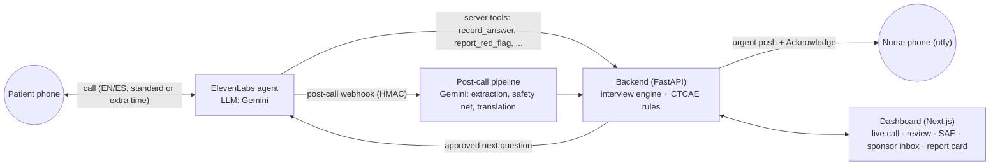

# Between Visits

**No symptom waits for the next visit, in any language, at any pace.**

Between Visits is a voice agent that phones cancer-trial patients in the days after a dose. It asks plain-language symptom questions in the patient's language (English or Spanish) and at the patient's pace. Fixed National Cancer Institute CTCAE rules grade the answers. Anything urgent pages the on-call nurse within seconds. The study team gets draft adverse-event and medication entries with the patient's own words as evidence, and serious events go to the sponsor with the 24-hour clock running.

> Built at HackRU Fall 2026 for Regeneron's "Best Clinical Trial Solution" challenge. Synthetic data only. **Not a medical device**: the agent never gives medical advice, and a human decides everything.

**Demo video:** _TODO_ · **Deck:** _TODO_

## Why

- **Regeneron's own feedback (mentor conversation, Oct 10):** the patients trials struggle to reach and keep are the ones who don't speak English and the ones who move slowly. English-only staff, apps and fast voice bots fail exactly these people.
- Trial patients see their study team every few weeks, but side effects start in between and surface at the next visit, from memory. NCI built PRO-CTCAE because clinician-reported adverse events under-detect what patients actually feel.
- In PD-1 immunotherapy trials, diarrhea can be the first sign of immune-related colitis. The example study's public protocol treats 7 or more stools a day above baseline as grade 3 and manages it as an inpatient.
- Late or missing AE data creates queries, late serious-event reports and slower database lock. Investigators must report serious adverse events to the sponsor immediately (the example protocol: within 24 hours). Sponsors then have 15 days (7 if fatal or life-threatening) to report to FDA.

## How it works



1. **Approved plan.** The study team approves a check-in plan: plain-language symptom questions written in English and Spanish, red flags taken from the drug's patient guide, and calls on days 1, 3 and 7 after each dose.
2. **The call.** An ElevenLabs agent running on Gemini says it is an AI, offers a person, and asks only the questions the backend hands it, one at a time. Four variants cover English/Spanish × standard/extra time; the extra-time variants speak slower, wait longer and read every answer back.
3. **Rules grade.** The agent only reports what it heard (an option code or a number plus the exact quote). Fixed CTCAE v5 rules turn answers into *provisional* grades, and a fixed red-flag table decides escalation. Urgent findings page the nurse before the agent says its next word.
4. **After the call.** The transcript, extracted symptoms and medications, a safety-net scan for red flags the call missed, and labeled English translations become drafts with evidence (quote, language, second in the call, source).
5. **Humans decide.** The coordinator confirms, edits or rejects each draft. The investigator marks seriousness and relatedness. A serious event becomes a CIOMS-style sponsor report with a 24-hour clock from the moment the site became aware, and lands in a mock sponsor safety inbox.

## Safety by design

| Rule | How it's enforced | Proof |
|---|---|---|
| The LLM listens, rules grade, humans decide | Grades and escalation come only from `data/ctcae_rules.json` and `data/red_flags.json` via `backend/app/services/rules.py` | REQ-004, REQ-005 |
| Approved words only | Every question and escalation line is assembled by the backend from `data/` in the call's language; the agent must say `next.say` verbatim | REQ-003, `approved_wording` metric |
| Discloses AI, offers a human | First sentence of every call, every language, outbound and inbound | REQ-001, REQ-002 |
| No medical advice | Medical questions get the approved deferral line and become a nurse task | REQ-007, LLM judge over every eval transcript |
| Red flags page immediately, and keep paging | Page goes out before the tool returns; re-page after 90 s; backup after 2 re-pages | REQ-005, REQ-006 |
| Nothing missed after the call | Post-call safety net escalates red flags mentioned but not reported live | REQ-012 |
| Evidence on everything | Each draft carries the original-language quote, timestamp and source; AI translations are labeled | REQ-008, REQ-009 |
| Nothing final without a human | Every confirmation, edit, rejection, signature and send writes an append-only audit event | REQ-010 |
| Fail safe | Tool or pipeline errors escalate to a human instead of failing silently | tests in `backend/tests/` |

## Evaluation

The safety report card runs 20 simulated patients (English/Spanish × standard/extra time, 5 per cell) through the real backend: Gemini plays the agent with the exact production prompt and tools, another Gemini plays the patient, then the production post-call pipeline runs and the result is scored against an answer key. Every persona runs twice and the worse run counts.

<!-- Filled from eval/results/latest.json after `make eval`. Never type numbers that didn't come from a run. -->
_Results pending the first full run (`make eval`)._

The validation pack traces each of 15 requirements to automated tests and their latest result: [`validation/traceability.md`](validation/traceability.md) (`make validate`).

## Quickstart

**Demo mode (no API keys, about 5 minutes):**

```bash
cp .env.example .env        # leave keys empty
make setup                  # uv sync + npm install
make demo                   # seeds, starts backend :8000 + dashboard :3000 with DEMO_MODE=1
```

Open http://localhost:3000 → **Today** → **Replay scenario** → *Rosa, Spanish, extra time, urgent diarrhea*. The replay drives the same service functions as a live call: answers, provisional grade 3, the urgent page (printed to the backend console in demo mode), acknowledgment, transcript and drafts. Then review the drafts, switch the demo role to Investigator, mark the diarrhea serious, sign and send the report to the sponsor inbox.

**Full mode (real calls):** needs ElevenLabs (agents + an imported Twilio number), Gemini, a public URL and the ntfy app on the nurse's phone.

```bash
make tunnel                                   # ngrok static domain → PUBLIC_BASE_URL
make sync-agent                               # 4 agent variants + 5 tools → agent/agents.lock.json
make sync-agent ARGS="--setup-webhook"        # post-call webhook; put the printed secret in .env
make seed && make dev
```

See `docs/04-voice-agent.md` for the Twilio, ElevenLabs and paging setup, including the inbound call-in fallback (`make sync-agent ARGS="--inbound es-extra_time"`).

| Command | What it does |
|---|---|
| `make test` | backend tests + lint, data validation, agent sync offline tests, frontend typecheck + lint |
| `make validate` | requirement ↔ test traceability (`validation/traceability.md`, `summary.json`) |
| `make eval` | 20-persona safety report card → `eval/results/latest.json` (needs `GEMINI_API_KEY`) |
| `make types` | regenerate frontend API types from the backend's OpenAPI |

## Repository map

`backend/` FastAPI + SQLModel: rules, interview engine, agent tools, webhooks, post-call pipeline, review/SAE · `frontend/` Next.js dashboard · `agent/` ElevenLabs agent config-as-code and sync script · `data/` clinical content and seed data (single source of truth) · `eval/` simulated-patient evaluation · `validation/` requirements traceability · `scenarios/` demo replays and webhook fixtures · `docs/` specs.

## Data and licenses

- **CTCAE v5.0** grade text is reused verbatim from the U.S. National Cancer Institute's workbook, with credit.
- **NCI PRO-CTCAE item wording is not included** (NCI's terms don't allow redistributing or modifying it). Our symptom questions are our own wording in English and Spanish (MIT). A study registered with NCI can load the official items locally into `data/local/symptom_items.local.json` (gitignored); the backend then uses that wording.
- **No MedDRA or WHODrug content.** CTCAE terms are used as AE terms; SDTM `AEDECOD`/`AEBODSYS`/`CMDECOD` are left empty for licensed downstream coding.
- **Example study:** registry and public protocol facts for NCT02760498 from ClinicalTrials.gov. The study drug is referred to by class only. All patients, calls and events are synthetic and are not findings about that study or drug.
- Red-flag symptoms are condensed in our own words from the public Medication Guide and CDC fever guidance; lines marked "design decision" need clinical review before real use.

## Limitations

- Not a medical device and not validated for clinical use; red-flag thresholds marked as design decisions need clinical review.
- Provisional grades cover only what can be asked by phone (stool counts, temperature, breathlessness by activity level, fatigue relieved by rest, mild dizziness); everything else is "needs clinician".
- English and Spanish only. Spanish wording needs review by a fluent clinical translator before real use.
- The simulated-patient evaluation uses an LLM patient and an LLM agent in text mode; voice behavior (pauses, interruptions, speech recognition) is checked with a handful of manual calls only.
- No authentication (a visible demo role switch), no EDC/EHR integration, SQLite.
- ntfy.sh delivery is best effort; the dashboard acknowledgment and re-page loop are the backstop.

## Team

<!-- names, roles -->

## License

MIT, see `LICENSE`.
