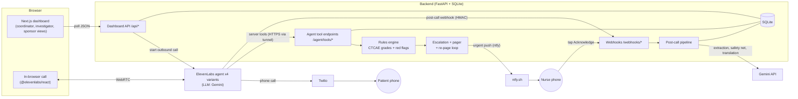
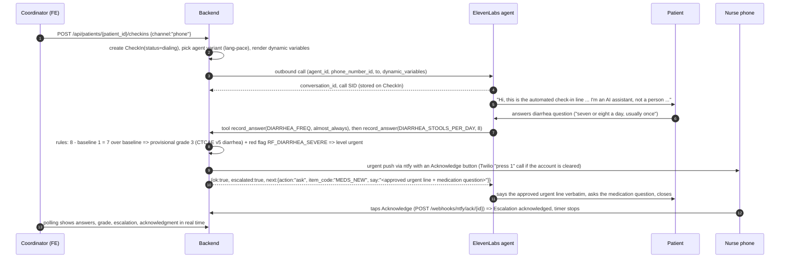

# 01 · Architecture

## Components



Public HTTPS reaches the laptop through an **ngrok static domain** (`PUBLIC_BASE_URL`). ElevenLabs server tools, the ElevenLabs post-call webhook and Twilio callbacks all point at it.

### Site Signal (planned, Sun Oct 11; `docs/10`, `docs/11`)

| Component | Where | Boundary |
|---|---|---|
| Statistics package | `monitoring/` (separate uv project; numpy and scipy live only here) | Simulates the study, matches episodes, computes indicators and thresholds, validates; writes committed JSON to `monitoring/out/` and `validation/site_signal/`. Imports `rules.py` and the stdlib `episodes.py` from `backend/` through `bvsignal/_backend.py`; no LLM, no database. |
| Episode builder | `backend/app/services/episodes.py` (stdlib only) | One implementation shared by `monitoring/` and the backend. |
| Read API, site queries, blind runs | `backend/app/routers/site_signal.py`, `services/site_signal.py`, `services/site_queries.py` | Reads `monitoring/out/*.json` (mtime-checked cache); computes no statistic and imports no numpy. Shells out to `python -m bvsignal.blind` (argument list, no shell, timeout) only for the demo-only blind run. |

The safety path (agent tools, rules, paging, post-call pipeline) never reads Site Signal data, so nothing in it can delay a page.

## Key flows

### Flow A · Live check-in call with a red flag



Safety property: the backend pages the nurse **as soon as the rule fires**, independent of what the LLM does next. The `say` text the agent receives is approved wording from `data/scripts.json`.

### Flow B · Post-call pipeline

1. ElevenLabs POSTs `post_call_transcription` to `/webhooks/elevenlabs/post-call`. Verify the HMAC signature, return 200 fast, process in a background task.
2. Store transcript turns (role, text, `time_in_call_secs`, language) on the CheckIn.
3. **Extraction (Gemini, structured output):** symptoms, new medications, urgent-care visits and questions for the nurse, each with `turn_index` and verbatim quote. Merge with what live tool calls already recorded; items found only here are marked `source="post_call_extraction"`.
4. **Safety net (Gemini, structured output):** list any red-flag IDs (enum from `data/red_flags.json`) mentioned in the transcript. Any red flag without a matching escalation creates a new escalation with `reason="post_call_safety_net"` and pages immediately.
5. **Translation:** non-English quotes get an English translation stored separately and always displayed with the label "AI translation, verify".
6. Create `DraftEntry` rows (AE per symptom, CM per new medication, NURSE_TASK per question) with evidence. Write audit events.

### Flow C · Review, serious event, sponsor handoff

1. Coordinator confirms, edits or rejects each draft (`/review`). Every action is an `AuditEvent` with before/after.
2. Investigator role sets seriousness (ICH E2A criteria) and relatedness on confirmed AE drafts and signs.
3. If serious: create `SAEReport` with `aware_at` = time a human at the site first acknowledged the escalation (fallback: draft confirmation time) and `due_at = aware_at + 24h`. Form is pre-filled; the narrative is an AI draft labeled as such; the investigator edits and signs.
4. "Send to sponsor" posts it to the mock sponsor inbox (`/sponsor`), which shows received time vs deadline and checks the four minimum valid-case criteria.

### Flow D · Demo mode (no external keys)

`DEMO_MODE=1` disables outbound calls and Gemini. `POST /api/demo/replay/{scenario_id}` replays a recorded scenario from `scenarios/*.json` through the **same** service functions (tool calls, page, acknowledgment, post-call payload) with the recorded timing. Optional recorded audio plays in the browser. The dashboard cannot tell the difference, which makes the demo robust to bad Wi-Fi and lets reviewers run the repo without accounts.

## Technology choices

| Concern | Choice | Why |
|---|---|---|
| Voice agent | ElevenLabs Agents, LLM = Gemini Flash (the deployed model is pinned and recorded in `agent/deployed_snapshot.json`, task V9) | Low-latency voice, Spanish, Twilio native integration, server tools, post-call webhooks |
| Telephony | Twilio (native ElevenLabs integration) for patient calls; browser calls as fallback | Real phone calls are the demo's best moment |
| Paging | ntfy.sh push with an Acknowledge button (default); Twilio "press 1" call optional | No account approval needed; works tonight |
| Backend | Python 3.12, FastAPI, SQLModel, SQLite, httpx, `google-genai`, `twilio` | Fast to build, Pydantic schemas double as OpenAPI contract |
| Frontend | Next.js (App Router) + TypeScript + Tailwind + shadcn/ui + TanStack Query | Team familiarity, fast UI |
| API types | `openapi-typescript` generated from `/openapi.json` into `frontend/src/lib/api-types.ts` | Frontend and backend can't drift |
| Realtime | Polling (1 s on live views, 2 s for the escalation banner) | Most robust option at 4 AM; no websockets to debug |
| Tunnel | ngrok free static domain | Stable URL so ElevenLabs tool and webhook URLs don't change |
| Package managers | `uv` (Python), `npm` (Node) | Reproducible, fast |

## Repository layout and ownership

```
between-visits/
  CLAUDE.md                 project rules for Claude Code (everyone)
  README.md                 reader-facing README (WS4 finalizes)
  LICENSE                   MIT
  .env.example              all configuration (WS2 owns)
  Makefile                  dev commands (WS2)
  docker-compose.yml        backend + frontend (WS2)
  backend/                  WS2  FastAPI app, rules, pipeline, tests
  frontend/                 WS3  Next.js dashboard
  agent/                    WS1  ElevenLabs config-as-code + sync script
  data/                     WS4  seed + clinical content (single source of truth)
  eval/                     WS4  personas, harness, results
  validation/               WS4  requirements and traceability generator
  scenarios/                WS1+WS2  recorded demo replays
  docs/                     specs (this folder)
```

Rule: only edit your workstream's folders. Changes to anything in `docs/03-api-contracts.md` or `data/` schemas are announced in the team chat first.

## Configuration

All configuration is in `.env` (copy from `.env.example`). Real phone numbers live only in `.env` and `data/patients.local.json` (gitignored), never in committed files.

## Cross-cutting rules

- **Time:** store UTC ISO-8601 (`2026-10-11T03:12:45Z`); display in `America/New_York`.
- **IDs:** prefixed random IDs: `pat_`, `ci_`, `ans_`, `fnd_`, `esc_`, `dr_`, `sae_`, `aud_` + 10 base32 chars; planned: `sq_` (SiteQuery, B18) and `sr_` (SignalRun, B19). Study subject IDs look like `101-007`.
- **Idempotency:** tool calls carry `checkin_id` and the backend upserts answers by `(checkin_id, item_code)`. Post-call webhooks are idempotent by `conversation_id`. A page is sent once per escalation unless re-paged by the timer.
- **Security:** agent tools require header `X-BV-Tool-Secret: $TOOL_SHARED_SECRET`. ElevenLabs webhooks are HMAC-verified. Twilio callbacks are signature-verified (skip only when `APP_ENV=dev` and the request comes through the tunnel with a clear log line). CORS allows only `CORS_ORIGINS`.
- **Logging:** one structured log line per tool call, page, acknowledgment and webhook, including `checkin_id` and `escalation_id`.
- **Failure behavior:** if a tool endpoint errors, it still returns HTTP 200 with `{"ok": false, "say": <approved fallback line>}` so the agent recovers gracefully, and logs the error. If the rules engine fails on a possible red flag, escalate (fail safe, never fail silent).
