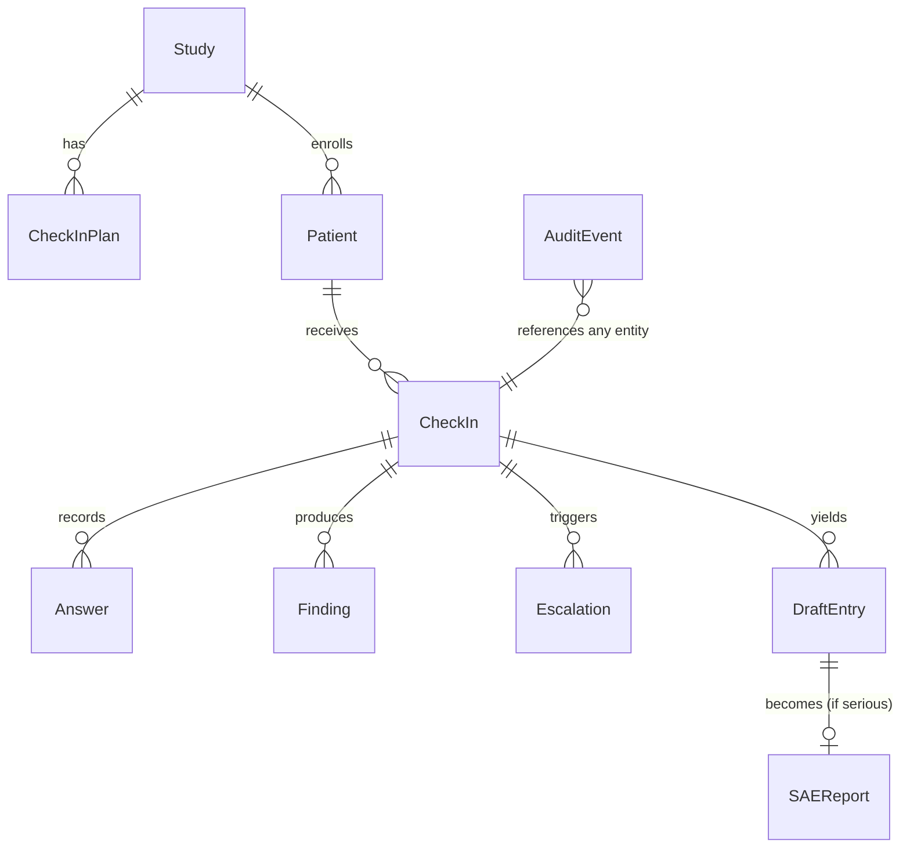

# 02 · Data model

SQLModel tables in `backend/app/models.py`, SQLite file at `backend/data/app.db`. JSON columns use SQLAlchemy `JSON`. All timestamps are UTC ISO-8601. IDs are prefixed strings (see `01-architecture.md`).

Seed data comes from `data/*.json` via `make seed`, which drops and recreates the database. Real phone numbers are merged at seed time from `data/patients.local.json` (gitignored).

## Entity overview



## Tables

### Study
| Field | Type | Example / notes |
|---|---|---|
| id | str | `std_demo01` |
| nct_id | str | real public NCT ID of the example study (see `docs/05-clinical-rules.md`) |
| title_short | str | "Open-label PD-1 immunotherapy study in advanced skin cancer (example)" |
| drug_class | str | "anti-PD-1 monoclonal antibody (immunotherapy)" (never a product name) |
| masking | str | `open_label` |
| site_id / site_name | str | `101` / "Hillside Cancer Center (fictional)" |
| study_team_name | JSON | `{"en": "the Hillside Cancer Center study team", "es": "el equipo del estudio del Hillside Cancer Center"}` |
| active_plan_id | str | FK CheckInPlan |

### CheckInPlan
| Field | Type | Notes |
|---|---|---|
| id | str | `plan_v1` |
| study_id | str | |
| version | int | 1, 2, ... |
| status | str | `draft` \| `approved` \| `superseded` |
| items | JSON list[str] | ordered item codes asked every call, e.g. `["DIARRHEA_FREQ","NAUSEA_FREQ",...]` |
| red_flag_ids | JSON list[str] | IDs from `data/red_flags.json` active for this study |
| schedule_days_after_dose | JSON list[int] | `[1,3,7]` |
| source | str | `seed` \| `protocol_pdf` |
| source_citations | JSON list | `[{"text": "...", "page": 112}]` (protocol-to-plan only) |
| approved_by / approved_at | str / datetime | required when `approved` |

Conditional follow-up items (e.g. stool count after a diarrhea answer) are defined in `data/symptom_items.json` (`followups`), not in the plan.

### Patient
| Field | Type | Notes |
|---|---|---|
| id | str | `pat_rosa` |
| subject_id | str | `101-007` |
| first_name / last_name | str | synthetic |
| age, sex | int, str | |
| language | str | `en` \| `es` |
| pace | str | `standard` \| `extra_time` |
| hearing | str | `typical` \| `hard_of_hearing` |
| caregiver_name / caregiver_relation | str? | "Lucía" / "daughter" |
| caregiver_may_answer | bool | if false, the agent asks to speak with the patient |
| phone_e164 | str | placeholder in seed; real number only via `patients.local.json` |
| dose_dates | JSON list[date] | drives the "due today" schedule; computed at seed time from `dose_offsets_days` in `data/patients.json` (relative to today) so someone is always due |
| baseline | JSON | `{"stools_per_day": 1}` recorded at enrollment |
| notes | str | free text for coordinators |

### CheckIn
| Field | Type | Notes |
|---|---|---|
| id | str | `ci_...` |
| patient_id, study_id, plan_id | str | |
| day_after_dose | int | 1, 3 or 7 |
| scheduled_for | datetime | |
| channel | str | `phone` \| `phone_inbound` \| `web` \| `replay` |
| language, pace | str | copied from patient at creation (can change mid-call via `set_language`, stretch) |
| agent_variant | str | `es-extra_time` etc. |
| el_agent_id, el_conversation_id | str? | from ElevenLabs |
| twilio_call_sid | str? | |
| status | str | `scheduled` \| `dialing` \| `in_progress` \| `completed` \| `no_answer` \| `failed` \| `cancelled` |
| speaker | str? | `patient` \| `caregiver` |
| interview_state | JSON | `{"queue": [...], "current": "DIARRHEA_FREQ", "asked": [...], "escalated": false, "closed": false}` |
| transcript | JSON list | `[{"i":0,"role":"agent","text":"...","t_s":0.4,"lang":"es"}]` filled after the call |
| summary_en | str? | post-call summary |
| started_at, ended_at | datetime? | |
| duration_s | int? | |
| termination_reason | str? | from ElevenLabs metadata |

### Answer
One row per `(checkin_id, item_code)`; re-answers overwrite and write an audit event.

| Field | Type | Notes |
|---|---|---|
| id | str | `ans_...` |
| checkin_id | str | |
| item_code | str | e.g. `DIARRHEA_FREQ`, `DIARRHEA_STOOLS_PER_DAY` |
| term | str | CTCAE term, e.g. "Diarrhea" |
| attribute | str | `frequency` \| `severity` \| `interference` \| `presence` \| `count` \| `temperature` \| `yes_no` \| `consent` \| `free_text` |
| option_code | str? | `often`, `yes`, `at_rest`, `unknown`, ... |
| numeric_value | float? | 8 |
| unit | str? | `per_day` \| `celsius` |
| reporter | str | `patient` \| `caregiver` |
| verbatim_quote | str | what the person said, original language |
| quote_lang | str | `en` \| `es` |
| t_s | float? | seconds into the call, filled post-call |
| source | str | `live_tool` \| `post_call_extraction` \| `replay` |

### Finding
Output of the rules engine for one term in one check-in. Recomputed whenever an answer for that term changes.

| Field | Type | Notes |
|---|---|---|
| id | str | `fnd_...` |
| checkin_id | str | |
| term | str | "Diarrhea" |
| provisional_grade | int? | null when phone data can't support a CTCAE grade |
| grade_basis | str | `rule` \| `needs_clinician` |
| rule_id / rule_text | str? | `CTCAE5_DIARRHEA_G3` / exact CTCAE text used |
| inputs | JSON | `{"stools_over_baseline": 7}` |
| red_flag_ids | JSON list | `["RF_DIARRHEA_SEVERE"]` |
| escalation_level | str | `none` \| `callback` \| `urgent` \| `emergency` |
| answer_ids | JSON list | evidence links |

### Escalation
| Field | Type | Notes |
|---|---|---|
| id | str | `esc_...` |
| checkin_id, patient_id | str | |
| level | str | `emergency` \| `urgent` \| `callback` |
| red_flag_ids | JSON list | |
| reason | str | `live_rule` \| `agent_report` \| `post_call_safety_net` \| `patient_request` \| `medical_question` |
| summary_en | str | one sentence read to the nurse, built from a template (no LLM) |
| patient_language | str | included in the page ("prefers Spanish, use interpreter line") |
| status | str | `open` \| `acknowledged` \| `resolved` |
| created_at, paged_at | datetime | |
| page_channel / page_target_name / page_ref | str | `ntfy` \| `twilio_voice` \| `console`; `page_ref` = ntfy message ID or Twilio call SID |
| ack_token | str | random per escalation; required as a Bearer token by the push Acknowledge button |
| repage_count | int | re-paged after `ACK_TIMEOUT_SECONDS`; after 2 re-pages also pages the backup contact |
| acknowledged_at / acknowledged_by / ack_method | | `push_button` \| `phone_keypress` \| `dashboard` |
| resolved_at / resolution_note | | |

`callback` escalations are not paged; they appear as tasks for the coordinator.

### DraftEntry
| Field | Type | Notes |
|---|---|---|
| id | str | `dr_...` |
| checkin_id, patient_id | str | |
| kind | str | `AE` \| `CM` \| `NURSE_TASK` |
| status | str | `draft` \| `confirmed` \| `rejected` |
| payload | JSON | by kind, below |
| evidence | JSON list | `[{"quote":"...","quote_lang":"es","translation_en":"...","translation_label":"AI translation, verify","t_s":52.1,"turn_index":7,"source":"live_tool"}]` |
| reviewed_by / reviewed_at / review_note | | coordinator action |
| investigator | JSON? | `{"is_serious": true, "seriousness_criteria": ["hospitalization"], "relatedness": "possibly_related", "signed_by": "Dr. Patel", "signed_at": "..."}` |

Payloads:

```json
{"kind":"AE","payload":{"term":"Diarrhea","verbatim_en":"7 to 8 loose stools a day, usually 1","onset_date":"2026-10-08","ongoing":true,"provisional_grade":3,"grade_basis":"rule","rule_id":"CTCAE5_DIARRHEA_G3","rule_text":"Increase of >=7 stools per day over baseline ...","answers":[{"item_code":"DIARRHEA_FREQ","option_code":"almost_always"},{"item_code":"DIARRHEA_STOOLS_PER_DAY","numeric_value":8}],"escalation_id":"esc_..."}}
{"kind":"CM","payload":{"medication_name":"loperamide (Imodium)","otc":true,"indication_en":"diarrhea","start_date":"2026-10-09","dose_text":null}}
{"kind":"NURSE_TASK","payload":{"category":"medical_question","text_en":"Should I take more Imodium?"}}
```

### SAEReport
| Field | Type | Notes |
|---|---|---|
| id | str | `sae_...` |
| draft_entry_id, patient_id, checkin_id | str | |
| status | str | `draft` \| `signed` \| `sent` |
| aware_at | datetime | first human acknowledgment of the related escalation; fallback: AE confirmation time |
| due_at | datetime | `aware_at + 24h` |
| payload | JSON | CIOMS-style fields (see `docs/05-clinical-rules.md`) |
| narrative_ai_draft | str | labeled "AI draft" in UI |
| narrative_final | str? | investigator-edited |
| signed_by / signed_at | | |
| sent_at / sponsor_received_at | | mock inbox receipt |

### AuditEvent
| Field | Type | Notes |
|---|---|---|
| id | str | `aud_...` |
| ts | datetime | |
| actor | str | user name from `X-BV-User` header, or `agent` / `system` |
| role | str | `coordinator` \| `investigator` \| `nurse` \| `sponsor` \| `agent` \| `system` |
| action | str | dotted verb, e.g. `answer.recorded`, `finding.updated`, `escalation.paged`, `escalation.acknowledged`, `draft.confirmed`, `draft.edited`, `sae.signed`, `sae.sent` |
| entity_type / entity_id | str | |
| before / after | JSON? | |
| note | str? | |

Audit rows are append-only. No endpoint updates or deletes them.

## Demo identity

There is no authentication. The UI has a visible "Demo role" switch that sends `X-BV-User` (e.g. "Jess Kim") and `X-BV-Role` (`coordinator`, `investigator`, `sponsor`) on every request. The backend uses them only for audit attribution and to gate investigator-only actions (409 if the role is wrong).
