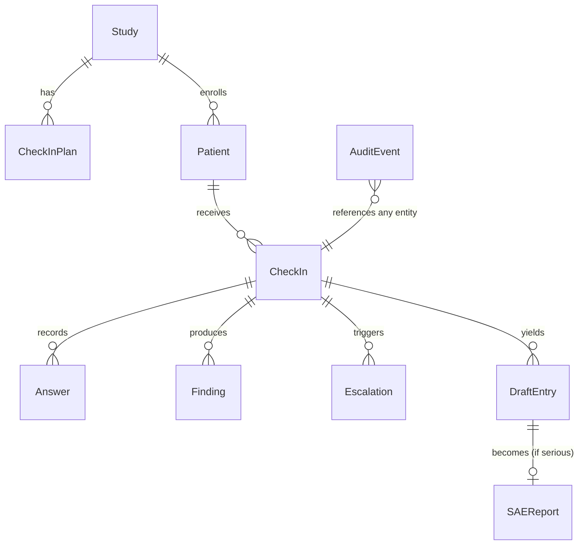
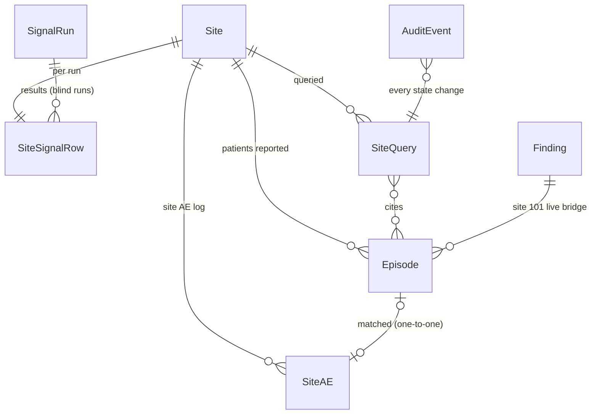

# 02 · Data model

SQLModel tables in `backend/app/models.py`, SQLite file at `backend/data/app.db`. JSON columns use SQLAlchemy `JSON`. All timestamps are UTC ISO-8601. IDs are prefixed strings (see `01-architecture.md`). *Planned (§ Site Signal): new random prefixes `sq_` and `sr_` from `app/ids.py`; deterministic file-backed IDs `ep_` and `ae_`. Values that are dates rather than timestamps (check-in day, timeline dates, AESTDTC and SAE onset fallbacks) use the `DISPLAY_TZ` local date of the call (`docs/03` §6.4).*

Seed data comes from `data/*.json` via `make seed`, which drops and recreates the database. Real phone numbers are merged at seed time from `data/patients.local.json` (gitignored).

## Entity overview



## Tables

### Study
| Field | Type | Example / notes |
|---|---|---|
| id | str | `std_demo01` |
| nct_id | str | real public NCT ID of the example study (see `docs/05-clinical-rules.md`) |
| title_short | str | "Open-label PD-1 immunotherapy study in advanced skin cancer (example)" |
| drug_class | str | "anti-PD-1 monoclonal antibody (immunotherapy)" (never a product name) |
| masking | str | `open_label` |
| site_id / site_name | str | `101` / "Hillside Cancer Center (fictional)" |
| study_team_name | JSON | `{"en": "the Hillside research team", "es": "equipo de investigación de Hillside"}`. *Planned change (D8): `es` drops the leading article, and the Spanish templates in `data/scripts.json` say `del {study_team_name}`, which fixes "de el equipo". Before: `"el equipo de investigación de Hillside"`.* |
| active_plan_id | str | FK CheckInPlan |

### CheckInPlan
| Field | Type | Notes |
|---|---|---|
| id | str | `plan_v1` |
| study_id | str | |
| version | int | 1, 2, ... |
| status | str | `draft` \| `approved` \| `superseded` |
| items | JSON list[str] | ordered item codes asked every call, e.g. `["DIARRHEA_FREQ","NAUSEA_FREQ",...]` |
| red_flag_ids | JSON list[str] | IDs from `data/red_flags.json` active for this study |
| schedule_days_after_dose | JSON list[int] | `[1,3,7]` |
| source | str | `seed` \| `protocol_pdf` |
| source_citations | JSON list | `[{"text": "...", "page": 112}]` (protocol-to-plan only) |
| approved_by / approved_at | str / datetime | required when `approved` |

Conditional follow-up items (e.g. stool count after a diarrhea answer) are defined in `data/symptom_items.json` (`followups`), not in the plan.

### Patient
| Field | Type | Notes |
|---|---|---|
| id | str | `pat_rosa` |
| subject_id | str | `101-007` |
| first_name / last_name | str | synthetic |
| age, sex | int, str | |
| language | str | `en` \| `es` |
| pace | str | `standard` \| `extra_time` |
| hearing | str | `typical` \| `hard_of_hearing` |
| caregiver_name / caregiver_relation | str? | "Lucía" / "daughter" |
| caregiver_may_answer | bool | if false, the agent asks to speak with the patient |
| phone_e164 | str | placeholder in seed; real number only via `patients.local.json` |
| dose_dates | JSON list[date] | drives the "due today" schedule; computed at seed time from `dose_offsets_days` in `data/patients.json` (relative to today) so someone is always due |
| baseline | JSON | `{"stools_per_day": 1}` recorded at enrollment |
| notes | str | free text for coordinators |

### CheckIn
| Field | Type | Notes |
|---|---|---|
| id | str | `ci_...` |
| patient_id, study_id, plan_id | str | |
| day_after_dose | int | 1, 3 or 7 |
| scheduled_for | datetime | |
| channel | str | `phone` \| `phone_inbound` \| `web` \| `replay` |
| language, pace | str | copied from patient at creation (can change mid-call via `set_language`, stretch) |
| agent_variant | str | `es-extra_time` etc. |
| el_agent_id, el_conversation_id | str? | from ElevenLabs |
| twilio_call_sid | str? | |
| status | str | `scheduled` \| `dialing` \| `in_progress` \| `completed` \| `no_answer` \| `failed` \| `cancelled` |
| speaker | str? | `patient` \| `caregiver` |
| interview_state | JSON | `{"queue": [...], "current": "DIARRHEA_FREQ", "asked": [...], "escalated": false, "closed": false}` |
| transcript | JSON list | `[{"i":0,"role":"agent","text":"...","t_s":0.4,"lang":"es"}]` filled after the call |
| summary_en | str? | post-call summary |
| started_at, ended_at | datetime? | |
| duration_s | int? | |
| termination_reason | str? | from ElevenLabs metadata |

### Answer
One row per `(checkin_id, item_code)`; re-answers overwrite and write an audit event.

| Field | Type | Notes |
|---|---|---|
| id | str | `ans_...` |
| checkin_id | str | |
| item_code | str | e.g. `DIARRHEA_FREQ`, `DIARRHEA_STOOLS_PER_DAY` |
| term | str | CTCAE term, e.g. "Diarrhea" |
| attribute | str | `frequency` \| `severity` \| `interference` \| `presence` \| `count` \| `temperature` \| `yes_no` \| `consent` \| `free_text` |
| option_code | str? | `often`, `yes`, `at_rest`, `unknown`, ... |
| numeric_value | float? | 8 |
| unit | str? | `per_day` \| `celsius` |
| reporter | str | `patient` \| `caregiver` |
| verbatim_quote | str | what the person said, original language |
| quote_lang | str | `en` \| `es` |
| t_s | float? | seconds into the call, filled post-call |
| source | str | `live_tool` \| `post_call_extraction` \| `replay` |

### Finding
Output of the rules engine for one term in one check-in. Recomputed whenever an answer for that term changes.

| Field | Type | Notes |
|---|---|---|
| id | str | `fnd_...` |
| checkin_id | str | |
| term | str | "Diarrhea" |
| provisional_grade | int? | null when phone data can't support a CTCAE grade |
| grade_basis | str | `rule` \| `needs_clinician` |
| rule_id / rule_text | str? | `CTCAE5_DIARRHEA_G3` / exact CTCAE text used |
| inputs | JSON | `{"stools_over_baseline": 7}` |
| red_flag_ids | JSON list | `["RF_DIARRHEA_SEVERE"]` |
| escalation_level | str | `none` \| `callback` \| `urgent` \| `emergency` |
| answer_ids | JSON list | evidence links |

### Escalation
| Field | Type | Notes |
|---|---|---|
| id | str | `esc_...` |
| checkin_id, patient_id | str | |
| level | str | `emergency` \| `urgent` \| `callback` |
| red_flag_ids | JSON list | |
| reason | str | `live_rule` \| `agent_report` \| `post_call_safety_net` \| `patient_request` \| `medical_question` |
| summary_en | str | one sentence read to the nurse, built from a template (no LLM) |
| patient_language | str | included in the page ("prefers Spanish, use interpreter line") |
| status | str | `open` \| `acknowledged` \| `resolved` |
| created_at, paged_at | datetime | |
| page_channel / page_target_name / page_ref | str | `ntfy` \| `twilio_voice` \| `console`; `page_ref` = ntfy message ID or Twilio call SID |
| ack_token | str | random per escalation; required as a Bearer token by the push Acknowledge button |
| repage_count | int | re-paged after `ACK_TIMEOUT_SECONDS`; after 2 re-pages also pages the backup contact |
| acknowledged_at / acknowledged_by / ack_method | | `push_button` \| `phone_keypress` \| `dashboard` |
| resolved_at / resolution_note | | |

`callback` escalations are not paged; they appear as tasks for the coordinator.

### DraftEntry
| Field | Type | Notes |
|---|---|---|
| id | str | `dr_...` |
| checkin_id, patient_id | str | |
| kind | str | `AE` \| `CM` \| `NURSE_TASK` |
| status | str | `draft` \| `confirmed` \| `rejected` |
| payload | JSON | by kind, below |
| evidence | JSON list | `[{"quote":"...","quote_lang":"es","translation_en":"...","translation_label":"AI translation, verify","t_s":52.1,"turn_index":7,"source":"live_tool"}]` |
| reviewed_by / reviewed_at / review_note | | coordinator action |
| investigator | JSON? | `{"is_serious": true, "seriousness_criteria": ["hospitalization"], "relatedness": "possibly_related", "signed_by": "Dr. Patel", "signed_at": "..."}` |
| origin | (computed, API only) | *Planned (B14):* `DraftOut.origin` is always `"between_visits"`. Not stored. It becomes the `ORIGIN` column of ae.csv, and Site Signal uses it to exclude these rows from matching. |

Payloads:

```json
{"kind":"AE","payload":{"term":"Diarrhea","verbatim_en":"7 to 8 loose stools a day, usually 1","onset_date":"2026-10-08","ongoing":true,"provisional_grade":3,"grade_basis":"rule","rule_id":"CTCAE5_DIARRHEA_G3","rule_text":"Increase of >=7 stools per day over baseline ...","answers":[{"item_code":"DIARRHEA_FREQ","option_code":"almost_always"},{"item_code":"DIARRHEA_STOOLS_PER_DAY","numeric_value":8}],"escalation_id":"esc_..."}}
{"kind":"CM","payload":{"medication_name":"loperamide (Imodium)","otc":true,"indication_en":"diarrhea","start_date":"2026-10-09","dose_text":null}}
{"kind":"NURSE_TASK","payload":{"category":"medical_question","text_en":"Should I take more Imodium?"}}
```

### SAEReport
| Field | Type | Notes |
|---|---|---|
| id | str | `sae_...` |
| draft_entry_id, patient_id, checkin_id | str | |
| status | str | `draft` \| `signed` \| `sent` |
| aware_at | datetime | first human acknowledgment of the related escalation; fallback: AE confirmation time |
| due_at | datetime | `aware_at + 24h` |
| payload | JSON | CIOMS-style fields (see `docs/05-clinical-rules.md`) |
| narrative_ai_draft | str | labeled "AI draft" in UI |
| narrative_final | str? | investigator-edited |
| signed_by / signed_at | | |
| sent_at / sponsor_received_at | | mock inbox receipt |

### AuditEvent
| Field | Type | Notes |
|---|---|---|
| id | str | `aud_...` |
| ts | datetime | |
| actor | str | user name from `X-BV-User` header, or `agent` / `system` |
| role | str | `coordinator` \| `investigator` \| `nurse` \| `sponsor` \| `agent` \| `system`. *Planned: adds `cra`.* |
| action | str | dotted verb, e.g. `answer.recorded`, `finding.updated`, `escalation.paged`, `escalation.acknowledged`, `draft.confirmed`, `draft.edited`, `sae.signed`, `sae.sent`. *Planned: `site_query.drafted`, `site_query.edited`, `site_query.approved`, `site_query.answered`, `site_query.closed`, `signal.blind_run.created`, `signal.blind_run.revealed` (`docs/03` §5.7).* |
| entity_type / entity_id | str | *Planned: new entity types `SiteQuery`, `SignalRun`.* |
| checkin_id | str? | convenience filter. Already in the model; documented here because the hash covers it. |
| before / after | JSON? | |
| note | str? | |
| seq | int | *Planned (B13):* unique, contiguous from 1, assigned as max + 1 under a process-wide lock when the event staged by `write_audit` is written (flushed); `docs/03` §6.6 |
| prev_hash | str | *Planned (B13):* the previous event's `hash`; 64 zeros for `seq` 1 |
| hash | str | *Planned (B13):* lowercase hex `sha256(prev_hash + canonical JSON)` of `id, seq, ts, actor, role, action, entity_type, entity_id, checkin_id, before, after, note`. The exact canonical form is in `docs/03` §6.6. |

Audit rows are append-only. No endpoint updates or deletes them. *Planned (B13, REQ-019): the rows form a hash chain, and `GET /api/audit/verify` reports the first event that no longer matches. Chain assignment must never fail or delay a safety-path write: a `seq` collision is retried, never raised. The database is reseeded, so there is no migration.*

## Demo identity

There is no authentication. The UI has a visible "Demo role" switch that sends `X-BV-User` (e.g. "Jess Kim") and `X-BV-Role` (`coordinator`, `investigator`, `sponsor`) on every request. The backend uses them only for audit attribution and to gate investigator-only actions (409 if the role is wrong).

*Planned change (B12, F11; `docs/03` §6.1):*
- The wrong role returns **403** `wrong_role` instead of 409.
- A fourth role, `cra`, is added.
- Gating covers the CRA-only, coordinator-only and cra/sponsor-only Site Signal routes as well as the investigator-only actions.
- A missing or unknown role still means `coordinator`.

| `X-BV-Role` | `X-BV-User` | Switch label |
|---|---|---|
| `coordinator` | Jess Kim | Coordinator |
| `investigator` | Dr. Patel | Investigator |
| `sponsor` | Sponsor safety (mock) | Sponsor |
| `cra` (planned) | Sam Rivera | CRA (sponsor) |

---

## Site Signal (planned, Sun Oct 11)

**Status: planned, not built.** This section defines the data behind the sponsor-side Site Signal layer.
- Product: `10-site-signal.md`.
- Statistics (what an episode, a match, evaluability and O/E mean): `11-site-signal-sap.md`.
- Endpoints and payloads: `03-api-contracts.md` §5.

Only two new tables live in the app database. Everything else is file-backed: either the committed simulated study written by `make site-signal` into `monitoring/out/`, or values built at request time from existing tables (site 101 only). The backend never imports numpy or scipy and never computes a threshold.

| Model | Kind | Source | Served by |
|---|---|---|---|
| `SiteQuery` | SQLModel table | app DB | `/api/site-queries*` |
| `SignalRun` | SQLModel table (blind runs only) | app DB | `/api/site-signal/blind-run*` |
| `Site` | Pydantic, file-backed | `monitoring/out/signal_run.json` `sites` | `/api/sites*` |
| `SiteSignalRow` | Pydantic | `monitoring/out/signal_run.json` `rows`, or `SignalRun.results` | `/api/sites*`, blind run |
| `Episode` | Pydantic | `monitoring/out/episodes.json` (simulated), or built at request time from `Finding` + `CheckIn` (site 101, `MEASURED`) | `/api/sites/{site_id}`, `/api/site-queries/{id}` |
| `SiteAE` | Pydantic, file-backed | `monitoring/out/site_ae.json` | matching only (`Episode.matched_site_ae_id`) |



### ID conventions

| Prefix / form | Entity | How it is made |
|---|---|---|
| `sq_` + 10 base32 | SiteQuery | `app/ids.py` `new_id("sq")` |
| `sr_` + 10 base32 | SignalRun (blind run) | `app/ids.py` `new_id("sr")` |
| `sr_committed` | the committed study | reserved literal; never a database row |
| `ep_{site}_{n}` | simulated Episode | deterministic, from `monitoring/` (e.g. `ep_112_17`) |
| `ep_live_{checkin_id}_{term}` | live Episode, site 101 | deterministic; `checkin_id` is the episode's first reporting call (e.g. `ep_live_ci_8KD2QW7MZP_Diarrhea`) |
| `ae_{site}_{n}` | simulated SiteAE | deterministic, from `monitoring/` |
| `'101'`..`'120'` | Site | site number as a string. 101 = Hillside Cancer Center (fictional), the live demo site |
| `{site}-{nnn}` | simulated subject ID | same pattern as seeded subjects (e.g. `112-014`). Subject IDs only, never names |

`app/ids.py` documents `sq_` and `sr_` next to the existing prefixes (`pat_`, `ci_`, `ans_`, `fnd_`, `esc_`, `dr_`, `sae_`, `aud_`).

### SiteQuery (table)

A CRA-approved, templated data-completeness query to one site. It records delivery to the mock site inbox, the coordinator's coded response and the closure. Every state change writes an `AuditEvent` (`site_query.*`). States: `draft` → `sent` → `answered` → `closed` (`docs/03` §5.4).

| Field | Type | Notes |
|---|---|---|
| id | str | `sq_...` |
| site_id | str | `'101'`..`'120'` |
| signal_run_id | str | `sr_committed` in this build. A blind-run `sr_` ID is reserved for later; blind runs keep no episodes. |
| template_id | str | key in `data/site_queries.json` `templates`, e.g. `SQ_UNMATCHED_EPISODES` |
| episode_ids | JSON list[str] | `ep_` IDs cited; at least 1; each `unmatched` at creation |
| subject_ids | JSON list[str] | derived from the episodes, unique and sorted. Subject IDs only |
| body_en | str | rendered from the template; the CRA may edit it while in `draft` |
| edited | bool | true once the CRA changed `body_en` (each edit audited with before/after) |
| status | str | `draft` \| `sent` \| `answered` \| `closed` |
| created_by / created_at | str / datetime | `X-BV-User`; UTC |
| approved_by / approved_at | str? / datetime? | approve = deliver to the mock inbox at the same instant |
| response_code | str? | one of `data/site_queries.json` `response_codes` |
| response_note | str? | coordinator free text |
| responded_by / responded_at | str? / datetime? | |
| closed_by / closed_at / closure_note | str? / datetime? / str? | CRA only |

Text rules, enforced at runtime and by `data/validate_data.py`:
- Wording comes only from `data/site_queries.json` (English, the site-staff language).
- Placeholders are limited to `{site_id}`, `{episode_lines}`, `{subject_id}`, `{term}`, `{episode_date}` and `{grade}`.
- No phrase from `banned_phrases_en` may appear.
- No patient first or last name may appear (identifier check against `Patient`, 422 `contains_identifier`).

### SignalRun (table)

A blind run (`docs/03` §5.5). The committed study is not stored here. It is file-backed and addressed as `sr_committed`.

| Field | Type | Notes |
|---|---|---|
| id | str | `sr_...` |
| kind | str | `blind` |
| seed_label | str | text typed by the user, 1–64 chars, stored verbatim |
| seed_int | int | `int(sha256(("blind:" + seed_label).encode("utf-8")).hexdigest()[:8], 16)` |
| design | JSON | copy of the `params.yaml` `design` block used |
| thresholds_sha256 | str | sha256 of the `monitoring/out/thresholds.json` used |
| planted_count | int | 0–3; never serialized before reveal |
| answer_key | JSON | `[{"site_id","label","f"}]`; never serialized before reveal |
| confusion | JSON | per indicator and tier `{tp, fp, fn, tn}`, from the `blind.py` output; never serialized before reveal |
| results | JSON | list of `SiteSignalRow` |
| source | str | `subprocess` \| `precomputed` |
| elapsed_ms | int | |
| code_commit / sap_tag_commit | str | short SHAs |
| created_by / created_role / created_at | str / str / datetime | |
| revealed_at / revealed_by | datetime? / str? | set once, by the first reveal |

The per-indicator confusion counts shown at reveal come from `blind.py` and are stored; the backend counts nothing.

### Site (file-backed)

Fictional site metadata. Served from `monitoring/out/signal_run.json`.

| Field | Type | Notes |
|---|---|---|
| site_id | str | `'101'`..`'120'` |
| name | str | fictional, ends with "(fictional)"; no real hospital names |
| region | str | generic US region label |
| n_patients | int | |
| spanish_share / extra_time_share | float | roster mix |
| call_completion | float | completed / scheduled calls in the window; input to the coverage guard (< 0.60 → not computed) |
| is_live_site | bool | true only for `101` |
| data_origin | str | `SIMULATED`, or `MIXED` for 101 when live episodes exist |

### Episode (file-backed or built at request time)

The unit of analysis and of drill-down evidence: one new or worsened, rule-graded, grade ≥ 2 occurrence of Diarrhea, Fever or Dyspnea for one subject. The exact definition is in `11-site-signal-sap.md`. Grades come from `rules.py` only. Other terms are "reported, ungraded" context and produce no Episode.

| Field | Type | Notes |
|---|---|---|
| episode_id | str | `ep_{site}_{n}` or `ep_live_{checkin_id}_{term}` |
| site_id / subject_id | str | subject ID only |
| language / pace | str | the subject's `en` \| `es` and `standard` \| `extra_time`; feeds the equity strata |
| term | str | `Diarrhea` \| `Fever` \| `Dyspnea` |
| grade | int | 2 or 3 (provisional, rule-graded) |
| kind | str | `new` \| `worsened` |
| episode_date | date | `DISPLAY_TZ` local date of the first reporting call (no onset item exists) |
| checkin_ids | list[str] | calls folded into the episode: DB `ci_` IDs for live episodes, opaque simulation call keys for simulated ones |
| status | str | `paged` \| `pending` \| `not_evaluated` \| `matched` \| `unmatched`, in that precedence (`11-site-signal-sap.md` §6.4). `not_evaluated` = no leave-one-site-out rate for the cell, or the site is not computed for `error` or `integrated_mode`. Episodes at a site not computed for low coverage or too little data keep `matched`/`unmatched`; an `unmatched` one can be cited in a site query. |
| paged_level | str? | `urgent` \| `emergency` when in the paged stratum |
| matched_site_ae_id | str? | `ae_...` when matched |
| evidence | object | `{quote, quote_lang, translation_en, translation_is_ai, t_s, source, checkin_id}`. `source`: `live_call` \| `replay` \| `synthetic`. Synthetic quotes come from `monitoring/quote_bank.json`, in our own words written with AI assistance, so their translations carry `translation_is_ai: true` and an `AiLabel`. Live and replay quotes come from `Answer.verbatim_quote`, with AI translations labeled. |
| data_origin | str | `SIMULATED` \| `MEASURED` |

**Live bridge, site 101.** All patients in the app database belong to the study's single site, `Study.site_id` (`101`). Live episodes are built from `Finding` rows of completed check-ins (`grade_basis = rule`, `provisional_grade` ≥ 2, primary terms only) by `backend/app/services/episodes.py`. That builder is stdlib only and shared with `monitoring/`. The episode is `paged` when the check-in has an urgent or emergency `Escalation`. Otherwise it is `pending` until its entry window passes. Live episodes are shown with the site 101 drill-down and never enter any statistic: the live bridge is integrated by construction (its coordinator reviews drafts), so it is descriptive only (`11-site-signal-sap.md` §2.4). `Patient` therefore gains no `site_id` column: the site is `Study.site_id`, and the subject ID prefix carries it too.

### SiteAE (file-backed)

One row of the simulated site AE log, SDTM-style. This is the comparison stream.

| Field | Type | Notes |
|---|---|---|
| site_ae_id | str | `ae_{site}_{n}` |
| site_id / subject_id / usubjid | str | |
| aeseq | int | |
| aeterm | str | site verbatim-like term. Matching maps it to a CTCAE term through our own synonyms in `data/signal_rules.json` (no MedDRA) |
| aetoxgr | str | `'1'`..`'3'` or `''` |
| aestdtc | date | |
| entered_on | date | rows with `entered_on` after the data cut are not yet in the log |
| origin | str | `site` \| `between_visits`. `between_visits` rows never match (stream independence, REQ-024) |
| symptomatic | bool | false for lab or other AEs used only by the rate KRI |
| data_origin | str | `SIMULATED` |

### SiteSignalRow (per site, per run)

| Field | Type | Notes |
|---|---|---|
| site_id | str | |
| n_patients / n_episodes_evaluable / n_pending / n_paged | int | |
| call_completion | float | |
| O / E / V | float? | O = matched evaluable non-paged episodes (a count); E = sum of leave-one-site-out capture rates by term × grade band; V = sum p(1−p). Null when not computed |
| oe_ratio / z_raw / z_adj | float? | `z_raw` = (O − E)/√V with cluster-robust V; `z_adj` = (O − E)/√(V + τ̂²E²), additive overdispersion (`11-site-signal-sap.md` §8.2) |
| tier | str | `watch` \| `look` \| `none` \| `not_computed` (no green, no "clean") |
| not_computed_reason | str? | `error` \| `integrated_mode` \| `low_coverage` \| `insufficient_patients` \| `insufficient_episodes` \| `study_below_min_sites` (checked in this order) |
| comparators | object | `{rate_kri: {z_adj, tier}, simaerep_classic: {prob, p_value, tier}}`, computed on the identical study and calibrated the same way |
| rank | int? | by `z_adj` ascending among computed sites |
| data_origin | str | `SIMULATED` |

### Files behind Site Signal

All outputs are committed. Each object carries `data_origin`. The backend reads them with an mtime-checked cache. A missing or invalid file returns 503 `site_signal_unavailable`, and the UI renders grey (`docs/03` §5.1).

| Path | Written by | Contents | Read by |
|---|---|---|---|
| `monitoring/out/signal_run.json` | `make site-signal` | `{run, sites: [Site], rows: [SiteSignalRow], funnel}` | `GET /api/sites*`, health |
| `monitoring/out/episodes.json` | `make site-signal` | `[Episode]` with synthetic evidence | `GET /api/sites/{id}`, site queries |
| `monitoring/out/site_ae.json` | `make site-signal` | `[SiteAE]` | drill-down (matched AE) |
| `monitoring/out/thresholds.json` | `bvsignal.calibrate` | look/watch thresholds per indicator, `sap_tag_commit`, `eval_seed`, `r_null`, achieved rates with MC SE | `GET /api/sites`, blind run |
| `monitoring/out/answer_key.json` | `make site-signal` | `{answer_key: [{site_id, label, f}], confusion: {indicator: {watch, look: {tp, fp, fn, tn}}}}` | `GET /api/site-signal/answer-key` |
| `monitoring/out/equity.json` | `bvsignal.equity` | language and pace odds ratios, single-language counterfactual | `GET /api/site-signal/equity` |
| `monitoring/out/blind_precomputed/<seed_label>.json` | `make blind-run ARGS=--precompute` | `{seed_label, seed_int, rows, answer_key, confusion}` (10 files) | blind-run fallback |
| `validation/site_signal/summary.json` | `make site-signal-validate` | every Site Signal number quoted anywhere; schema `11-site-signal-sap.md` §12.9 | `GET /api/site-signal/validation` |
| `validation/site_signal/run_log.jsonl` | every evaluation-seed run of `calibrate`, `run`, `validate`, `blind --precompute` | one line per run: `{utc_time, code_commit, git_dirty, command, output_sha256}` | REQ-022 test |
| `monitoring/seed_beacon.json` | `bvsignal.seed --fetch-beacon` (after the tag) | `{source, round, randomness, url, fetched_at}` | eval-seed derivation (`11-site-signal-sap.md` §1.3) |
| `backend/tests/fixtures/site_signal/*.json` | hand-written (B16b) | same shapes as `monitoring/out/` and `summary.json`, every file labeled `"_about": "fixture, not a result"`, placeholder numbers only | B17 tests; frontend development via `MONITORING_OUT` until the committed outputs exist |

New data files (WS4, D11; frozen by the `sap-v1` tag together with `docs/11` and `monitoring/params.yaml`). The schemas below are the contract that `episodes.py`, `site_signal.py`, `site_queries.py`, `monitoring/` and `data/validate_data.py` all read. Values shown are the pre-registered ones; `...` marks text WS4 writes.

| File | Purpose | Rules checked by `data/validate_data.py` |
|---|---|---|
| `data/signal_rules.json` | Operational Site Signal rules and UI labels | each primary term has G2 and G3 rules in `data/ctcae_rules.json`; synonyms lower-case, trimmed and unique across terms; every `not_computed` reason and every answer-key key has a label; no names; no banned phrase in any label |
| `data/site_queries.json` | Approved, non-leading query templates, coded responses, banned phrases (English) | allowed placeholders only; no banned phrase in any template; no name placeholder |

`data/signal_rules.json`:

```json
{"_about": "...", "version": 1,
 "primary_terms": ["Diarrhea", "Fever", "Dyspnea"], "min_grade": 2,
 "grade_source": "data/ctcae_rules.json via rules.py", "ungraded_terms_policy": "context_only",
 "episode": {"gap_days": 21, "worsened_opens_new": true},
 "match": {"window_days": 7, "lower_anchor": "last_negative_call", "lower_tolerance_days": 2,
           "sensitivity": [{"id": "SE1", "window_days": 3, "lower_tolerance_days": 0},
                           {"id": "SE2", "window_days": 14, "lower_tolerance_days": 7}],
           "one_to_one": true, "exclude_origins": ["between_visits"],
           "term_synonyms": {"Diarrhea": ["diarrhea", "diarrhoea", "loose stools"],
                             "Fever": ["fever", "pyrexia", "febrile"],
                             "Dyspnea": ["dyspnea", "dyspnoea", "shortness of breath", "breathlessness"]}},
 "evaluability": {"entry_window_days": 14, "next_visit_plus_days": 8},
 "paged": {"levels": ["urgent", "emergency"], "policy": "exclude_from_oe_report_separately", "proximity_days": 7},
 "minimum_data": {"min_sites": 10, "min_patients": 10, "min_evaluable_episodes": 15, "min_call_completion": 0.60},
 "integrated_mode": {"site_roles": ["coordinator", "investigator"]},
 "tiers": {"look": {"per_site_alpha": 0.05}, "watch": {"family_wise_alpha": 0.10}},
 "overdispersion": {"method": "additive", "winsor": [0.10, 0.90]},
 "labels": {"watch": {"en": "Watch"}, "look": {"en": "Look"},
            "none": {"en": "No signal at this sample size"}, "not_computed": {"en": "Not computed"},
            "footer": {"en": "A reason to look, not a finding."},
            "footer_expected_false_look": {"en": "About {expected_false_look} false Look flags are expected in a study like this with no problems, under the pre-registered null."},
            "reasons": {"error": {"en": "..."}, "integrated_mode": {"en": "..."}, "low_coverage": {"en": "..."},
                        "insufficient_patients": {"en": "..."}, "insufficient_episodes": {"en": "..."},
                        "study_below_min_sites": {"en": "..."}},
            "answer_key": {"gross_under": {"en": "Planted: large capture loss"}, "under_50": {"en": "Planted: 50% capture loss"},
                           "under_25": {"en": "Planted: 25% capture loss"}, "language_gap": {"en": "Planted: lower capture for Spanish speakers"},
                           "decoy_healthy_casemix": {"en": "Honest (healthier patients)"}, "honest_low_diligence": {"en": "Honest (low diligence)"},
                           "low_coverage": {"en": "Honest (low call completion)"}, "small_site": {"en": "Honest (small site)"},
                           "honest": {"en": "Honest"}}}}
```

The API passes `labels` through with the `en` strings flattened (`docs/03` §5.3). Tier thresholds are not in this file; they come from `monitoring/out/thresholds.json`.

`data/site_queries.json`:

```json
{"_about": "...", "version": 1,
 "templates": {"SQ_UNMATCHED_EPISODES": {
   "title_en": "...",
   "body_en": "Site {site_id}: between-visit calls recorded the symptom reports listed below. We could not find a matching entry in the AE log. Please review the source documents for each listed subject and date, and either enter the event or tell us why no entry is needed.\n{episode_lines}\nThis is a data-completeness request only. It is not a finding about the site and does not concern clinical management.",
   "episode_line_en": "- {subject_id}: {term}, reported on the call of {episode_date} (provisional grade {grade}, rule-graded)"}},
 "response_codes": [{"code": "entered_now", "label_en": "AE entered after source review"},
                    {"code": "recorded_as_medical_history", "label_en": "..."},
                    {"code": "recorded_under_other_term", "label_en": "..."},
                    {"code": "not_an_ae_per_investigator", "label_en": "..."},
                    {"code": "other", "label_en": "..."}],
 "banned_phrases_en": ["under-report", "underreport", "fraud", "misconduct", "failed to", "you must", "should treat", "dose", "discontinue"]}
```

Placeholders are limited to `{site_id}`, `{episode_lines}`, `{subject_id}`, `{term}`, `{episode_date}` and `{grade}`. WS4 finalizes the wording in D11 before the tag.

---

## Planned changes to existing entities and files

Changes at Checkpoint A (Sun 03:30 ET) unless noted. Endpoint behavior is in `03-api-contracts.md` §6. Synthetic data only; no migration, because `make seed` recreates the database.

| Entity / file | Change | Task | Contract |
|---|---|---|---|
| `AuditEvent` | adds `seq`, `prev_hash`, `hash` (hash chain); role `cra`; new `site_query.*` and `signal.blind_run.*` actions | B13, B18, B19 | §6.6, §5.7 |
| Role (`X-BV-Role`) | adds `cra` (frontend `Role` union and `DEMO_IDENTITIES.cra` = Sam Rivera, "CRA (sponsor)"); wrong role → 403 `wrong_role` (was 409) | B12, F11 | §6.1 |
| `DraftOut` | computed `origin: "between_visits"` | B14 | §6.5 |
| AE export (`ae.csv`) | no `#` line; note in `X-BV-Note`; trailing `ORIGIN` column; `AEOUT` from the shared `outcome_of()`; `AESTDTC` fallback = local call date | B14, R3 | §6.4, §6.5 |
| CM export (`cm.csv`) | no `#` line; note in `X-BV-Note` | B14 | §6.5 |
| `SAEReport.payload` | `reaction.outcome` from `outcome_of()`; `reaction.onset_date` fallback = local call date | B14, R3 | §6.4, §6.5 |
| `CheckInDetail` | adds `days_before_next_visit` (int?, `MEASURED`) and `site_aware_basis` (**Checkpoint C**) | B21 | §5.8 |
| `ScenarioOut` | adds `recorded` (bool), `recorded_at` (date?), `label`, `audio_url` (str?; only when the mp3 exists on the server; audio never in git) | B15, V11 | §6.2 |
| `Health` | adds `site_signal: {available, sap_tag_commit, generated_at, data_origin}` | B15 | §6.7 |
| Settings (`config.py`) | `demo_controls_enabled` = `demo_mode` only; `assert_safe_startup()`; new `monitoring_out`, `site_signal_summary`, `monitoring_cmd`, `blind_run_timeout_s`, `agents_lock_json`, `dashboard_token`; `elevenlabs_llm` default = evaluated model | R4, R6, V9, B17, B19 | §6.3, §6.8, §6.9 |
| `data/study.json` | `study_team_name.es` = `equipo de investigación de Hillside` (templates say `del {study_team_name}`); `registry_title`, which contains the product code, is removed or replaced with a class-only paraphrase. Not a model field. | D8 | §6.10 |
| `data/red_flags.json` | source citations name the drug class only: "US Medication Guide of an approved anti-PD-1 antibody (class only)" | D8 | – |
| `eval/results/latest.json` | each proportion gains `ci95` (Clopper-Pearson) overall, `by_language`, `by_pace`; new `zero_failure_n` | D10 | §6.11 |

New record files (not database tables):

| File | Owner | Shape |
|---|---|---|
| `eval/results/voice_checks.json` | WS1 (V10) | `{run_at, backend, agent_llm, calls: [{variant, conversation_id, checkin_id, scenario, disclosure_first_turn, red_flag_expected, paged, utterance_to_page_s, page_to_ack_s, grade, rule_id}]}`, served by `GET /api/eval/voice-checks` (`MEASURED`) |
| `agent/deployed_snapshot.json` | WS1 (V9) | `{captured_at, variants: {"en-standard": {agent_id_suffix, llm, backup_llms, tts_model, prompt_sha256, tools_sha256, config_sha256}, ...}}`; agent IDs redacted to the last 4 characters |
| `validation/capa.md` | WS2 | table `id \| found \| root cause \| correction \| prevention (test id) \| commit`: CAPA-001 (AEOUT vs narrative), CAPA-002 (UTC vs local date) |
