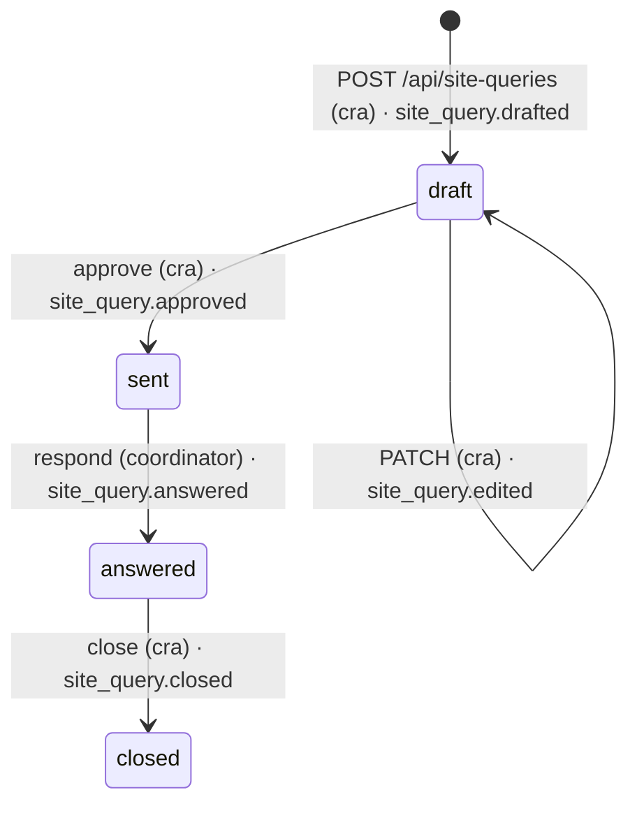

# 03 · API contracts

Single source of truth for every HTTP interface. The backend implements these with Pydantic models in `backend/app/schemas.py`; the frontend generates TypeScript types from `GET /openapi.json` with `make types`. JSON is snake_case. Errors use `{"error": {"code": "string", "message": "string"}}` with a matching HTTP status.

Headers sent by the dashboard on every request: `X-BV-User`, `X-BV-Role` (demo identity, see `02-data-model.md`). *Planned change (§6.1, §6.8): `X-BV-Role` also accepts `cra`; when `BV_DASHBOARD_TOKEN` is set, the dashboard also sends `X-BV-Token`.*

---

## 1. Dashboard API (`/api`)

### Health and reference data

`GET /api/health` → `{"ok": true, "demo_mode": false, "version": "0.1.0", "commit": "abc1234"}` *Planned change (§6.7): adds `site_signal`.*

`GET /api/study`
```json
{"id":"std_demo01","nct_id":"NCT02760498","title_short":"Open-label PD-1 immunotherapy study in advanced skin cancer (example)","drug_class":"anti-PD-1 monoclonal antibody (immunotherapy)","masking":"open_label","site_id":"101","site_name":"Hillside Cancer Center (fictional)","active_plan_id":"plan_v1"}
```

`GET /api/plan/active`
```json
{"id":"plan_v1","version":1,"status":"approved","approved_by":"Jess Kim","approved_at":"2026-10-10T20:00:00Z",
 "schedule_days_after_dose":[1,3,7],
 "items":[{"item_code":"DIARRHEA_FREQ","term":"Diarrhea","attribute":"frequency","text":{"en":"...","es":"..."},"source":"study_team"}],
 "red_flags":[{"id":"RF_DIARRHEA_SEVERE","level":"urgent","label_en":"7 or more stools a day over baseline, or blood in stool"}],
 "source":"seed","source_citations":[]}
```

Stretch: `POST /api/plan/propose` (multipart `file`=protocol PDF) → a `draft` plan with `source_citations`; `POST /api/plan/{plan_id}/approve` → approved plan, previous plan becomes `superseded`. Proposed items must be codes that exist in `data/symptom_items.json` and red flags must exist in `data/red_flags.json`; anything else is rejected (Gemini output is constrained with enums).

### Patients and check-ins

`GET /api/patients` → list of
```json
{"id":"pat_rosa","subject_id":"101-007","first_name":"Rosa","last_name":"Méndez","age":74,"language":"es","pace":"extra_time","hearing":"typical","caregiver_name":"Lucía","caregiver_relation":"daughter","next_due":{"day_after_dose":3,"date":"2026-10-11"},"last_checkin_status":"completed","open_escalations":0}
```

`GET /api/patients/{patient_id}` → patient + `checkins` (newest first) + `timeline` (per term, one point per check-in: `{"term":"Diarrhea","points":[{"checkin_id":"...","date":"...","provisional_grade":3,"answer":"almost_always"}]}`) + `dose_dates`.

`GET /api/checkins?date=2026-10-11` → check-ins scheduled or run that day, plus patients due that day without a check-in yet (`"status":"due"`). *Planned change (§6.4): "that day" is the `DISPLAY_TZ` local day, and timeline `date` values are local call dates; shapes unchanged.*

`POST /api/patients/{patient_id}/checkins`
```json
// request
{"channel":"phone","day_after_dose":3}
// response 201 (phone)
{"checkin":{"id":"ci_8KD2...","status":"dialing","channel":"phone","language":"es","pace":"extra_time","agent_variant":"es-extra_time"}}
// response 201 (web): the browser starts the session itself
{"checkin":{"id":"ci_...","status":"dialing","channel":"web"},
 "web_session":{"agent_id":"agent_...","conversation_token":"<from GET /v1/convai/conversation/token>","conversation_id":"conv_...","dynamic_variables":{"checkin_id":"ci_...","patient_first_name":"Rosa","study_team_name":"...","language_name":"Spanish","pace_instructions":"...","caregiver_name":"Lucía"}}}
```
Errors: 409 `checkin_in_progress` if the patient already has a live check-in; 503 `telephony_unavailable` in demo mode for `phone`.

`POST /api/checkins/{checkin_id}/web-started` `{"conversation_id":"conv_..."}` → `{"ok":true}` (confirms the browser session started; the token endpoint already returned the conversation ID, so this mainly flips status to `in_progress`).

`POST /api/checkins/{checkin_id}/cancel` → check-in with `status:"cancelled"`.

`GET /api/checkins/{checkin_id}` (polled every 1 s while live)
```json
{"checkin":{"id":"ci_...","status":"in_progress","language":"es","pace":"extra_time","speaker":"patient","started_at":"...","interview_state":{"current":"DIZZY_ON_STANDING","asked":["CALL_CONSENT","DIARRHEA_FREQ","DIARRHEA_STOOLS_PER_DAY"],"escalated":true}},
 "patient":{"id":"pat_rosa","subject_id":"101-007","first_name":"Rosa","language":"es","pace":"extra_time","caregiver_name":"Lucía"},
 "answers":[{"id":"ans_...","item_code":"DIARRHEA_STOOLS_PER_DAY","numeric_value":8,"unit":"per_day","verbatim_quote":"Como siete u ocho veces al día","quote_lang":"es","reporter":"patient","source":"live_tool","created_at":"..."}],
 "findings":[{"term":"Diarrhea","provisional_grade":3,"grade_basis":"rule","rule_id":"CTCAE5_DIARRHEA_G3","rule_text":"...","inputs":{"stools_over_baseline":7},"red_flag_ids":["RF_DIARRHEA_SEVERE"],"escalation_level":"urgent"}],
 "escalations":[{"id":"esc_...","level":"urgent","status":"open","paged_at":"...","seconds_open":21,"page_target_name":"RN on call","repage_count":0}],
 "drafts":[],
 "transcript":[]}
```

### Escalations

`GET /api/escalations?status=open` → list (each includes `patient` summary and `seconds_open`).
`POST /api/escalations/{id}/ack` `{}` → escalation with `status:"acknowledged"`, `ack_method:"dashboard"`, `acknowledged_by` from `X-BV-User`.
`POST /api/escalations/{id}/resolve` `{"note":"Nurse spoke with patient, sent to ED for IV fluids"}` → `status:"resolved"`.

### Drafts (review queue)

`GET /api/drafts?status=draft&kind=AE` → list of DraftEntry (see `02-data-model.md`) with `patient` summary.

`PATCH /api/drafts/{id}` `{"payload":{"provisional_grade":2,"onset_date":"2026-10-07"},"note":"Patient corrected count on nurse call"}` → updated draft (still `draft`). Audit `draft.edited` with before/after.

`POST /api/drafts/{id}/confirm` `{"note":null}` → `status:"confirmed"`. Audit `draft.confirmed`.

`POST /api/drafts/{id}/reject` `{"reason":"Duplicate of earlier report"}` → `status:"rejected"`.

`POST /api/drafts/{id}/investigator` (role must be `investigator`; draft must be a confirmed AE) *Planned change (§6.1): any other role gets 403 `wrong_role` (was 409).*
```json
{"is_serious":true,"seriousness_criteria":["hospitalization"],"relatedness":"possibly_related","sign":true}
```
→ `{"draft":{...},"sae_report":{"id":"sae_...","status":"draft","aware_at":"...","due_at":"..."}}` (`sae_report` only when serious). Allowed `seriousness_criteria`: `death`, `life_threatening`, `hospitalization`, `disability`, `congenital_anomaly`, `important_medical_event`. Allowed `relatedness`: `not_related`, `unlikely_related`, `possibly_related`, `probably_related`, `related`.

### Serious-event reports and mock sponsor

`GET /api/sae` · `GET /api/sae/{id}` → SAEReport with `seconds_until_due`.
`PATCH /api/sae/{id}` `{"narrative_final":"...","payload":{...}}` (investigator).
`POST /api/sae/{id}/sign` (investigator) → `status:"signed"`.
*Planned change (§6.1): on both, any other role gets 403 `wrong_role` (was 409). The report's `reaction.outcome` and onset fallback follow §6.4 and §6.5.*
`POST /api/sae/{id}/send` → `status:"sent"`, sets `sent_at` and `sponsor_received_at` (same instant, mock).
`GET /api/sponsor/inbox`
```json
[{"sae_id":"sae_...","received_at":"...","due_at":"...","on_time":true,"study":"NCT02760498","site":"101","subject_id":"101-007",
  "event_term":"Diarrhea","seriousness_criteria":["hospitalization"],"provisional_grade":3,"relatedness":"possibly_related",
  "valid_case_checks":{"identifiable_patient":true,"identifiable_reporter":true,"suspect_product":true,"adverse_event":true},
  "narrative":"..."}]
```

### Exports, audit, evaluation, validation

`GET /api/export/ae.csv` and `/api/export/cm.csv` → confirmed drafts only, SDTM-style columns (see `docs/05-clinical-rules.md`). *Planned change (§6.5): header row first (no `#` line), note in `X-BV-Note`, trailing `ORIGIN` column in ae.csv, `AEOUT` from `outcome_of()`.*
`GET /api/export/sae/{id}.json` → CIOMS-style JSON.
`GET /api/audit?entity_id=ci_...&limit=200` → newest first. *Planned change (§6.6): items add `seq`, `prev_hash`, `hash`, ordered by `seq` descending; new `GET /api/audit/verify`.*
`GET /api/eval/latest` → contents of `eval/results/latest.json` (404 `no_eval_run` if missing).
`GET /api/validation/latest` → contents of `validation/summary.json`.

### Demo controls (enabled only when `DEMO_MODE=1`)

*Planned change (§6.2): was "enabled when `DEMO_MODE=1` or `APP_ENV=dev`". `APP_ENV` no longer opens `/api/demo/*`; otherwise 404 `demo_disabled`. Local replay development uses `make demo`.*

`GET /api/demo/scenarios` → `[{"id":"rosa_es_urgent","title":"Rosa, Spanish, extra time, urgent diarrhea","duration_s":140}]` *Planned change (§6.2): items add `recorded`, `recorded_at`, `label`, `audio_url`.*
`POST /api/demo/replay/{scenario_id}` → `{"checkin_id":"ci_..."}`; the replay runs in the background through the same service functions. *Planned change (§6.2): optional `?speed=1|2|4`.*
`POST /api/demo/reset` → reseeds the database.

---

## 2. Agent tool endpoints (`/agent/tools`)

Called by the ElevenLabs agent as server tools. Every request must carry `X-BV-Tool-Secret`. `checkin_id` is injected from the conversation's dynamic variables (exact mechanism in `docs/04-voice-agent.md`); the LLM never has to remember it.

All tools return HTTP 200 with this envelope, even on validation errors:

```json
{"ok": true,
 "next": {"action": "ask", "item_code": "DIARRHEA_STOOLS_PER_DAY", "say": "<approved text in the call's language>"},
 "escalated": false}
```

- `next.action`: `ask` (say `say` verbatim, then listen) or `close` (say `say` verbatim, then call `end_call`).
- `say` is always approved text assembled by the backend from `data/scripts.json` and `data/symptom_items.json` (or the local official-item override). The agent may put one short neutral acknowledgment before it ("Thank you" / "Gracias"), nothing else.
- On a bad option code: `{"ok": false, "error": "invalid_option", "next": {"action":"ask","item_code":"<same>","say":"<approved re-ask listing the options>"}}`.
- On an internal error: `{"ok": false, "error": "internal", "next": {"action":"ask" or "close","say":"<approved fallback line>"}}` and the backend escalates to `callback` so a human follows up.

### The interview engine

The backend owns the question order. At check-in creation it builds `interview_state.queue`:

1. `IDENTITY` (the agent's first message, from `data/scripts.json` `first_message`, discloses the AI and asks "May I speak with {first name}?"; nothing about the study or health is said before identity is confirmed)
2. `CALL_CONSENT` (`say` = `consent_question`, or `caregiver_allowed` after `set_speaker`)
3. the plan's `items` in order (the first one is prefixed with `intro_questions`)
4. `MEDS_NEW` (+ `MEDS_DETAIL` if yes), `CARE_VISIT` (+ `CARE_VISIT_DETAIL` if yes), `ANYTHING_ELSE`
5. closing line (`closing`, or `closing_after_escalation` if an urgent escalation happened)

`IDENTITY` = `no` (wrong person) → `say` = `wrong_person_close`, `action:"close"`, no health information recorded.

Follow-up items are inserted right after their parent when the parent's answer triggers them (rules in `data/symptom_items.json` → `followups`). Rules engine runs after every answer:

- **urgent** red flag → page now, set `escalated=true`, drop remaining symptom items and their follow-ups, keep the flow items (`MEDS_NEW`, `CARE_VISIT`, `ANYTHING_ELSE`); `say` = urgent line + next question.
- **emergency** red flag → page now, `say` = emergency line + closing line, `action:"close"`.
- `CALL_CONSENT` = `no` or `later` → create a `callback` escalation, `say` = `consent_later`, `action:"close"`.
- A red flag reported while an escalation at the same or higher level is already open is added to that escalation (no second page) and `say` = `added_to_page` + the current question.
- `MEDS_DETAIL` is answered with `record_medication_change`; `CARE_VISIT` = `yes` creates a `callback` escalation and a `NURSE_TASK`; a non-empty `ANYTHING_ELSE` creates a `NURSE_TASK`.

Every tool body also carries `conversation_id` (injected from `system__conversation_id`). Exact ElevenLabs tool definitions: `agent/tools.json`.

### `POST /agent/tools/record_answer`
```json
{"checkin_id":"ci_...","conversation_id":"conv_...","item_code":"DIARRHEA_STOOLS_PER_DAY","option_code":null,"numeric_value":8,"unit":"per_day",
 "verbatim_quote":"Como siete u ocho veces al día"}
```
- `item_code` is optional; when missing, the answer applies to `interview_state.current`.
- `item_code` must equal `interview_state.current` or any already-asked item (corrections allowed). Otherwise `error:"unexpected_item"` and `say` re-asks the current question.
- `option_code` must be one of the item's options, or `unknown` (patient doesn't know or declines).
- For ranges ("seven or eight") the agent sends the higher number and keeps the exact words in `verbatim_quote`.
- Temperature answers: `numeric_value` plus `unit` `"celsius"` or `"fahrenheit"`; the backend converts to °C. Temperature not taken: `option_code:"not_measured"`.

### `POST /agent/tools/report_red_flag`
Use any time the person mentions something on the red-flag list, even outside a question.
```json
{"checkin_id":"ci_...","red_flag_id":"RF_CHEST_PAIN","verbatim_quote":"me duele el pecho","language":"es"}
```
`red_flag_id` is an enum of the study's active red flags. The backend never second-guesses a report: it escalates at the flag's level (false alarms are acceptable; misses are not) and returns the urgent or emergency `say`.

### `POST /agent/tools/record_medication_change`
```json
{"checkin_id":"ci_...","description":"Imodium from the pharmacy, started yesterday","verbatim_quote":"Tomé Imodium de la farmacia ayer","language":"es"}
```
Creates or appends a CM draft. Returns `next` (usually the following queue item).

### `POST /agent/tools/request_human`
```json
{"checkin_id":"ci_...","reason":"medical_question","verbatim_quote":"¿Debo tomar más Imodium?","language":"es"}
```
`reason`: `wants_person` \| `medical_question` \| `distress` \| `other`. Creates a `callback` escalation and a `NURSE_TASK` draft. `say` is the approved deferral line ("That's a question for your nurse. I'll pass it on and they'll call you.") followed by the current question again, unless the person asked to stop, in which case `action:"close"`.

### `POST /agent/tools/set_speaker`
```json
{"checkin_id":"ci_...","speaker":"caregiver","relation":"daughter"}
```
If the patient's `caregiver_may_answer` is true: continue, and later answers are stored with `reporter:"caregiver"`. If false: `say` = approved "I can only complete this check-in with {name}..." line and `action:"close"` with a `callback` escalation.

---

## 3. Webhooks (`/webhooks`)

### `POST /webhooks/elevenlabs/post-call`
ElevenLabs `post_call_transcription`, `call_initiation_failure` (set the check-in to `no_answer` or `failed`) and optionally `post_call_audio` (save the MP3 for replay) events. Payload shapes in `docs/04-voice-agent.md`. Verify the HMAC header with `ELEVENLABS_WEBHOOK_SECRET` (algorithm in `docs/04-voice-agent.md`); reject with 401 on mismatch. Return 200 within 1 s and run the post-call pipeline in a background task. Idempotent by `conversation_id`. Find the check-in by `conversation_id`, falling back to the `checkin_id` dynamic variable in the payload.

### `POST /webhooks/elevenlabs/inbound-init` (inbound fallback)
Called by ElevenLabs before the agent answers an inbound call. Header `X-BV-Tool-Secret` must match; `called_number` must equal `TWILIO_FROM_NUMBER`. Body: `{"caller_id","called_number","agent_id","call_sid","conversation_id"}`. Match `caller_id` to a patient's `phone_e164`; create a check-in (`channel:"phone_inbound"`, `status:"in_progress"`, `el_conversation_id` from the body); return `{"type":"conversation_initiation_client_data","dynamic_variables":{...},"conversation_config_override":{"agent":{"first_message":"..."}},"user_id":"<subject_id>"}`. **Always 200**, even on a bad secret or unknown caller (then return the unknown-caller defaults and log a warning). Must respond in under 1 s. Full shapes in `docs/04-voice-agent.md` § Inbound fallback.

### `POST /webhooks/ntfy/ack/{escalation_id}` (default pager)
Called by the **Acknowledge** button on the nurse's ntfy push notification, with header `Authorization: Bearer <escalation.ack_token>`. Valid token → acknowledge (`ack_method:"push_button"`, `acknowledged_by` = `ONCALL_NURSE_NAME`) → `{"ok":true}`; already acknowledged → `{"ok":true}` (idempotent); bad token → 401.

### `POST /webhooks/twilio/page-ack?escalation_id=esc_...` (optional pager)
Twilio `<Gather>` action (form-encoded: `Digits`, `CallSid`, ...). If `Digits == "1"`: acknowledge (`ack_method:"phone_keypress"`) and respond with TwiML `<Response><Say>Acknowledged. Thank you.</Say></Response>`. Otherwise re-prompt once. Validate `X-Twilio-Signature` against `PUBLIC_BASE_URL` + path + query.

### `POST /webhooks/twilio/page-status?escalation_id=esc_...` (optional)
Twilio status callback. Logs `no-answer` / `busy` / `failed`; the re-page loop handles retries.

---

## 4. Additions made during implementation (Sat Oct 10, evening)

Backward-compatible additions; `GET /openapi.json` is the exact schema (`make types`).

- `GET /api/health` also returns `app_env` and `pager_channel` (`console` when `DEMO_MODE=1` or no `NTFY_TOPIC`).
- `GET /api/checkins/{id}` also returns `current_question` (the approved text currently being asked, or null) and `checkin.postcall_status` (`processing` | `done` | `failed`).
- Escalations also return `red_flag_labels`, `seconds_to_ack` (paged → acknowledged), `backup_paged_at` and a `patient` summary. `Escalation.reason` can also be `care_visit` (patient reported an ER / urgent care / other doctor visit; callback level). `GET /api/escalations` accepts `checkin_id` and a comma-separated `status`.
- Drafts also return `sae_report_id` and a `patient` summary. `GET /api/drafts` also filters by `checkin_id`; `status` and `kind` accept comma-separated values. NURSE_TASK categories: `medical_question`, `wants_person`, `distress`, `other`, `care_visit`, `anything_else`. CM payloads may carry `as_reported_en` (the agent's description) when post-call extraction normalized `medication_name`.
- `GET /api/checkins` items: `{"id": "ci_..." | null, "status", "channel", "day_after_dose", "started_at", "patient": PatientSummary, "open_escalations"}`.
- `GET /api/patients/{id}` also returns `phone_on_file` (true when a real number came from `data/patients.local.json`), `baseline` and `notes`; never the phone number itself.
- Sponsor inbox items also return `seconds_before_deadline` and the full `report` payload.
- `POST /api/sae/{id}/send` requires a signed report (409 `not_signed`). Editing a signed report returns it to `draft` (re-sign needed).
- `GET /api/demo/scenarios` items also return `patient_id`. Replay timing scales with env `REPLAY_SPEED` (default 1.0). *Planned change (§6.2): `?speed=` query parameter; default 2 when `DEMO_MODE=1`.* Scenario files may carry `translations_en` (scripted quote → English) used only by the fake translator in demo mode, and `summary_en`.
- `POST /agent/tools/*` unknown or `"unknown"` `checkin_id`: `{"ok": false, "error": "unknown_checkin", "next": {"action": "close", "say": <wrong_person_close>}}`. Internal errors close with `fallback_error` and escalate (urgent + page for `report_red_flag` and symptom answers, callback otherwise).

---

## 5. Site Signal and readiness additions (planned, Sun Oct 11)

**Status: planned, not built.** This is the interface contract for the sponsor-side Site Signal layer: router `backend/app/routers/site_signal.py`, services `backend/app/services/site_signal.py`, `episodes.py` and `site_queries.py` (tasks B16–B21 in `workstreams/WS2-backend.md`). Product requirements are in `10-site-signal.md`. Statistics (episode, match, evaluability, O/E, null model, thresholds, blind-run design) are in `11-site-signal-sap.md`, which wins on any statistical detail. Tables and file-backed models are in `02-data-model.md` § Site Signal. The new readiness routes (`GET /api/audit/verify`, `GET /api/eval/voice-checks`, scenario audio) and the changes to existing endpoints at Checkpoint A are in §6. `backend/tests/test_contract_routes.py` (B20) checks that every route in §5 and §6 exists in `/openapi.json`.

### 5.1 Conventions

- **Roles.** `X-BV-Role` is `coordinator` | `investigator` | `sponsor` | `cra` (new). A missing or unknown role means `coordinator`, as today. A role not listed for a route gets 403 `wrong_role` (§6.1). The role is a demo identity, not authentication.
- **`data_origin` on everything.** Every run, site row, site card, episode and query payload carries `data_origin` (REQ-030):
  - `SIMULATED`: generated by `monitoring/` from `monitoring/params.yaml`.
  - `MEASURED`: built from real or recorded calls in the app database (site 101 only).
  - `MIXED`: the site 101 card when live episodes exist, or a query that cites both kinds of episode.
- **Tiers.** There are four: `watch`, `look`, `none` (shown as "No signal at this sample size", neutral) and `not_computed` (grey, always with a `not_computed_reason`). No tier means "clean" and none renders green. Display labels come from `data/signal_rules.json` `labels` (schema in `02-data-model.md` § Files behind Site Signal) and are passed through in `GET /api/sites` (`labels`), including the footer template and the answer-key display labels; the frontend has no label literals and never shows a raw answer-key label such as `gross_under`.
- **Threshold direction.** Discordance and the rate KRI flag a site when `z_adj` ≤ the tier threshold. simaerep classic flags a site when `prob` ≥ the tier threshold. Every site at `watch` also passes the `look` threshold.
- **Where numbers come from.**
  - The committed study is file-backed in `monitoring/out/*.json`, written by `make site-signal`, and addressed as run `sr_committed`.
  - Blind runs are `SignalRun` rows with `sr_` IDs.
  - Validation numbers come only from `validation/site_signal/summary.json`.
  - The backend never computes a threshold. It reads `monitoring/out/thresholds.json`.
  - No route in this section calls an LLM (REQ-021).
- **Subject IDs only.** No patient name appears in any Site Signal payload, query text or inbox item (REQ-027).
- **Fail safe (REQ-025).** If `monitoring/out/` is missing, unreadable or fails schema validation, the read routes return 503 `site_signal_unavailable` and the UI renders every site grey "Not computed: error". The safety path (agent tools, paging, post-call pipeline) never reads Site Signal data, and nothing here can delay a page.
- **Examples.** Numbers in the examples below are placeholders that show types and shapes. They are not results. Results are quoted only from `validation/site_signal/summary.json`.
- **Logging.** Each write (query actions, blind-run create and reveal) logs one structured line with `site_id`, `query_id` or `run_id`, plus `role`.

### 5.2 Endpoint summary

| Method | Path | Roles | Demo only | Audit action | Task |
|---|---|---|---|---|---|
| GET | `/api/sites` | cra, sponsor | no | none (read) | B17 |
| GET | `/api/sites/{site_id}` | cra, sponsor | no | none (read) | B17 |
| GET | `/api/site-signal/answer-key` | cra, sponsor | no | none (read of a committed file) | B17 |
| GET | `/api/site-signal/validation` | any | no | none | B17 |
| GET | `/api/site-signal/equity` | cra, sponsor | no | none | B17 (UI at C) |
| POST | `/api/site-queries` | cra | no | `site_query.drafted` | B18 |
| GET | `/api/site-queries` | cra, sponsor, coordinator | no | none | B18 |
| GET | `/api/site-queries/{query_id}` | cra, sponsor, coordinator | no | none | B18 |
| PATCH | `/api/site-queries/{query_id}` | cra | no | `site_query.edited` | B18 |
| POST | `/api/site-queries/{query_id}/approve` | cra | no | `site_query.approved` | B18 |
| POST | `/api/site-queries/{query_id}/respond` | coordinator | no | `site_query.answered` | B18 |
| POST | `/api/site-queries/{query_id}/close` | cra | no | `site_query.closed` | B18 |
| POST | `/api/site-signal/blind-run` | cra, sponsor | yes | `signal.blind_run.created` | B19 |
| GET | `/api/site-signal/blind-run/{run_id}` | cra, sponsor | yes | none | B19 |
| POST | `/api/site-signal/blind-run/{run_id}/reveal` | cra, sponsor | yes | `signal.blind_run.revealed` (first reveal only) | B19 |
| GET | `/api/site-signal/blind-run-seeds` | cra, sponsor | yes | none | B19 |
| GET | `/api/checkins/{checkin_id}` (field added) | any | no | none | B21 (Checkpoint C) |

On "demo only" routes the backend checks `DEMO_MODE=1` before the role. When demo mode is off, every caller gets 404 `demo_disabled`, so a live instance does not reveal the routes.

### 5.3 Committed study (read)

#### `GET /api/sites` (cra, sponsor)

Returns the committed run: metadata, thresholds, funnel, and one row per site. Each row merges the `SiteSignalRow` and `Site` fields, plus `open_queries`. Computed sites come first, ordered by `rank` (z_adj ascending). Not-computed sites follow, ordered by `site_id`.

```json
{"run":{"id":"sr_committed","data_origin":"SIMULATED","sap_tag_commit":"1a2b3c4","eval_seed":2873401127,
        "generated_at":"2026-10-11T08:40:00Z","code_commit":"5d6e7f8",
        "design":{"n_sites":20,"window_weeks":36,"data_cut_date":"2026-09-14","patients_per_site":[0,0]},
        "thresholds":{"discordance":{"look":-1.70,"watch":-3.00},"rate_kri":{"look":-1.70,"watch":-3.00},
                      "simaerep_classic":{"look":0.95,"watch":0.995}},
        "expected_false_look_flags_per_study":0.0,"phi":0.0,"tau2":0.0,"n_computed_sites":18,"study_not_computed_reason":null},
 "labels":{"watch":"Watch","look":"Look","none":"No signal at this sample size","not_computed":"Not computed",
           "footer":"A reason to look, not a finding.","footer_expected_false_look":"About {expected_false_look} false Look flags ...",
           "reasons":{"insufficient_patients":"...","low_coverage":"...","integrated_mode":"..."},
           "answer_key":{"gross_under":"Planted: large capture loss","honest":"Honest","...":"..."}},
 "funnel":{"points":[{"site_id":"112","E":21.4,"oe_ratio":0.42,"tier":"watch"}],
           "limits":[{"E":5,"look_lower":0.40,"watch_lower":0.0},{"E":40,"look_lower":0.80,"watch_lower":0.65}]},
 "sites":[
  {"site_id":"112","name":"Maple Ridge Oncology (fictional)","region":"Midwest","n_patients":24,
   "spanish_share":0.21,"extra_time_share":0.29,"call_completion":0.86,"is_live_site":false,
   "n_episodes_evaluable":31,"n_pending":4,"n_paged":11,"O":9,"E":21.4,"V":4.9,"oe_ratio":0.42,
   "z_raw":-5.6,"z_adj":-5.1,"tier":"watch","not_computed_reason":null,
   "comparators":{"rate_kri":{"z_adj":-1.2,"tier":"none"},"simaerep_classic":{"prob":0.71,"p_value":0.29,"tier":"none"}},
   "rank":1,"open_queries":0,"data_origin":"SIMULATED"},
  {"site_id":"117","name":"...","region":"South","n_patients":6,"spanish_share":0.0,"extra_time_share":0.17,
   "call_completion":0.88,"is_live_site":false,"n_episodes_evaluable":7,"n_pending":1,"n_paged":2,
   "O":null,"E":null,"V":null,"oe_ratio":null,"z_raw":null,"z_adj":null,"tier":"not_computed",
   "not_computed_reason":"insufficient_patients","comparators":{"rate_kri":{"z_adj":null,"tier":"not_computed"},
   "simaerep_classic":{"prob":null,"p_value":null,"tier":"not_computed"}},"rank":null,"open_queries":0,"data_origin":"SIMULATED"}]}
```

- `not_computed_reason` is one of `integrated_mode` (drafts reached site staff, `11-site-signal-sap.md` §2.4), `low_coverage` (call completion < 0.60), `insufficient_patients` (< 10), `insufficient_episodes` (< 15 evaluable, or zero variance), `study_below_min_sites` (< 10 computed sites; every row then carries this reason and `run.study_not_computed_reason` is set) or `error`. The limits live in `data/signal_rules.json` `minimum_data`.
- `expected_false_look_flags_per_study` is copied from `monitoring/out/thresholds.json`: the mean number of false Look flags per null study at the `sap-v1` design. The UI fills `labels.footer_expected_false_look` with it and shows `n_computed_sites` next to the tier legend.
- `run.design.data_cut_date` is derived from `params.yaml` `design.study_start_date` + `data_cut_day`; `patients_per_site` is the range chosen at the tag.
- `phi` and `tau2` are the study's winsorized dispersion and additive between-site variance (`11-site-signal-sap.md` §8.2).
- `funnel.limits` are O/E lower limits on a grid of E, from the same thresholds (`11-site-signal-sap.md`).
- In this list, a row's `data_origin` describes the statistic, which is always `SIMULATED`. The site 101 card's `MIXED` origin appears in `GET /api/sites/101`.
- Errors: 403 `wrong_role`; 503 `site_signal_unavailable`.

#### `GET /api/sites/{site_id}?run_id=sr_committed&status=unmatched,pending` (cra, sponsor)

Drill-down: the site card, its signal row, episodes with evidence and status, language and pace strata, the paged stratum, and the site's queries.

```json
{"site":{"site_id":"112","name":"Maple Ridge Oncology (fictional)","region":"Midwest","n_patients":24,"spanish_share":0.21,
         "extra_time_share":0.29,"call_completion":0.86,"is_live_site":false,"data_origin":"SIMULATED"},
 "signal":{"site_id":"112","tier":"watch","O":9,"E":21.4,"z_adj":-5.1,"...":"SiteSignalRow"},
 "episodes":[
  {"episode_id":"ep_112_17","site_id":"112","subject_id":"112-014","language":"es","pace":"extra_time",
   "term":"Diarrhea","grade":2,"kind":"new","episode_date":"2026-08-14","checkin_ids":["sim_112_0381","sim_112_0382"],
   "status":"unmatched","paged_level":null,"matched_site_ae_id":null,
   "evidence":{"quote":"...","quote_lang":"es","translation_en":"...","translation_is_ai":true,"t_s":null,
               "source":"synthetic","checkin_id":null},
   "data_origin":"SIMULATED"},
  {"episode_id":"ep_112_18","subject_id":"112-009","term":"Fever","grade":2,"status":"paged","paged_level":"urgent","...":"..."}],
 "strata":{"language":{"en":{"evaluable":22,"matched":7},"es":{"evaluable":9,"matched":2}},
           "pace":{"standard":{"evaluable":20,"matched":6},"extra_time":{"evaluable":11,"matched":3}}},
 "paged_stratum":{"n":11,"matched":10},
 "queries":[]}
```

- `run_id` defaults to `sr_committed`. A blind-run id returns that run's `signal` row with `episodes: []`, `strata: null`, `paged_stratum: null` and `queries: []`. Blind runs store per-site results only.
- `status` (optional, comma-separated) filters episodes. Values: `matched` | `unmatched` | `pending` | `paged` | `not_evaluated`.
  - `unmatched` = evaluable, not paged, and no matching site-originated AE.
  - `pending` = the entry window has not passed at the data cut. Shown greyed, never counted as missed.
  - `paged` = the call raised an urgent or emergency page. Reported as a separate descriptive stratum, never in O or E.
  - `not_evaluated` = the episode's cell has no leave-one-site-out rate, or the site is not computed for reason `error` or `integrated_mode` (`11-site-signal-sap.md` §6.4). Episodes at a site not computed for `low_coverage`, `insufficient_patients`, `insufficient_episodes` or `study_below_min_sites` keep `matched` or `unmatched`, and an `unmatched` one can be cited in a site query.
- `strata` and `paged_stratum` count episodes in the O/E set (evaluable, not paged) and in the paged set respectively.
- `evidence.source` is `live_call` | `replay` | `synthetic`.
  - Synthetic quotes come from `monitoring/quote_bank.json`. The phrasings and their English translations were written with AI assistance, so `translation_is_ai` is true, the UI shows an `AiLabel`, and `t_s` is null.
  - Live and replay quotes come from `Answer` rows. Their translations are AI translations (`translation_is_ai: true`) and the UI shows them with an `AiLabel`.
- **Site 101 (live bridge).** The response also lists `MEASURED` episodes built at request time from the database `Finding` rows (grade ≥ 2 Diarrhea, Fever or Dyspnea, rule-graded), via `episodes.py`, placed first. Their status is computed against the current time, so they come back as `pending` or `paged`. They never enter the committed run's O/E. `site.data_origin` is then `MIXED`.
- Errors: 403 `wrong_role`; 404 `site_not_found` (not in the run) or `signal_run_not_found`; 503 `site_signal_unavailable`.

#### `GET /api/site-signal/answer-key` (cra, sponsor)

Backs the "Reveal answer key" button for the committed study. `monitoring/out/answer_key.json` is committed for transparency, so reading it is not audited.

```json
{"run_id":"sr_committed","data_origin":"SIMULATED",
 "answer_key":[{"site_id":"112","label":"gross_under","f":0.85},{"site_id":"104","label":"decoy_healthy_casemix","f":null},
               {"site_id":"101","label":"honest","f":null}],
 "confusion":{"discordance":{"watch":{"tp":0,"fp":0,"fn":0,"tn":0},"look":{"tp":0,"fp":0,"fn":0,"tn":0}},
              "rate_kri":{"watch":{"...":0},"look":{"...":0}},"simaerep_classic":{"watch":{"...":0},"look":{"...":0}}}}
```

- Labels: `gross_under`, `under_50`, `under_25`, `language_gap`, `decoy_healthy_casemix`, `honest_low_diligence`, `low_coverage`, `small_site`, `honest`. These are keys. The UI shows only their display labels from `labels.answer_key` (for example "Planted: large capture loss", "Honest (low diligence)"), never wording that names a site an under-reporter.
- `answer_key` and `confusion` are both read from `monitoring/out/answer_key.json`, which `run.py` writes (S6). The backend counts nothing.
- Confusion positives are `gross_under`, `under_50`, `under_25` and `language_gap`.
- A site counts as flagged at the look tier if its tier is `look` or `watch`, and at the watch tier only if its tier is `watch`. Not-computed sites count as not flagged.
- Errors: 403 `wrong_role`; 503 `site_signal_unavailable`.

#### `GET /api/site-signal/validation` (any role)

Returns `validation/site_signal/summary.json` verbatim, plus `"data_origin":"SIMULATED"`. Powers the "How well it works" tab, which shows no typed numbers. The schema is the list in `11-site-signal-sap.md` §12.9; the route model types the top-level keys and passes nested blocks through as dicts.

```json
{"sap_tag_commit":"1a2b3c4","eval_seed":0,"beacon_round":0,"code_commit":"5d6e7f8","generated_at":"...",
 "numpy_version":"...","scipy_version":"...","data_origin":"SIMULATED",
 "design":{"n_sites":20,"patients_per_site":[0,0],"mu":1.5,"gross_f":0.0,"gate":"passed"},
 "null":{"look_per_site":{"rate":0.0,"mc_se":0.0,"ci95":[0.0,0.0]},"look_per_study":{"rate":0.0,"mc_se":0.0},
         "watch_fwer":{"rate":0.0,"mc_se":0.0,"ci95":[0.0,0.0]},"look_per_site_by_e_tertile":[],"by_k_bin":[],
         "r":2000,"computability":{"...":"..."}},
 "power":[{"indicator":"discordance","tier":"watch","n_sites":20,"patients_per_site":20,"mu":1.5,"f":0.5,
           "power":0.0,"mc_se":0.0,"p_computed":0.0,"null_rate_achieved":0.0}],
 "full_mix":{"...":"..."},"head_to_head":{"...":"..."},"failure_case":{"...":"..."},"sensitivity":[],
 "eval_study":{"confusion":{"...":"..."},"caught":[],"missed":[],"not_computed":[]},
 "simaerep_fixture":{"rows":10,"max_rel_diff":0.0},"quick_hashes":{"...":"..."}}
```

Errors: 404 `no_validation_run` when the file is missing (same code as `GET /api/validation/latest`).

#### `GET /api/site-signal/equity` (cra, sponsor)

Returns `monitoring/out/equity.json`:
- capture odds ratios within sites, Spanish vs English and extra-time vs standard pace, pooled with Mantel-Haenszel over sites that have ≥ 5 evaluable episodes per group, with a patient-cluster bootstrap 95% CI (primary) and the Robins-Breslow-Greenland CI (secondary), plus a Breslow-Day heterogeneity test (`11-site-signal-sap.md` §14);
- per-site odds ratios where the data allow;
- the single-language-app counterfactual: each site's minimum-data status recomputed with only English speakers' episodes.

An odds ratio below 1 means that group's episodes were captured less often.

```json
{"data_origin":"SIMULATED",
 "language":{"mh_or":0.0,"ci95":[0.0,0.0],"ci95_method":"patient_bootstrap","rbg_ci95":[0.0,0.0],"breslow_day_p":0.0,"n_sites_used":0,
             "per_site":[{"site_id":"108","or":0.0,"ci95":[0.0,0.0],"n_es":0,"n_en":0}]},
 "pace":{"mh_or":0.0,"ci95":[0.0,0.0],"n_sites_used":0,
         "per_site":[{"site_id":"108","or":0.0,"ci95":[0.0,0.0],"n_extra_time":0,"n_standard":0}]},
 "single_language_counterfactual":[{"site_id":"108","tier_now":"look","tier_if_english_only":"not_computed","reason":"insufficient_episodes"}],
 "note":"Within-site comparisons; power is low at these sample sizes."}
```

Errors: 403 `wrong_role`; 404 `no_equity_run` when `equity.json` is missing.

### 5.4 Site queries

A site query is a templated, non-leading, data-completeness request to one site. It lists subject IDs and episode dates and asks the site to review its source documents and either enter the event or say why no entry is needed. Wording comes only from `data/site_queries.json` (WS4). A CRA must approve a query before it reaches the mock site inbox, and every state change writes an `AuditEvent` (REQ-027).



There is no delete endpoint. Every state is kept.

**`SiteQueryOut`** (shared response shape):

```json
{"id":"sq_K3M9Q2T7WZ","site_id":"112","signal_run_id":"sr_committed","template_id":"SQ_UNMATCHED_EPISODES",
 "title_en":"<from template title_en>","body_en":"<rendered from data/site_queries.json SQ_UNMATCHED_EPISODES>","edited":false,
 "episode_ids":["ep_112_17","ep_112_23"],"subject_ids":["112-014","112-020"],"status":"draft",
 "created_by":"Sam Rivera","created_at":"2026-10-11T09:02:11Z","approved_by":null,"approved_at":null,
 "response_code":null,"response_label_en":null,"response_note":null,"responded_by":null,"responded_at":null,
 "closed_by":null,"closed_at":null,"closure_note":null,"data_origin":"SIMULATED"}
```

- `title_en` and `response_label_en` are looked up from `data/site_queries.json`.
- `data_origin` is derived from the cited episodes: all simulated gives `SIMULATED`, all live gives `MEASURED`, a mix gives `MIXED`.

#### `POST /api/site-queries` (cra)

```json
// request
{"site_id":"112","episode_ids":["ep_112_17","ep_112_23"],"template_id":"SQ_UNMATCHED_EPISODES","signal_run_id":"sr_committed"}
// response 201: SiteQueryOut with status "draft"
```

- The body is rendered from the template. `{episode_lines}` gets one `episode_line_en` per cited episode, ordered by episode date. The only placeholders allowed are `{site_id}`, `{episode_lines}`, `{subject_id}`, `{term}`, `{episode_date}` and `{grade}`. No name placeholder exists. `subject_ids` are derived from the episodes, unique and sorted.
- Eligibility: every cited episode must exist in the run, belong to `site_id`, and have status `unmatched` (including at a site not computed for low coverage or too little data, §5.3). Episodes that are `pending`, `paged`, `matched` or `not_evaluated` cannot be cited.
- `signal_run_id` is optional and defaults to `sr_committed`. In this build only `sr_committed` is accepted, because blind runs keep per-site results and not episodes.
- Errors:
  - 403 `wrong_role`;
  - 404 `site_not_found`, `episode_not_found` or `template_not_found`;
  - 422 `episode_not_eligible` (the message names the episode and its status), `run_not_queryable` or `validation_error` (empty `episode_ids`);
  - 503 `site_signal_unavailable`.
- Audit: `site_query.drafted`.

#### `GET /api/site-queries?site_id=112&status=sent,answered` (cra, sponsor, coordinator)

Returns `[SiteQueryOut]`, newest first.
- `cra` and `sponsor` see every status at every site.
- `coordinator` sees only `sent`, `answered` and `closed` queries. Drafts never appear, even with `status=draft`, which returns `[]`. The mock inbox stands in for the coordinator of whichever site was queried, so it covers all sites unless `site_id` is given.
- Errors: 403 `wrong_role` (investigator).

#### `GET /api/site-queries/{query_id}` (cra, sponsor, coordinator)

Returns `SiteQueryOut` plus `episodes` (the cited `Episode` objects) and `audit` (`AuditOut` rows for this query, oldest first).
- For `coordinator`, each episode's `evidence` is `null`. The site reviews its own source documents, and patient quotes stay on the sponsor side, which keeps the query non-leading.
- A coordinator asking for a draft gets 404.
- Errors: 403 `wrong_role`; 404 `site_query_not_found`.

#### `PATCH /api/site-queries/{query_id}` (cra)

```json
{"body_en":"<edited text>","note":"Shortened the opening line"}
```

Returns `SiteQueryOut` with `edited: true`.
- Errors:
  - 403 `wrong_role`;
  - 404 `site_query_not_found`;
  - 409 `not_draft`;
  - 422 `contains_identifier`: a first or last name of any `Patient` in the database appears in the text (case-insensitive, whole word);
  - 422 `banned_phrase`: the text contains an entry of `banned_phrases_en` in `data/site_queries.json`;
  - 422 `validation_error`: empty body.
- Audit: `site_query.edited`, with `before`/`after` = `{"body_en": ...}` and `note`.

#### `POST /api/site-queries/{query_id}/approve` (cra)

Request `{}`. Approval and delivery to the mock site inbox happen at the same instant. Returns `SiteQueryOut` with `status:"sent"`, `approved_by` and `approved_at`.
- Errors: 403 `wrong_role`; 404 `site_query_not_found`; 409 `not_draft`.
- Audit: `site_query.approved`.

#### `POST /api/site-queries/{query_id}/respond` (coordinator)

```json
{"response_code":"recorded_as_medical_history","note":"Baseline loose stools documented at screening"}
```

`response_code` is one of `data/site_queries.json` `response_codes`: `entered_now`, `recorded_as_medical_history`, `recorded_under_other_term`, `not_an_ae_per_investigator` or `other`. Legitimate clinical judgment is a normal answer. Returns `SiteQueryOut` with `status:"answered"` and `responded_by`/`responded_at`.
- Errors: 403 `wrong_role`; 404 `site_query_not_found`; 409 `not_sent`; 422 `invalid_response_code`.
- Audit: `site_query.answered`.

#### `POST /api/site-queries/{query_id}/close` (cra)

Request `{"note":"Explained; no entry needed"}` (`note` optional, stored as `closure_note`). Returns `SiteQueryOut` with `status:"closed"`.
- Errors: 403 `wrong_role`; 404 `site_query_not_found`; 409 `not_answered`.
- Audit: `site_query.closed`.

### 5.5 Blind run (DEMO_MODE only)

A user types any seed string. The backend generates a fresh simulated study at the `sap-v1` design, with a hidden planted count of 0–3 sites, and ranks it against the fixed `sap-v1` thresholds. The answer key stays hidden until an audited reveal (REQ-029). The design is in `11-site-signal-sap.md` § Blind run.

#### `POST /api/site-signal/blind-run` (cra, sponsor; demo only)

```json
// request
{"seed_label":"demo-42"}
// response 201
{"run_id":"sr_7HQ2M4XK9P","seed_label":"demo-42","source":"subprocess","elapsed_ms":6200,
 "sap_tag_commit":"1a2b3c4","thresholds_sha256":"9f2c...","thresholds":{"discordance":{"look":-1.70,"watch":-3.00},"...":"..."},
 "sites":[{"site_id":"109","tier":"watch","z_adj":-4.2,"...":"SiteSignalRow"}],
 "planted_count":null,"answer_key":null,"confusion":null,"revealed_at":null,"revealed_by":null,"data_origin":"SIMULATED"}
```

- `seed_label` is 1–64 characters and is stored verbatim. `seed_int = int(sha256(("blind:" + seed_label).encode("utf-8")).hexdigest()[:8], 16)`.
- If `seed_label` exactly matches a precomputed seed listed by `GET /api/site-signal/blind-run-seeds`, the backend serves that file (`source:"precomputed"`). Otherwise it runs `MONITORING_CMD --seed-label <label> --json`:
  - the label is passed as one argv element, with no shell;
  - the process times out after `BLIND_RUN_TIMEOUT_S` (default 20 s);
  - `source` is `"subprocess"`.
  
  The same label always gives the same output.
- With `BLIND_RUN_TIMEOUT_S=0`, the subprocess is disabled and only precomputed seeds work (cut rule for slow hosts).
- `planted_count`, `answer_key` and `confusion` come from the `blind.py` output, are stored on the `SignalRun` row and are never serialized before reveal.
- `demo-42` is not one of the precomputed labels, so it exercises the subprocess path.
- Errors:
  - 404 `demo_disabled`;
  - 403 `wrong_role`;
  - 422 `validation_error` (label length);
  - 503 `blind_run_unavailable` when the subprocess fails or exceeds the timeout. This is the only error body with an extra field: `{"error":{"code":"blind_run_unavailable","message":"...","precomputed_seeds":["aurora","basalt","..."]}}`.
- Audit: `signal.blind_run.created`, entity `SignalRun`, with `after` = `{"seed_label","seed_int","source"}`.

#### `GET /api/site-signal/blind-run/{run_id}` (cra, sponsor; demo only)

Same shape as the POST response. `planted_count`, `answer_key`, `confusion`, `revealed_at` and `revealed_by` are filled only after reveal.
- Errors: 404 `demo_disabled` or `signal_run_not_found`; 403 `wrong_role`.

#### `POST /api/site-signal/blind-run/{run_id}/reveal` (cra, sponsor; demo only)

Request `{}`.

```json
{"run_id":"sr_7HQ2M4XK9P","planted_count":0,
 "answer_key":[{"site_id":"109","label":"gross_under","f":0.0},{"site_id":"101","label":"honest","f":null}],
 "confusion":{"discordance":{"watch":{"tp":0,"fp":0,"fn":0,"tn":0},"look":{"tp":0,"fp":0,"fn":0,"tn":0}},
              "rate_kri":{"watch":{"...":0},"look":{"...":0}},"simaerep_classic":{"watch":{"...":0},"look":{"...":0}}},
 "revealed_at":"2026-10-11T09:20:03Z","revealed_by":"Sam Rivera"}
```

- The answer key has one row per site.
- Confusion uses the same rules as `GET /api/site-signal/answer-key` and is computed by `blind.py`, not the backend. In a blind run the positives are the planted `gross_under` sites. The UI shows `labels.answer_key` display labels only.
- The route is idempotent. A second reveal returns the same body and writes no new audit row.
- Errors: 404 `demo_disabled` or `signal_run_not_found`; 403 `wrong_role`.
- Audit: `signal.blind_run.revealed`, with `after` = `{"planted_count","answer_key"}`.

#### `GET /api/site-signal/blind-run-seeds` (cra, sponsor; demo only)

Returns the 10 precomputed fallback seeds shipped in `monitoring/out/blind_precomputed/`.

```json
[{"seed_label":"aurora","file":"monitoring/out/blind_precomputed/aurora.json"}]
```

The backend serves only labels from this listing and never builds a file path from user input.
- Errors: 404 `demo_disabled`; 403 `wrong_role`.

### 5.6 Error codes added in §5

All errors use the standard envelope `{"error":{"code","message"}}`.

| Status | Code | When |
|---|---|---|
| 403 | `wrong_role` | Role not allowed for the route (§6.1). |
| 404 | `demo_disabled` | Demo-only route while `DEMO_MODE` is not 1. |
| 404 | `site_not_found` | `site_id` not in the run. |
| 404 | `episode_not_found` / `template_not_found` | Unknown `ep_` ID / unknown `template_id`. |
| 404 | `site_query_not_found` | Unknown `sq_` ID, or a draft requested by `coordinator`. |
| 404 | `signal_run_not_found` | Unknown `sr_` ID. |
| 404 | `no_validation_run` / `no_equity_run` | `validation/site_signal/summary.json` / `monitoring/out/equity.json` missing. |
| 409 | `not_draft` / `not_sent` / `not_answered` | Query is not in the state the action needs. |
| 422 | `episode_not_eligible` | Cited episode is pending, paged, matched, not evaluated or at another site. |
| 422 | `run_not_queryable` | `signal_run_id` other than `sr_committed`. |
| 422 | `contains_identifier` | Query text contains a patient's first or last name. |
| 422 | `banned_phrase` | Query text contains a banned phrase from `data/site_queries.json`. |
| 422 | `invalid_response_code` | `response_code` not in `data/site_queries.json`. |
| 503 | `site_signal_unavailable` | `monitoring/out/` missing, unreadable or invalid. The UI shows grey, never green. |
| 503 | `blind_run_unavailable` | Blind-run subprocess failed or timed out. The body also carries `precomputed_seeds`. |

### 5.7 Audit actions added in §5

Every action is written with `actor` = `X-BV-User` and `role` = `X-BV-Role` into the hash chain (§6.6).

| Action | `entity_type` / `entity_id` | `before` → `after` | Written by |
|---|---|---|---|
| `site_query.drafted` | `SiteQuery` / `sq_...` | – → `{site_id, signal_run_id, template_id, episode_ids, status:"draft"}` | `POST /api/site-queries` |
| `site_query.edited` | `SiteQuery` | `{body_en}` → `{body_en}`, plus `note` | `PATCH /api/site-queries/{id}` |
| `site_query.approved` | `SiteQuery` | `{status:"draft"}` → `{status:"sent", approved_at}` | `.../approve` |
| `site_query.answered` | `SiteQuery` | `{status:"sent"}` → `{status:"answered", response_code}`, plus `note` | `.../respond` |
| `site_query.closed` | `SiteQuery` | `{status:"answered"}` → `{status:"closed"}`, plus `note` | `.../close` |
| `signal.blind_run.created` | `SignalRun` / `sr_...` | – → `{seed_label, seed_int, source}` | `POST /api/site-signal/blind-run` |
| `signal.blind_run.revealed` | `SignalRun` | `{revealed:false}` → `{planted_count, answer_key}` | first `.../reveal` only |

### 5.8 Timeliness evidence (Checkpoint C, B21)

`GET /api/checkins/{checkin_id}` adds two fields: `days_before_next_visit` (int or null, `MEASURED`) and `site_aware_basis` (`"page_ack"` | `"call_end"` | null).
- `days_before_next_visit` = the patient's next dose date after the call, minus the `DISPLAY_TZ` local date the site was made aware.
- The site was made aware at the first acknowledgment of an escalation on this check-in. If none was acknowledged, it is the call end (`ended_at`), and `site_aware_basis` says which one applied.
- The value is null when the call did not complete or no later dose date is known.
- The UI shows it as "Site aware N days before next visit" with a `MEASURED` badge.

---

## 6. Readiness contract changes (Checkpoint A)

**Status: planned, target Sun 03:30 ET (Checkpoint A).** These are changes to existing endpoints and behavior, plus three new readiness routes: `GET /api/audit/verify`, `GET /api/eval/voice-checks` and `GET /api/demo/scenarios/{scenario_id}/audio`. They are marked inline in §1 and §4 with *Planned change (§6.x)*. Each one has a requirement planned in `07-eval-and-validation.md` (REQ-016..020); those requirements are added to `validation/requirements.yaml` together with their tests.

### 6.1 Role gating: 403 `wrong_role` (B12, REQ-018)

A role-restricted action called with any other role now returns **403** `wrong_role`. It used to return 409.

```json
{"error":{"code":"wrong_role","message":"Only the investigator role can sign the serious-event report."}}
```

- One dependency, `require_role(*roles)` in `backend/app/routers/api.py`, gates every restricted route. The Site Signal router reuses it.
- A missing or unknown `X-BV-Role` still means `coordinator`. Known values: `coordinator`, `investigator`, `sponsor`, `cra`.
- The frontend handles errors by `error.code`, not by HTTP status.

| Route | Allowed roles |
|---|---|
| `POST /api/drafts/{id}/investigator`, `PATCH /api/sae/{id}`, `POST /api/sae/{id}/sign` | investigator |
| `GET /api/sites`, `GET /api/sites/{site_id}`, `GET /api/site-signal/answer-key`, `GET /api/site-signal/equity` | cra, sponsor |
| `POST /api/site-queries`, `PATCH /api/site-queries/{id}`, `.../approve`, `.../close` | cra |
| `POST /api/site-queries/{id}/respond` | coordinator |
| `GET /api/site-queries`, `GET /api/site-queries/{id}` | cra, sponsor, coordinator |
| `/api/site-signal/blind-run*` (demo only) | cra, sponsor |
| Every other `/api/*` route | any role (unchanged) |

### 6.2 Demo controls only in demo mode; replay speed; recorded scenarios (R4, B15, V11, REQ-017)

**Demo mode only.** `/api/demo/*` and the demo-only routes in §5.5 are enabled only when `DEMO_MODE=1`. `APP_ENV=dev` no longer enables them. Otherwise they return 404:

```json
{"error":{"code":"demo_disabled","message":"Demo controls are off (set DEMO_MODE=1)."}}
```

- The frontend shows replay controls only when `GET /api/health` returns `demo_mode: true`.
- In demo mode, "Call in browser" is disabled with a visible reason.
- Local replay development uses `make demo`.

**`POST /api/demo/replay/{scenario_id}?speed=1|2|4`.**
- `speed` is a playback multiplier: 2 = twice real time.
- Precedence: the `speed` query parameter, then the `REPLAY_SPEED` env variable, then the default of 2 in demo mode.
- Any other value returns 422 `validation_error`.
- The response is unchanged: `{"checkin_id":"ci_..."}`.

**`GET /api/demo/scenarios`.** Items add provenance fields:

```json
[{"id":"rosa_es_urgent","title":"Rosa, Spanish, extra time, urgent diarrhea","duration_s":140,"patient_id":"pat_rosa",
  "recorded":false,"recorded_at":null,"label":"Scripted","audio_url":null},
 {"id":"rec_en_g3_flag","title":"...","duration_s":180,"patient_id":"pat_...",
  "recorded":true,"recorded_at":"2026-10-11","label":"Recorded real call; synthetic patient played by a teammate",
  "audio_url":"/api/demo/scenarios/rec_en_g3_flag/audio"}]
```

`audio_url` is set only when `scenarios/audio/<scenario_id>.mp3` exists on the server. Audio is never committed (gitignored).

**New: `GET /api/demo/scenarios/{scenario_id}/audio`** (any role; demo only). Returns `audio/mpeg`.
- Errors: 404 `demo_disabled`, `scenario_not_found` or `audio_not_found`.
- Audit: none.
- Whether recorded audio is served on the public instance depends on the teammate's written consent. Without it, recorded scenarios ship transcript-only.

### 6.3 Safe startup (R4, REQ-017)

This changes no HTTP shape. `assert_safe_startup()` runs at process start.
- With `DEMO_MODE=0`, the process exits non-zero with a clear message when `TOOL_SHARED_SECRET` is:
  - empty;
  - equal to the `.env.example` placeholder (`change-me-long-random-string`); or
  - shorter than 24 characters.
- A warning is logged when `NTFY_TOPIC` is shorter than 16 characters, because ntfy topic names act as shared secrets.
- `DEMO_MODE=1` starts with any secret, because demo mode makes no external calls.

### 6.4 Local dates (R3, REQ-016, CAPA-002)

Every value that is a **date** (not a timestamp) uses the `DISPLAY_TZ` local date of the call, through `app/timeutil.local_date(dt)`. Timestamps stay UTC ISO-8601. No response shape changes.

| Where | Before | After |
|---|---|---|
| `GET /api/checkins?date=` | Compared the UTC date of `started_at` / `scheduled_for` / `created_at` with the local "today", so calls between 8 PM and midnight ET disappeared from Today. | `date` (default: today local) is a local day. A check-in is listed when `local_date(started_at, else scheduled_for, else created_at)` or `local_date(created_at)` equals it. |
| `GET /api/patients/{id}` `timeline[].points[].date` | UTC date | local call date |
| ae.csv `AESTDTC` when `onset_date` is empty | UTC date of the call | local call date |
| SAE payload `reaction.onset_date` fallback, `suspect_product.last_dose_date` lookup | UTC date of the call | local call date |

Test: `backend/tests/test_local_dates.py` freezes the clock at `2026-10-11T03:30:00Z` (23:30 ET on Oct 10) and runs a replay. The check-in is listed under Oct 10, `AESTDTC` is `2026-10-10`, and the SAE onset is `2026-10-10`. No clock library is added: a fixture monkeypatches `utcnow` on `app.timeutil` and on every loaded `app.*` module that imported it by name (found by scanning `sys.modules`), and model fields that use `default_factory=utcnow` are routed through `lambda: timeutil.utcnow()` in R3. The replay runs synchronously and fast: `replay.start(session, "rosa_es_urgent", speed=1000, run_async=False)`.

### 6.5 Exports and draft origin (B14, REQ-020, CAPA-001)

**`GET /api/export/ae.csv`, `GET /api/export/cm.csv`.**
- The header row is line 1. The `#` comment line is removed, because a standard CSV reader took it for the header.
- The note moves to the response header `X-BV-Note` and to `05-clinical-rules.md` §8:
  - ae.csv: `X-BV-Note: CTCAE v5.0; synthetic data; AEDECOD/AEBODSYS coded downstream by licensed sponsor; ORIGIN is a sponsor-defined column`.
  - cm.csv: `X-BV-Note: synthetic data; CMDECOD empty: WHODrug coding is licensed and done downstream`.
- CORS exposes `X-BV-Note` and `Content-Disposition`, so the dashboard's download helper can read them.
- ae.csv gains a trailing, non-standard column `ORIGIN`, which is `between_visits` on every row (every exported row is a confirmed Between Visits draft). In a real submission this would be a supplemental qualifier (SUPPAE, QNAM `ORIGIN`). Site Signal excludes rows with this origin from matching (REQ-024).

```text
STUDYID,DOMAIN,USUBJID,AESEQ,AESPID,AETERM,AEDECOD,AEBODSYS,AETOXGR,AESER,AESDTH,AESLIFE,AESHOSP,AESDISAB,AESCONG,AESMIE,AEREL,AEOUT,AESTDTC,AEENDTC,ORIGIN
NCT02760498,AE,NCT02760498-101-007,1,ci_...,Diarrhea,,,3,Y,N,N,Y,N,N,N,POSSIBLY RELATED,NOT RECOVERED/NOT RESOLVED,2026-10-10,,between_visits
```

**`AEOUT` agrees with the SAE report.** A single helper, `outcome_of(payload)`, is used by both `export.py` (`AEOUT`) and `sae.py` (`reaction.outcome`):

| Draft payload | `outcome_of` | `AEOUT` |
|---|---|---|
| `outcome` is a known key | that key | `OUT[key]`, e.g. `RECOVERED/RESOLVED` |
| no `outcome`, `ongoing: true` | `not_recovered` | `NOT RECOVERED/NOT RESOLVED` |
| no `outcome`, `ongoing` false or missing | `unknown` | `UNKNOWN` |

Before this change, the export defaulted to `UNKNOWN` while the narrative said "not recovered". This is logged as CAPA-001 in `validation/capa.md`.

**`DraftOut`** (every `/api/drafts*` response and `CheckInDetail.drafts`) gains a computed `origin: "between_visits"`. The review and sponsor views show it as a tag on confirmed AE rows.

### 6.6 Audit hash chain (B13, REQ-019)

**`AuditEvent` gains three fields** (`02-data-model.md` § AuditEvent):

| Field | Meaning |
|---|---|
| `seq` | int, unique, contiguous from 1 |
| `prev_hash` | the previous event's `hash`; 64 zeros for `seq` 1 |
| `hash` | lowercase hex `sha256(prev_hash + canonical)` |

`canonical` is computed as:

```python
canonical = json.dumps(
    {"id": id, "seq": seq, "ts": ts_utc_str, "actor": actor, "role": role, "action": action,
     "entity_type": entity_type, "entity_id": entity_id, "checkin_id": checkin_id,
     "before": before, "after": after, "note": note},
    sort_keys=True, separators=(",", ":"), ensure_ascii=False)
# ts_utc_str = ts.astimezone(UTC).strftime("%Y-%m-%dT%H:%M:%S.%fZ")
```

`write_audit` stages the event in the caller's session; `seq` (max + 1), `prev_hash` and `hash` are assigned when that session flushes the event, which is the moment the row is written (`backend/app/audit.py`). The event commits or rolls back with the caller's change.

**Safety constraint.** Chain assignment must never fail or delay a safety-path write (rule 5).
- Assignment happens under one process-wide lock. Before reading the head, the writing connection takes the SQLite write lock (`BEGIN IMMEDIATE`, the lock the flush takes a moment later anyway), so nothing is locked earlier than without the chain, and the process-wide lock is never held while waiting for the database.
- A `seq` collision is retried, never raised to the caller.
- Any other chain error is logged at ERROR with the full event (`audit_chain_failed`) and is not raised; the caller's write still commits.
- The backend runs as a single process (SQLite, single instance).

Rows stay append-only. The database is reseeded, so there is no migration.

**`GET /api/audit`** items add `seq`, `prev_hash` and `hash`, ordered by `seq` descending.

**New: `GET /api/audit/verify`** (any role) walks the chain in `seq` order. It checks that `seq` is contiguous, that each `prev_hash` matches the previous event's `hash`, and that each `hash` recomputes. It always returns 200; a broken chain is `ok:false`, not an HTTP error.

```json
{"ok":true,"n_events":41,"head_hash":"3f9a...","first_bad_id":null,"first_bad_seq":null}
{"ok":false,"n_events":41,"head_hash":"3f9a...","first_bad_id":"aud_7QK2...","first_bad_seq":17}
```

- An empty log returns `{"ok":true,"n_events":0,"head_hash":"000...0",...}`.
- Limit: the chain is tamper-evident only inside the database. Someone who rewrites every row from the edited one onward is not detected, because the head hash is not anchored externally (not built).

**New audit role and actions.**
- `role` adds `cra`.
- New actions: `site_query.drafted`, `site_query.edited`, `site_query.approved`, `site_query.answered`, `site_query.closed`, `signal.blind_run.created`, `signal.blind_run.revealed` (§5.7).

### 6.7 Health (B15)

`GET /api/health` adds `site_signal`:

```json
{"ok":true,"demo_mode":true,"version":"0.1.0","commit":"abc1234","app_env":"prod","pager_channel":"console",
 "phone_calls_enabled":false,"browser_calls_enabled":false,"phone_calls_note":"...","browser_calls_note":"...",
 "site_signal":{"available":false,"sap_tag_commit":null,"generated_at":null,"data_origin":"SIMULATED"}}
```

`available` is false until Checkpoint B, and whenever `monitoring/out/` is missing or unreadable. When it is true, `sap_tag_commit` and `generated_at` come from `monitoring/out/signal_run.json`.

### 6.8 Optional dashboard token (R6)

When `BV_DASHBOARD_TOKEN` is set, every `/api/*` request must carry `X-BV-Token` with that value. Otherwise the request gets 401 `invalid_token`.
- `GET /api/health` is exempt, because the hosting platform's health check calls it.
- `/agent/tools/*` and `/webhooks/*` are not affected: they keep the tool secret, HMAC and ack-token checks.
- `apiFetch()` sends `NEXT_PUBLIC_BV_DASHBOARD_TOKEN` as `X-BV-Token` when it is set (one line in `frontend/src/lib/api.ts`, part of R6, so the V10 calls work before F10).
- The token is unset by default and in demo mode. It is used only on the private live instance.
- A `NEXT_PUBLIC_` value is visible in the browser bundle. The token keeps casual traffic off a private instance; it is not authentication.

### 6.9 Configuration added or changed

Every variable is read in `backend/app/config.py` and listed in `.env.example`.

| Variable | Default | Effect |
|---|---|---|
| `DEMO_MODE` | `0` | Now the only switch for `/api/demo/*` and the §5.5 blind-run routes. |
| `TOOL_SHARED_SECRET` | (none valid) | Checked by `assert_safe_startup()` when `DEMO_MODE=0` (§6.3). |
| `REPLAY_SPEED` | unset (→ 2 in demo mode) | Default replay multiplier; the `?speed=` parameter overrides it. |
| `MONITORING_OUT` | `<repo>/monitoring/out` | Where the backend reads committed Site Signal outputs. |
| `SITE_SIGNAL_SUMMARY` | `<repo>/validation/site_signal/summary.json` | Where the backend reads the validation summary. Development against the B16b fixtures sets `MONITORING_OUT=backend/tests/fixtures/site_signal` and `SITE_SIGNAL_SUMMARY=backend/tests/fixtures/site_signal/summary.json`. |
| `MONITORING_CMD` | `uv run --project monitoring python -m bvsignal.blind` | Blind-run command (no shell). |
| `BLIND_RUN_TIMEOUT_S` | `20` | Subprocess timeout; `0` = precomputed seeds only. |
| `AGENTS_LOCK_JSON` | unset | JSON string used when `agent/agents.lock.json` is absent (cloud deploys). |
| `BV_DASHBOARD_TOKEN` / `NEXT_PUBLIC_BV_DASHBOARD_TOKEN` | unset | §6.8. |
| `ELEVENLABS_LLM` | evaluated model (V9) | Agent LLM default. It matches the model in `eval/results/latest.json`, or the difference is documented in `agent/deployed_snapshot.json` and `04-voice-agent.md`. |

### 6.10 Approved-text and agent changes (no API shape change)

- **Spanish disclosure contraction (D8).** `data/study.json` `study_team_name.es` becomes `equipo de investigación de Hillside`, and the Spanish templates in `data/scripts.json` use `del {study_team_name}`. The `study_team_name` dynamic variable (§1, `web_session.dynamic_variables`) carries the new value. The Spanish first turn changes from "llamada automática de el equipo de investigación de Hillside" to "llamada automática del equipo de investigación de Hillside". The disclosure and the offer of a human are unchanged (rule 4).
- **Agent LLM (V9).** `agent/variants.json` `llm` and the `ELEVENLABS_LLM` default are pinned to the evaluated model, or the difference is documented. `agent/deployed_snapshot.json` records each variant's deployed config hashes, with IDs redacted.

### 6.11 Evaluation uncertainty and real-voice evidence (D10, V10)

**`GET /api/eval/latest`.** The shape is unchanged; the file it returns gains fields. `eval/results/latest.json` is rescored without new LLM calls (`eval/score.py --rescore`).
- Every proportion metric gains `ci95: [lo, hi]`, a Clopper-Pearson exact 95% interval, overall and per stratum (`by_language`, `by_pace`). For example, `red_flag_recall` 8/8 has `ci95` [0.631, 1.0].
- A new top-level `zero_failure_n: {"0.90": 29, "0.95": 59, "0.99": 299}` gives the number of consecutive red-flag cases with no miss needed to show recall ≥ p at one-sided 95% confidence.

**New: `GET /api/eval/voice-checks`** (any role). Returns `eval/results/voice_checks.json` plus `"data_origin":"MEASURED"`. The file records the real browser calls against the deployed live backend. They are never pooled with text-mode evaluation results. If the file is missing, the route returns 404 `no_voice_checks` and the report card hides the row.

```json
{"run_at":"<UTC ISO-8601>","backend":"render-live","agent_llm":"<model id from agent/deployed_snapshot.json>","data_origin":"MEASURED",
 "calls":[{"variant":"es-extra_time","conversation_id":"conv_...","checkin_id":"ci_...","scenario":"rosa_g3_diarrhea",
           "disclosure_first_turn":true,"red_flag_expected":true,"paged":true,"utterance_to_page_s":null,"page_to_ack_s":null,
           "grade":3,"rule_id":"CTCAE5_DIARRHEA_G3"}]}
```

Values in this example are placeholders that show types and shapes, not results.

The report card compares `latest.json` `model.agent` with `voice_checks.json` `agent_llm` and states plainly whether they match.
