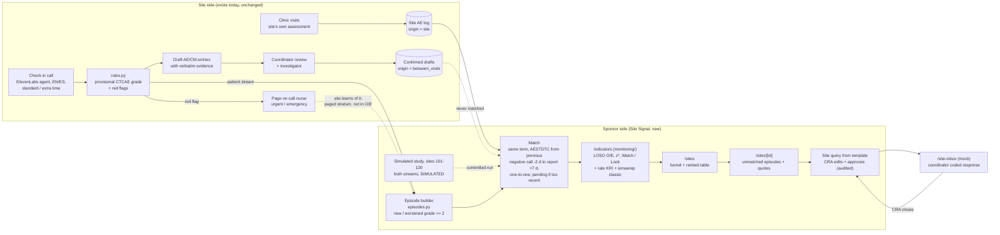
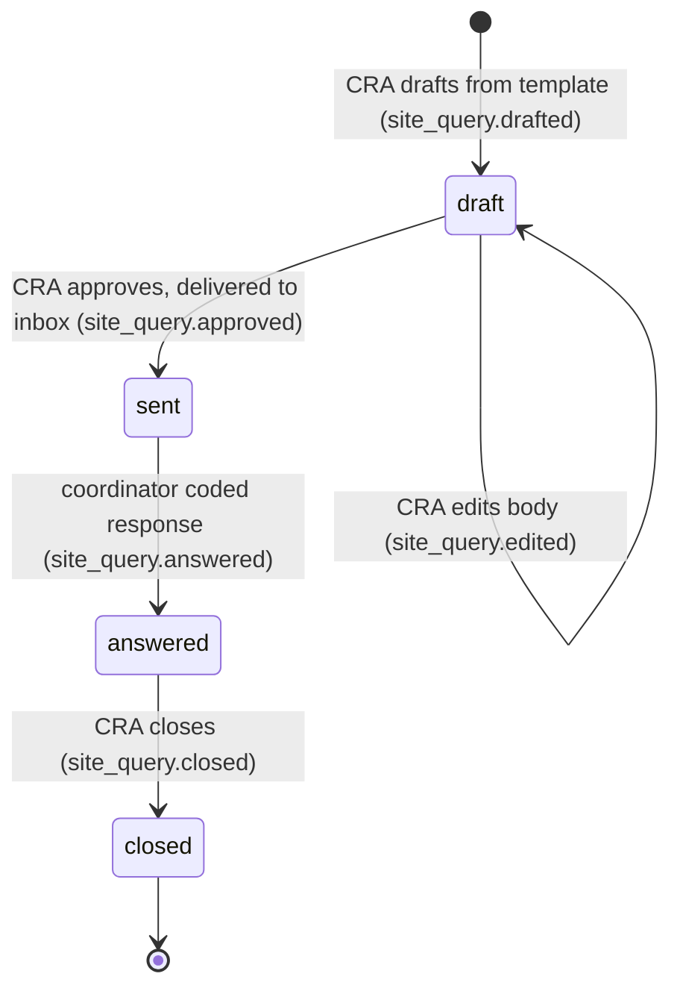

# 10 · Site Signal

Product requirements for the sponsor-side statistical layer added to Between Visits. **Status: planned (Sun Oct 11). Nothing in this doc is built yet.**

- Interfaces (endpoints, models, errors, audit actions): [`docs/03-api-contracts.md` §5](03-api-contracts.md#5-site-signal-and-readiness-additions-planned-sun-oct-11). Contracts first: change §5 before code.
- Estimand, episode and match definitions, null model, thresholds, simulation, pre-registration: [`docs/11-site-signal-sap.md`](11-site-signal-sap.md). Where this doc and the SAP differ on statistics, the SAP wins.
- Tasks and acceptance checks: [`docs/workstreams/WS5-site-signal.md`](workstreams/WS5-site-signal.md) (S1–S10), plus the WS0–WS4 task files. Timeline and cut rules: [`docs/09`](09-timeline-and-workstreams.md).

## 1. Summary

**One-liner:** Patients speak, rules grade, statistics point, humans decide.

Site Signal compares each site's own adverse-event (AE) log with what that site's own patients told Between Visits, adjusted for the mix of moderate (grade 2) diarrhea and breathlessness episodes (§4.2). It gives the sponsor's central monitor a ranked list of sites where the two disagree more than chance and case mix explain. Every flag opens the patient's own words, and a human approves every query to a site. The output is **a reason to look, not a finding**.

| Question | Answer |
|---|---|
| What it measures | **Capture discordance:** of the patient-reported, rule-graded, new or worsened grade ≥ 2 episodes of Diarrhea, Fever and Dyspnea at a site, how many have a matching entry in that site's own AE log, compared with what the other sites capture for the same symptom mix (O/E). |
| How it decides | Pre-specified code only (`monitoring/`, `backend/app/services/site_signal.py`, `backend/app/services/episodes.py`), driven by `data/signal_rules.json` and parameters frozen under the git tag `sap-v1` before any evaluation output existed. No LLM anywhere on this path. |
| What it shows | Two tiers, **Watch** and **Look**; a neutral **No signal at this sample size**; and grey **Not computed: reason**. No tier is green and no tier means "clean". |
| What it is compared with | A gsm-style AE-rate KRI and **simaerep classic (legacy)**, computed on the identical study and calibrated by the same null procedure. |
| What data it runs on | A simulated 20-site study (sites 101–120, badged **SIMULATED**) plus live or replayed calls at site 101 (badged **MEASURED**). |
| What it changes on the safety path | Nothing in grading, paging or what the agent says. Site Signal itself touches none of `rules.py`, `interview.py`, `escalation.py`, `postcall.py`, `sae.py` or `agent/*`. The only edits near the safety path are named readiness tasks: B14 (`outcome_of` and narrative punctuation in `sae.py`), R3 (local-date fallback in `sae.py` and `export.py`) and V9 (LLM pin in the agent config). Paging never waits on statistics. |

### Key terms

Formal definitions are in the SAP. Short versions:

| Term | Meaning |
|---|---|
| Reference stream | The symptom reports the voice agent collects from patients on days 1, 3 and 7 after each dose, independent of site staff. |
| Episode | One new or worsened rule-graded grade ≥ 2 occurrence of Diarrhea, Fever or Dyspnea for one subject. Repeats on later day-1/3/7 calls at the same grade are the same episode. A rise to a higher grade opens a new "worsened" episode. Episode date = local date of the first call that reported it. |
| Site-originated AE | A row in the site's AE log with `origin = site`. Rows with `origin = between_visits` (confirmed Between Visits drafts) never count. |
| Match | Same CTCAE term (through our own synonym list in `data/signal_rules.json`, no MedDRA) and site AESTDTC between the subject's previous call that reported the symptom below the episode's grade (minus 2 days) and 7 days after the episode date, one-to-one (SAP §5). Patients report symptoms after onset, so the window looks back. |
| Pending | Episode whose site entry window has not passed at the data cut. Shown greyed, never counted as missed. |
| Paged stratum | Episodes on a call that paged the nurse (urgent or emergency). The site learns of them through the page, so they are excluded from O/E and reported separately. A page may also raise capture of the same subject's other episodes nearby; SAP SE14 and SE15 bound that. |
| O / E | O = matched evaluable, non-paged episodes at the site. E = sum of the other sites' (leave-one-site-out) capture rates for each episode's term and grade band. |
| Shadow mode | The only supported deployment framing: during the analysis period, drafts are reviewed only by a sponsor-side reviewer and never shown to site roles; the site enters AEs from its own visits. A site where drafts reach site staff is not computed (`integrated_mode`, SAP §2.4). |

## 2. Problem and evidence

| # | Claim | Evidence |
|---|---|---|
| 1 | Clinicians record fewer of the symptoms patients feel, across the trials and sites studied. | Across three randomized trials, physicians did not report 40.7–74.4% of the symptomatic toxicities patients reported, and 13–50% at the highest severity [1] (secondary summary, UNVERIFIED against the full text). In 243 phase I patients, 19 symptoms were recorded by clinicians in ≤ 1% of patients although ≥ 10% of patients reported them [2] (secondary summary, UNVERIFIED). NCI developed PRO-CTCAE because investigator reporting "underdetects symptomatic AEs" [3, 4]. |
| 2 | The patient stream is a reference, not ground truth. | Patients reported symptoms earlier and more often than clinicians, but clinician reports were more closely associated with unfavorable clinical outcomes [5] (secondary summary, UNVERIFIED). Discordance therefore includes legitimate clinical judgment (§7.2). |
| 3 | Because the gap exists everywhere, the useful signal is how one site compares with the others, not the raw gap. | Follows from 1; also why the FDA SMART approach compares each site with all sites and notes that if all the data are spurious an anomaly will not be detected [6]. |
| 4 | Monitoring is expensive and moving toward centralized, data-driven review. | Site monitoring is 9–14% of trial cost [7] (secondary summary, UNVERIFIED against the full text). FDA encourages a risk-based approach that uses centralized monitoring to decide where to go [8]. ICH E6(R3) describes centralized monitoring of accumulated data to find systemic or site-specific issues [9] (our paraphrase, not re-checked against the guideline text: UNVERIFIED). |
| 5 | Current AE KRIs compare one site's AE log with other sites' AE logs, so they cannot tell "healthier patients" from "missed AEs". | gsm's AE indicator is AEs per days on study with an overdispersed Poisson z-score [10, 11]. simaerep compares a site's AE counts per visit with patients resampled from the study's own AE records [12, 13]; it does not adjust for differences in patients' symptom burden between sites (our reading of the v1.0.0 method, not a statement from its documentation). A site with healthier patients looks like a low reporter; a low-capture site with sicker patients looks normal. |
| 6 | Low AE reporting at a site is a recognized data-quality signal. | The FDA SMART poster lists under-reporting of AEs as an example of sloppiness and says the method works best with at least 10 sites [6]. The starter sheet "Check Engine Light" describes "a site whose patients somehow never report side effects" and asks that a flag be worded as "a reason to look, not a finding of misconduct" [14]. |
| 7 | Site entry lags the visit. | 8 days from visit to EDC entry (Tufts CSDD 2017, as quoted in the HackRU kit and `docs/00`) [15]. This sets the evaluability window: an unmatched episode only counts once the entry window has passed. |
| 8 | Whose symptoms reach the safety record is an equity question. | Mentor feedback (`docs/00`): non-English speakers and slower patients are the hardest to reach and keep. Direct evidence that their symptoms are captured less completely is limited, so the equity panel poses this as a question the tool can measure, not a known effect. |

**What is different here:** the denominator is what each site's own patients reported, through a channel site staff do not run. Case mix largely cancels because the comparison is per reported episode. In one literature search we found no published site-level indicator anchored on a patient-reported stream (UNVERIFIED).

**Why these three terms:** they are the only terms with grade 2 and grade 3 rules in `data/ctcae_rules.json` (`docs/05` §4). Every other term is "reported, ungraded" context. Clinically, they are the symptom-level start of key toxicities for the drug classes in scope: diarrhea (immune-related colitis) and dyspnea (pneumonitis) for anti-PD-1 antibodies [16], and fever (cytokine release syndrome) for CD3 bispecifics, which appear here in roadmap context only [17].

## 3. Users and user stories

| User | `X-BV-Role` | Demo identity | What they do in Site Signal |
|---|---|---|---|
| CRA / central monitor (sponsor side) | `cra` (new) | Sam Rivera, "CRA (sponsor)" (see §11) | Ranks sites, drills down, drafts, edits, approves and closes site queries, runs blind runs. Only role that drafts, edits, approves and closes queries. |
| Sponsor biostatistician | `sponsor` | "Sponsor safety (mock)" (existing) | Reads the ranking, validation and equity panels; runs blind runs; cannot send queries. |
| Site coordinator | `coordinator` | Jess Kim (existing) | Answers approved queries in the mock site inbox with a coded response. The mock inbox stands in for the coordinator of whichever site was queried, so it lists queries for every site (`docs/03` §5.4). Sees no drafts and no site rankings. |
| Investigator, site 101 | `investigator` | Dr. Patel (existing) | No Site Signal screen. Their judgment reaches the sponsor through the coordinator's coded response (for example "not an AE per investigator"). |
| Patient | (none) | Synthetic personas | Nothing changes on the call. Their words become evidence, shown with subject ID only. |

| ID | Story | Where | Proven by |
|---|---|---|---|
| US-1 | As a CRA covering 20 sites, I want sites ranked by symptom-mix-adjusted capture discordance, so I know where to look first. | `/sites` | REQ-023, REQ-025 |
| US-2 | As a CRA, I want every flag to open the specific unmatched episodes with the patient's words, date and source, so I can check a flag in under a minute instead of trusting a score. | `/sites/[id]` | REQ-026 |
| US-3 | As a CRA, I want sites with too little data, low call completion, or an error to show "not computed" with the reason, never a reassuring color. | `/sites` | REQ-025 |
| US-4 | As a CRA, I want to send a templated, non-leading data-completeness query only after I approve it, and to track it to closure. | `/sites/[id]`, `/site-inbox` | REQ-027 |
| US-5 | As a CRA, I want to see how a plain AE-rate KRI and simaerep classic rank the same sites, so I know what the patient stream adds and where it does not. | `/sites` | REQ-028 |
| US-6 | As a sponsor biostatistician, I want the estimand, thresholds and seeds fixed in git before any evaluation data existed, so I can verify the result was not tuned. | git tag `sap-v1`, `docs/11` | REQ-022 |
| US-7 | As a sponsor biostatistician, I want the null false-flag rate and power at both tiers, with Monte Carlo SE, including the cases where it fails. | `/sites` "How well it works" | REQ-023 |
| US-8 | As a sponsor biostatistician, I want to type my own seed, see the ranking against the fixed thresholds, and only then reveal which sites were planted. | Blind run dialog | REQ-029 |
| US-9 | As a sponsor biostatistician, I want capture compared by language and by pace within sites, with intervals. | `/sites` "Equity" | REQ-031 |
| US-10 | As a site coordinator, I want queries that list subject IDs and dates and ask me to review source documents and either enter or explain, never to tell me what to record. | `/site-inbox` | REQ-027 |
| US-11 | As an investigator, I want "not an AE", "recorded as medical history" and "recorded under another term" to be normal answers, so legitimate clinical judgment closes a query without penalty. | `data/site_queries.json` response codes | REQ-027 |
| US-12 | As a patient, I want my call unchanged: the same disclosure, questions and paging, with statistics never delaying a page. | Safety path untouched | REQ-001..REQ-012 still pass |
| US-13 | As a patient, I want my words shown to the sponsor and in site queries with my subject ID only, never my name. | Sponsor views, queries | REQ-027 (identifier check) |

## 4. How it fits the existing product

### 4.1 Three rules keep the two streams independent

| Threat | Rule | Requirement |
|---|---|---|
| Our own confirmed drafts enter the site AE log and "match" themselves | Rows with `origin = between_visits` are excluded from matching. `ae.csv` carries an `ORIGIN` column so the tag survives export. This prevents self-matching only; it does not make the streams independent, because a site that saw a draft may change its own entries. A site with any such row or any draft action by site staff is therefore not computed (`integrated_mode`). | REQ-024, REQ-025, REQ-020 |
| The nurse page tells site staff about the episode, so the site's capture of it is caused by us | Episodes on any call that paged (urgent or emergency) form a separate, descriptive **paged stratum**, excluded from O and E. | REQ-024 |
| Recent episodes look "missed" because the site has not entered them yet | An episode counts only when `data_cut >= max(episode_date + 14 days, next scheduled visit after the episode + 8 days)`; otherwise it is **pending**. | REQ-024, SAP |

Integrated mode, where drafts reach the site and the site reviews them, breaks independence. It is not supported; a different indicator (draft rejection behavior) would be needed and is not built. Site 101's live bridge is integrated by construction, so its MEASURED episodes are descriptive only.

### 4.2 What the analysis set is in practice

The paged-stratum rule interacts with the red-flag table (`docs/05` §4), and this shapes what O/E can see:

- Fever at grade 2 or 3 means a highest temperature above 39.0 °C, and `RF_FEVER` pages at 38.0 °C. **Every Fever episode in the primary set is on a paged call.**
- Diarrhea grade 3 (≥ 7 stools over baseline) always fires `RF_DIARRHEA_SEVERE`; Dyspnea grade 3 (breathless at rest) always fires `RF_BREATHING`. **Every grade 3 episode is paged.**
- Some grade 2 episodes are paged too: Diarrhea grade 2 with blood in stool, or with dizziness on standing (`RF_DEHYDRATION`); Dyspnea grade 2 rated severe; and any episode on a call where another red flag fired.

So O/E is computed mostly on **non-paged Diarrhea grade 2 and Dyspnea grade 2 episodes**. Fever and grade 3 episodes appear in the paged stratum, where the site was told in real time. This is intended (the site learning through our page is not independent capture), but it means Site Signal measures capture of moderate, non-urgent symptoms, not of the most severe ones, and it lowers the number of evaluable episodes per site. The simulation and planning grid must apply the real red-flag rules so power is not overstated (SAP).

### 4.3 Data streams and labels

| Stream | Sites | Where it lives | Badge | In O/E? |
|---|---|---|---|---|
| Simulated patient episodes (answers graded by the real `rules.py`, synthetic quotes) | 101–120 | `monitoring/out/episodes.json` | SIMULATED | Yes, when evaluable and not paged |
| Simulated site AE log (SDTM-style) | 101–120 | `monitoring/out/site_ae.json` | SIMULATED | Yes (`origin = site` rows) |
| Live or replayed calls processed by the real handlers | 101 only | Built at request time from DB Findings | MEASURED | Shown in the drill-down only; does not change the committed run's O/E or tier |
| Confirmed Between Visits drafts | 101 | `ae.csv`, `ORIGIN = between_visits` | (n/a) | Never |

In the simulated study, site 101 (Hillside Cancer Center, fictional) is always honest by the answer key. After a Rosa replay, `/sites/101` shows her MEASURED episode as "Paged: separate stratum"; a non-red-flag grade 2 call shows as "Pending".

## 5. Scope

### In scope

| Checkpoint | Site Signal deliverable |
|---|---|
| SAP (Sun 02:45) | `docs/11` + `monitoring/params.yaml` + `data/signal_rules.json` + `data/site_queries.json` + planning grid + `monitoring/uv.lock` committed and pushed; annotated tag `sap-v1` pushed on that commit before any evaluation output exists; tag sha timestamped externally; beacon recorded (S1, D11). |
| B (Sun 06:15) | `monitoring/` uv project: simulate, match, indicators, calibrate, simaerep classic (legacy) port with fixture test, validate, blind run (S2–S9). Shared pure episode builder (B16). Read API, site query flow, blind run endpoints (B17–B20). `/sites`, `/sites/[id]`, `/site-inbox`, CRA role, funnel, badges, "How well it works" tab, blind run dialog (F11–F16). Playwright smoke from a flagged site to a closed query (R10). REQ-021..030 with passing tests. |
| C (Sun 07:30 freeze) | Equity panel and single-language toggle (S9, F17, REQ-031). `WHAT_IT_GETS_WRONG.md` and `NOT_BUILT.md` with numbers from `validation/site_signal/summary.json` (D13). Optional Synthea roster for language and age mix, as a labeled sensitivity analysis only (S10). |

Cut rules that touch Site Signal (full list in `docs/09`): never cut SAP-before-data ordering, the null false-flag rate with MC SE, SIMULATED/MEASURED labels, the 25% and 50% rows, or `WHAT_IT_GETS_WRONG.md`. At 05:00, drop simaerep classic if its fixture test is not green. At 05:25, ship `/sites` and `/sites/[id]` read-only plus `validation/site_signal/report.md` and move the query flow and blind run to `NOT_BUILT.md`. If a blind run takes more than 10 s on the host, serve precomputed seeds only and say so in the UI.

### Non-goals

- Any finding of misconduct, fraud, a protocol deviation, or a site "score" shared with the site.
- Any LLM in episode building, matching, statistics, thresholds, tiers or query text.
- Changes to the safety path or to what the agent says to patients.
- Grading terms without a CTCAE rule, or any new PRO-to-CTCAE conversion table.
- MedDRA coding, WHODrug, SNOMED codes. Matching uses CTCAE terms plus our own synonyms.
- Real EDC, CTMS or e-mail integration. The site inbox is a mock.
- Integrated mode (drafts reaching the site) and its draft-rejection indicator.
- A null model fitted to each study's data (data-fitted bootstrap), and simaerep's v1.0.0 inframe default. Both are listed in `NOT_BUILT.md`.
- Mixed-model secondary analyses, an entry-lag KRI, visit agendas or monitoring-visit planning.
- Synthea for anything beyond the roster's language and age mix.
- Real-time updates (polling stays; no websockets).

## 6. UX by page

Page layouts and components are in `docs/06-frontend.md` § Site Signal pages. This section says what each page must show and who can act.

| Route | Shows | Who can act |
|---|---|---|
| `/sites` (tab **Signal**) | Header: SIMULATED badge, `sap-v1` short sha and date, "Thresholds fixed from the pre-registered null". Hand-built SVG funnel: x = E, y = O/E, Look and Watch lower limits as curves in E, one dot per computed site, not-computed sites as grey hollow markers in a strip below the axis; accessible table fallback. Ranked table: site, patients, evaluable, pending, paged, coverage, O/E, tier badge, rate-KRI tier, simaerep classic (legacy) tier, open queries. Footer from `signal_rules.json` labels, with the number filled from `run.expected_false_look_flags_per_study`: "A reason to look, not a finding. About {expected_false_look} false Look flags are expected in a study like this with no problems, under the pre-registered null." The number of computed sites *K* is shown next to the tier legend. Buttons: **Blind run** (DEMO_MODE only) and **Reveal answer key** (committed study: shows each planted site's display label from `signal_rules.json` `labels.answer_key`, e.g. "Planted: large capture loss", never the raw key, read from `monitoring/out/answer_key.json`, which is committed for transparency, and whether each indicator flagged it; a view toggle, not an audited action). | View: `cra`, `sponsor`. Other roles see a "Switch to CRA to view site rankings" notice. Blind run and reveal: `cra`, `sponsor`. |
| `/sites` (tab **How well it works**) | From `GET /api/site-signal/validation` only, never typed numbers: power at both tiers for discordance, rate KRI and simaerep classic (legacy), including the f = 0.25 and 0.50 rows; null false-flag rates with MC SE; the failure case; sensitivity rows; the committed study's confusion (illustration, not proof); link to `WHAT_IT_GETS_WRONG.md`. Every number badged SIMULATED. | Any role (read-only). |
| `/sites` (tab **Equity**, Checkpoint C) | Within-site capture odds ratios, Spanish vs English and extra time vs standard, with intervals and a "power is low" note; per-site ORs where each group has ≥ 5 evaluable episodes; toggle **Single-language app** that greys out sites that would fall below minimum data with only the English stream. The planted language-gap site is labeled "planted" only after reveal. | View: `cra`, `sponsor`. |
| `/sites/[id]` | Site card: fictional name, region, roster mix (Spanish share, extra-time share), call completion, tier with reason. Episode table: subject ID, term, provisional grade ("rule-graded"), episode date, status chip (Unmatched, Matched, Pending, Paged: separate stratum, Not evaluated; an Unmatched episode at a site that is not computed for low coverage or too little data stays Unmatched and can be cited), `EvidenceQuote` in the original language with `AiLabel` translation (synthetic translations are AI-assisted and labeled too), source chip (Live call / Replay / Synthetic), data-origin badge. Site 101 lists MEASURED episodes first. Language and pace strata mini-table. Paged stratum count shown separately. Query list with status and audit links. | View: `cra`, `sponsor`. **Draft site query** for selected Unmatched evaluable episodes, edit, **Approve and send**, **Close**: `cra` only. |
| `/site-inbox` | Banner "Mock site inbox (synthetic data)". Sent, answered and closed queries for the queried site (the mock covers all sites; optional site filter): body, cited subject IDs and episode dates, status timeline. Respond with a coded response and an optional note. Drafts never appear. | Respond: `coordinator`. Read-only: `cra`, `sponsor`. |
| Nav (`AppShell`) | Adds **Sites** and **Site inbox**. | Any role. |

Related changes elsewhere in the dashboard (readiness work, not Site Signal): `/review` shows an "origin: between_visits" tag on confirmed AE rows and AE/CM CSV downloads; `/report-card` shows Clopper-Pearson intervals, the zero-failure note and a separate MEASURED real-voice row; `/sae` gets a list page; `/checkins/[id]` gets a MEASURED "Site aware N days before next visit" badge (Checkpoint C). See `docs/06`.

### 6.1 Tier badges and wording

Badge text comes from `data/signal_rules.json` `labels`, not from code.

| Tier | Badge text | Rule | Visual |
|---|---|---|---|
| `watch` | Watch | z* at or below the null 10% quantile of the per-study minimum: P(≥ 1 false Watch per study) ≤ 10% under the pre-registered null | Strongest emphasis |
| `look` | Look | z* at or below the null per-site one-sided 5% quantile; the expected number of false Look flags per study comes from `thresholds.json` and is shown, never typed | Medium emphasis |
| `none` | No signal at this sample size | Computed and above both thresholds | Neutral; never green, never "clean" |
| `not_computed` | Not computed: {reason} | < 10 patients, < 15 evaluable episodes, call completion < 0.60, drafts reaching site staff (`integrated_mode`), study < 10 computed sites, or any error | Grey |

No tier badge uses a green or "success" token, or the red and amber escalation tokens, so a statistical tier is never read as a clinical escalation (`docs/06` § Site Signal pages; F11 acceptance).

| Say | Never say (UI, docs, deck, queries) |
|---|---|
| capture discordance; unmatched episode; a reason to look, not a finding; no signal at this sample size; not computed | under-reporting, under-reporter, missed AE (for a site), fraud, misconduct, non-compliant, failed to, clean site, verified site |
| provisional grade (rule-graded) | grade (without "provisional") |
| SIMULATED / MEASURED on every view | any Site Signal number without a badge |

### 6.2 Blind run (DEMO_MODE only)

1. A CRA or sponsor user clicks **Blind run** and types any seed string (1–64 characters).
2. The backend runs `python -m bvsignal.blind` in the `monitoring` project: a fresh study at the `sap-v1` design, with a hidden number (0–3) of sites planted at the gross capture-loss level among sites other than 101, ranked against the fixed `sap-v1` thresholds. Target under 10 s. Audit: `signal.blind_run.created`.
3. The result shows 20 ranked rows and "planted count hidden". The answer key is not in the response.
4. **Reveal** shows which sites were planted and, for each indicator, caught, missed and false flags. Audit: `signal.blind_run.revealed` (once; a second reveal returns the same body without a new audit row).
5. If the subprocess fails or times out, the dialog offers the 10 precomputed seeds and says it is using them.

The same seed always gives the same study. Thresholds are never recomputed per run.

### 6.3 States

- `GET /api/sites` 503 `site_signal_unavailable` (outputs missing or unreadable): every site renders grey "Not computed: error"; nothing renders green or empty-as-fine.
- Equity before S9: 404 `no_equity_run` → "Equity analysis not run yet".
- Validation before S7: 404 `no_validation_run` → "Validation not run yet" with a link to `docs/11`.
- Wrong role: 403 `wrong_role` → role notice, not an error toast. The frontend keys on `error.code`.

### 6.4 Site query lifecycle

- Only episodes with status `unmatched` can be cited (422 `episode_not_eligible` otherwise). That includes unmatched episodes at sites not computed for low coverage or too little data; it excludes pending, paged, matched and not-evaluated episodes.
- Text is rendered from the `SQ_UNMATCHED_EPISODES` template in `data/site_queries.json` (WS4). The exact wording lives only there. Content rules, enforced by `data/validate_data.py`: data completeness only; asks the site to review source documents and either enter the event or say why no entry is needed; lists subject IDs, term, episode date and provisional grade; states it is not a finding about the site and does not concern clinical management; placeholders limited to `{site_id}`, `{episode_lines}`, `{subject_id}`, `{term}`, `{episode_date}`, `{grade}`; banned phrases include "under-report", "fraud", "misconduct", "failed to", "you must", "should treat", "dose", "discontinue".
- A CRA edit containing a patient's first or last name from the database is refused (422 `contains_identifier`).
- Coded responses: entered after source review, recorded as medical history, recorded under another term, not an AE per investigator, other. None of them is "wrong".

## 7. Regulatory framing and limits

### 7.1 Shadow mode only

The reference stream reaches the sponsor separately; the site enters AEs from its own visits; the two are compared. Between Visits drafts that a site confirms are tagged and excluded. This is the only framing in the UI, README, deck and video.

### 7.2 Capture discordance is not misconduct

Discordance mixes several things, most of them legitimate: symptoms present at baseline recorded as medical history, attribution judgments, grade 1 events a protocol allows the site to omit, different terms for the same event, entry delays, and also genuine gaps in capture. A flag says the pattern differs from other sites by more than the pre-registered null allows. It does not say why. The committed study includes an honest-but-low-diligence site (honest by the answer key) to show exactly this, and the UI footer says so on every view.

### 7.3 Non-leading queries

Queries are data-completeness requests from fixed wording (§6.4). They never suggest a term, grade or attribution beyond restating what the patient reported, never mention clinical management, and offer several equally valid coded answers. A CRA approves every query and every step is audited. Whether this wording meets a given sponsor's query-management SOP is UNVERIFIED.

### 7.4 SIMULATED vs MEASURED

Every Site Signal run, row, episode and view carries `data_origin`. SIMULATED = generated by `monitoring/` from `params.yaml`. MEASURED = computed from calls processed by the app's real handlers (site 101 live or replayed calls, voice checks, eval). MIXED = the site 101 card when live episodes exist, or a query that cites both kinds of episode. No chart or statistic pools SIMULATED and MEASURED data. A replay of a scripted (not recorded) scenario is MEASURED in the sense that the real handlers processed it; its source chip reads "Replay", never "Live call", and the check-in page shows the scenario's label ("Scripted" or "Recorded real call", F18), so it is never presented as a real call. Synthetic quotes carry `source = synthetic` and are never spoken by the agent.

### 7.5 Pre-registration

The SAP, `params.yaml` (with the gross capture loss chosen by its pre-registered rule from the planning grid), `data/signal_rules.json` and the planning grid are committed and tagged `sap-v1` (annotated, pushed) before any file under `monitoring/out/` or `validation/site_signal/` exists. The evaluation seed is fixed by the tag commit and a public randomness beacon published after the tag, the tag sha is timestamped outside the team's control, and every evaluation run is logged (SAP §1.2–§1.3). Simulation and analysis code written after the tag implements the SAP; any deviation is logged in `docs/11` "Deviations" with commit and reason. REQ-022 checks the order, the seed and the run log.

### 7.6 Privacy

Sponsor views, site queries and the site inbox carry subject IDs only. Sites and patients are fictional. Real phone numbers stay in `.env` and `data/patients.local.json`.

### 7.7 Open regulatory questions (UNVERIFIED)

- **ePRO source control.** EMA's guideline on computerised systems and electronic data in clinical trials (EMA/INS/GCP/112288/2023) covers eCOA/ePRO and expects investigator control of source data [18]; how that applies to a sponsor-side reference stream is not checked.
- **Sponsor safety awareness.** A sponsor that sees unfiltered patient symptom reports may become aware of possible serious or unexpected events, with possible IND safety-reporting implications (21 CFR 312.32) [19]. A real deployment needs a defined process; not addressed here.
- **Not a medical device; not validated.** Site Signal informs where a monitor looks. It makes no clinical decision and does not change patient care.

## 8. Planned requirements

The planned requirements REQ-016..031 (text, risk, checkpoint and planned test) are listed once, in [`docs/07-eval-and-validation.md` §6](07-eval-and-validation.md). Site Signal's are REQ-021..031; user stories in §3 cite them. Each ID enters `validation/requirements.yaml` only in the commit that adds its passing test.

### End-to-end acceptance (Checkpoint B)

On the public DEMO_MODE instance, as `cra`: `/sites` shows 20 sites with the SIMULATED badge and at least 2 grey sites with reasons → open a Watch or Look site → unmatched episodes show quotes with source chips → draft, edit, approve a query → switch to `coordinator` → `/site-inbox` shows it, respond → switch back to `cra` → close → `/audit` shows the query actions and `GET /api/audit/verify` returns `ok: true`. A blind run with a typed seed returns in under 10 s and reveals correctly. This is the R10 Playwright smoke.

## 9. How the non-negotiables hold

| CLAUDE.md rule | How Site Signal keeps it |
|---|---|
| 1. The LLM listens, rules grade, humans decide | No LLM anywhere on the statistics path (REQ-021 import scan). Grades in the simulation come from the real `rules.py`; thresholds from the pre-registered null; tiers and wording from `data/signal_rules.json`. A human decides whether to act: a CRA approves every query. |
| 2. Approved words only | Nothing new is said to patients. Query wording lives only in `data/site_queries.json` (WS4), non-leading and validator-checked. Synthetic quotes are patient-side text, labeled "synthetic", never spoken. No clinical thresholds in code: the simulator grades candidate answers with `rules.py`, and match, evaluability and minimum-data numbers live in `data/signal_rules.json`. |
| 3. No medical advice | Queries ask the site to review source and enter or explain; the template states it does not concern clinical management; UI copy says "a reason to look, not a finding". |
| 4. Disclose and offer a human | Unchanged. Site Signal adds no calls. |
| 5. Fail safe | Paging never waits on statistics; Site Signal is read-only with respect to the safety path. Below minimum data, below coverage, study below 10 sites, or any error → grey "Not computed", never green (REQ-025). |
| 6. Evidence on every draft | Every Look or Watch flag drills down to verbatim quotes in the original language with date, source and `data_origin` (REQ-026); AI translations labeled; every view badged SIMULATED, MEASURED or MIXED (REQ-030). |
| 7. Nothing is final without a human; every human action audited | CRA approval before a query reaches the inbox; draft, edit, approve, answer, close, blind-run create and reveal each write an AuditEvent (REQ-027, REQ-029); the audit log is a verifiable hash chain (REQ-019). |
| 8. Synthetic data only; drug by class only | Fictional sites (names end in "(fictional)") and synthetic subject IDs only. The drug is "anti-PD-1"; CD3 bispecifics appear in roadmap context only. No real numbers or keys. |
| 9. No licensed content; subject ID only | CTCAE terms plus our own synonyms, no MedDRA; no PRO-CTCAE wording; no WHODrug; optional Synthea roster keeps age and language only (no SNOMED codes, no raw output, no jar in git). Sponsor views and queries carry subject IDs only (identifier check, REQ-027). |

## 10. Known limits: what it gets wrong

### 10.1 Results (filled from validation only)

Every Site Signal number quoted anywhere comes from `validation/site_signal/summary.json`, written by `monitoring/bvsignal/validate.py` (S7). The cells below were filled after S7 by `validation/render_numbers.py` from the JSON path kept in each row (rounded by `docs/11` §15 rule 6; the provenance table at the foot of `WHAT_IT_GETS_WRONG.md` lists every value with its path). Figures from earlier drafts and from the planning grid are not results and are not quoted. *f* is the planted capture loss; "Look or Watch" counts a flag at either tier.

| Result (all SIMULATED) | `summary.json` source | Value |
|---|---|---|
| False Look rate per site under the null (target 0.05), overall and by site-size tertile | `null.look_per_site`, `null.look_per_site_by_e_tertile`; REQ-023 and the size check computed by `validation/render_numbers.py` (`derived`) | 0.05 (MC SE 0.001); REQ-023 bound 0.053, outcome: met (conservative: below the nominal rate). Tertiles of *E*: 0.03 (MC SE 0.002), 0.05 (MC SE 0.002), 0.06 (MC SE 0.002); size check met |
| False Watch rate per study under the null (target ≤ 0.10) | `null.watch_fwer` (rate, mc_se, ci95) | 0.11 (MC SE 0.007), Clopper-Pearson 95% CI [0.095, 0.122]; REQ-023 bound 0.119, outcome: met |
| Discordance power at Watch: gross f, f = 0.50, f = 0.25, at the `sap-v1` design row (`summary.json` `design.patients_per_site`, mu = 1.5) | `power[]` rows with indicator `discordance`, tier `watch` | f = 0.90: 0.70 (MC SE 0.026); f = 0.50: 0.22 (MC SE 0.024); f = 0.25: 0.03 (MC SE 0.009) |
| Discordance power at Look, same rows | `power[]`, tier `look` | Look or Watch: f = 0.90: 0.77 (MC SE 0.024); f = 0.50: 0.51 (MC SE 0.029); f = 0.25: 0.15 (MC SE 0.021). The planted site was computed in 0.77 of studies (`p_computed`), which caps this power |
| Rate KRI, same rows | `power[]` indicator `rate_kri` | Look or Watch: f = 0.90: 0.99 (MC SE 0.005); f = 0.50: 0.50 (MC SE 0.029); f = 0.25: 0.19 (MC SE 0.023). Watch: f = 0.90: 0.78 (MC SE 0.024); f = 0.50: 0.13 (MC SE 0.019); f = 0.25: 0.02 (MC SE 0.007) |
| Discordance minus rate KRI, paired, same rows | `head_to_head.grid` comparator `rate_kri` | Look or Watch: f = 0.90: -0.22 (paired MC SE 0.025); f = 0.50: 0.01 (paired MC SE 0.043); f = 0.25: -0.04 (paired MC SE 0.031). Watch: f = 0.90: -0.08 (paired MC SE 0.033); f = 0.50: 0.09 (paired MC SE 0.029); f = 0.25: 0.01 (paired MC SE 0.012) |
| simaerep classic (legacy), same rows | `power[]` indicator `simaerep_classic` | Look or Watch: f = 0.90: 0.12 (MC SE 0.019); f = 0.50: 0.14 (MC SE 0.020); f = 0.25: 0.07 (MC SE 0.014). Watch: f = 0.90: 0.03 (MC SE 0.010); f = 0.50: 0.04 (MC SE 0.012); f = 0.25: 0.02 (MC SE 0.008) |
| AE-to-report ratio ablation, same rows | `power[]` indicator `ae_report_ratio` | Look or Watch: f = 0.90: 0.77 (MC SE 0.024); f = 0.50: 0.53 (MC SE 0.029); f = 0.25: 0.17 (MC SE 0.022). Watch: f = 0.90: 0.69 (MC SE 0.027); f = 0.50: 0.21 (MC SE 0.024); f = 0.25: 0.02 (MC SE 0.009) |
| Power at mu = 0.5 (lower episode rate) | `power[]` rows with mu 0.5 | Discordance: the planted site is never computed in any mu = 0.5 cell, so it is never flagged. Example cell (20 sites, 60 patients per site, f = 0.50): discordance computed in 0.00 of studies, Look or Watch 0.00 (MC SE 0.000); rate KRI Look or Watch 0.46 (MC SE 0.029), Watch 0.13 (MC SE 0.019). Same cell at mu = 1.5: discordance Look or Watch 0.55 (MC SE 0.029), Watch 0.23 (MC SE 0.024) |
| Failure case: between-site capture SD 0.6, case-mix SD 0.2, all indicators | `failure_case` | (a) Re-calibrated thresholds, f = 0.50, Look or Watch / Watch: discordance 0.30 (MC SE 0.026) / 0.04 (MC SE 0.011); rate KRI 0.82 (MC SE 0.022) / 0.36 (MC SE 0.028); simaerep classic 0.81 (MC SE 0.022) / 0.02 (MC SE 0.008); AE-to-report ratio 0.38 (MC SE 0.028) / 0.06 (MC SE 0.014). Gross f = 0.90: discordance 0.82 (MC SE 0.022) / 0.48 (MC SE 0.029); rate KRI 1.00 (MC SE 0.000) / 0.99 (MC SE 0.005); simaerep classic 1.00 (MC SE 0.000) / 0.03 (MC SE 0.010); AE-to-report ratio 0.81 (MC SE 0.022) / 0.55 (MC SE 0.029). (b) Frozen `sap-v1` thresholds on failure-case null data: discordance: Look per site 0.06 (MC SE 0.001), any Watch per study 0.15 (MC SE 0.011); rate KRI: Look per site 0.06 (MC SE 0.001), any Watch per study 0.21 (MC SE 0.013); simaerep classic: Look per site 0.00 (MC SE 0.000), any Watch per study 0.00 (MC SE 0.000); AE-to-report ratio: Look per site 0.06 (MC SE 0.001), any Watch per study 0.16 (MC SE 0.011) |
| Committed study: planted sites caught, missed, false flags (illustration only) | `eval_study.confusion`, `caught`, `missed` | discordance (Watch: caught 0, missed 5, false flags 0; Look or Watch: caught 2, missed 3, false flags 0); rate KRI (Watch: caught 2, missed 3, false flags 0; Look or Watch: caught 2, missed 3, false flags 0); simaerep classic (Watch: caught 0, missed 5, false flags 0; Look or Watch: caught 0, missed 5, false flags 0). Discordance placed both gross-loss sites at Look and did not compute the language-gap site (insufficient episodes) |
| simaerep classic p-value reproduction | `simaerep_fixture.max_rel_diff` | maximum relative difference 0.000 (3 decimals) over 10 fixture rows |

Measured on the existing product (`eval/results/latest.json`, text mode, 20 simulated patients): red-flag recall 8/8, Clopper-Pearson 95% CI 63.1–100%. Showing red-flag recall of at least 90%, 95% or 99% with one-sided 95% confidence needs 29, 59 or 299 consecutive red-flag cases without a miss.

### 10.2 Limits

1. **Both streams are simulated.** The planted-site results show method and power, not real-world validity. The non-circular test is retrospective: trials that collected patient-reported (PRO-CTCAE) and clinician-reported (CTCAE) symptoms side by side, with site IDs. No new patients needed.
2. **Moderate gaps are mostly invisible at the Watch tier.** At the `sap-v1` design (patients per site chosen by SAP §11.5 rule P1), sites with a planted capture loss of 25% or 50% are expected to go mostly unflagged at Watch; Look catches more at the cost of the expected false Look flags per study shown on screen. Measured values are in §10.1; if they disagree with this sentence, the sentence is corrected. They bear it out. The committed study plants a 25% and a 50% site so this shows on screen.
3. **Discordance is not ahead of a plain AE-rate KRI everywhere, and the failure case reverses the comparison.** At the `sap-v1` design it is ahead at Watch for a 50% gap but behind for a gross loss, partly because a planted site below the minimum data is not computed and counts as a miss (§10.1). Any advantage rests on the assumed ratio of case-mix to diligence variation between honest sites; when honest sites differ mainly in diligence the KRI does much better (failure case, §10.1).
4. **Thresholds come from an assumed null.** They are calibrated once at the `sap-v1` design from a parametric null (patient frailty, patient-level capture effect, between-site capture SD, case-mix SD), not fitted to each study. Misspecification is reported as sensitivity; a data-fitted bootstrap is not built.
5. **Episode rate is an assumption.** 1.5 grade ≥ 2 episodes per patient per 36-week window (ASSUMPTION, representing a combination regimen). At lower rates power drops: at mu = 0.5 the planted site is never computed for discordance in the power grid, so it is never flagged (§10.1).
6. **Three terms only, and mostly grade 2.** Only Diarrhea, Fever and Dyspnea have grade 2/3 rules. Because red flags page for every Fever and every grade 3 episode, O/E rests mostly on non-paged Diarrhea and Dyspnea grade 2 episodes (§4.2). Everything else is "reported, ungraded".
7. **No onset date.** The interview has no onset item, so episode date = call date and the live AESTDTC = call date. The match window looks back to the subject's previous call that reported the symptom below the episode's grade (SAP §5); a site onset date earlier than that, minus 2 days, cannot match.
8. **No MedDRA.** Matching uses CTCAE terms and our synonym list. Real matching needs licensed coding by the sponsor.
9. **Patient-stream error is weakly measured.** The error model comes from a text-mode evaluation of 20 simulated patients; speech-recognition and accent error are unmeasured. P19 was an escalation false alarm, not an AE-term error (Spanish AE precision 1.0, English 0.833), so mapping error is stress-tested symmetrically in both languages.
10. **Paged episodes are a separate stratum.** A page may also raise the site's capture of the same subject's other episodes nearby (SAP SE14, SE15). In integrated mode, where drafts reach sites, independence is lost; such a site is not computed and a different indicator would be needed (not built).
11. **Discordance includes legitimate clinical judgment** (§7.2). It is not evidence of misconduct or a protocol deviation.
12. **Regulatory questions are open** (§7.7). Shadow mode only.
13. **Demo-grade security.** Demo identity headers, no real authentication or RBAC, SQLite single instance, audit hash chain tamper-evident only inside the database. The public instance is replay-only (DEMO_MODE).
14. **simaerep classic is the legacy algorithm.** simaerep v1.0.0's default (inframe) is not ported.
15. **Synthea, if used, changes no statistical assumption.** It supplies a language and age mix for a labeled sensitivity analysis only; the committed study uses the parametric roster.

`WHAT_IT_GETS_WRONG.md` (D13, Checkpoint C) is the reader-facing version of this list, with numbers from `summary.json`.

## 11. Open questions

1. **Design assumptions before the tag:** accept 20 sites, a 36-week window, mu = 1.5 grade ≥ 2 episodes per patient (combination-regimen assumption), and the patients-per-site range chosen by SAP §11.5 rule P1 (first of 15–30, 20–40, 30–60, 40–80 that passes; shown in `planning_grid.json` `.chosen`)? The reviewer approves the rule, not a fixed range. These are frozen at `sap-v1` (02:45).
2. **Paged-stratum size:** given §4.2, should the planning grid report the expected share of episodes that land in the paged stratum, and should the gross capture-loss choice be re-checked against it before the tag?
3. **Look tier visibility:** Look expects a known number of false flags per study (`thresholds.json`). Show it by default next to Watch (current plan), or behind a toggle?
4. **CRA demo identity:** "Sam Rivera" as the `cra` user, and who plays CRA vs nurse in a live walkthrough.
5. **Query wording review:** can someone with query-management experience review `data/site_queries.json` before Checkpoint B?
6. **Retrospective validation data:** is any trial with paired PRO-CTCAE and CTCAE data and site IDs available for the next step (UNVERIFIED)?
7. **Regulatory questions in §7.7:** who would own them in a pilot?

## References

1. Di Maio M, Gallo C, Leighl NB, et al. Symptomatic toxicities experienced during anticancer treatment: agreement between patient and physician reporting in three randomized trials. *J Clin Oncol* 2015;33(8):910–915.
2. Veitch ZW, Shepshelovich D, Gallagher C, et al. Underreporting of symptomatic adverse events in phase I clinical trials. *J Natl Cancer Inst* 2021;113(8):980–988. https://academic.oup.com/jnci/article/113/8/980/6146406
3. NCI. PRO-CTCAE development and testing. https://healthcaredelivery.cancer.gov/pro-ctcae/testing.html
4. Starter sheet "How Are You Feeling?" (HackRU Fall 2026 kit), §1, citing NCI [3].
5. Basch E, Jia X, Heller G, et al. Adverse symptom event reporting by patients vs clinicians: relationships with clinical outcomes. *J Natl Cancer Inst* 2009;101(23):1624–1632. https://pmc.ncbi.nlm.nih.gov/articles/PMC2786917
6. FDA CDER. "A Data Anomaly Detection Tool" (SMART) poster, in the HackRU Fall 2026 kit reading list.
7. Sertkaya A, Wong HH, Jessup A, Beleche T. Key cost drivers of pharmaceutical clinical trials in the United States. *Clin Trials* 2016;13(2):117–126. https://journals.sagepub.com/doi/10.1177/1740774515625964
8. FDA. A Risk-Based Approach to Monitoring of Clinical Investigations: Questions and Answers (2023). https://www.fda.gov/regulatory-information/search-fda-guidance-documents/risk-based-approach-monitoring-clinical-investigations-questions-and-answers
9. ICH E6(R3) Guideline for Good Clinical Practice (Step 4, 6 Jan 2025). https://www.ich.org/page/efficacy-guidelines
10. Gilead-BioStats/gsm (Apache-2.0), KRI method vignette. https://github.com/Gilead-BioStats/gsm
11. Spiegelhalter DJ. Handling over-dispersion of performance indicators. *Qual Saf Health Care* 2005;14(5):347–351.
12. Koneswarakantha B, et al. *Ther Innov Regul Sci* 2024, doi:10.1007/s43441-024-00631-8 (as cited in the simaerep v1.0.0 DESCRIPTION file). https://doi.org/10.1007/s43441-024-00631-8
13. openpharma/simaerep v1.0.0 (MIT), documentation and NEWS. https://github.com/openpharma/simaerep · https://openpharma.github.io/simaerep/
14. Starter sheet "Check Engine Light" (HackRU Fall 2026 kit), §1 and §10.
15. Tufts CSDD 2017 eClinical Landscape study, as quoted in the HackRU Fall 2026 kit; also `docs/00-overview.md`.
16. Schneider BJ, et al. Management of immune-related adverse events in patients treated with immune checkpoint inhibitor therapy: ASCO guideline update. *J Clin Oncol* 2021;39(36):4073–4126. (UNVERIFIED: not re-checked in this planning round.)
17. Lee DW, et al. ASTCT consensus grading for cytokine release syndrome and neurologic toxicity associated with immune effector cells. *Biol Blood Marrow Transplant* 2019;25(4):625–638. (UNVERIFIED: not re-checked in this planning round.)
18. EMA. Guideline on computerised systems and electronic data in clinical trials, EMA/INS/GCP/112288/2023. https://www.ema.europa.eu/en/documents/regulatory-procedural-guideline/guideline-computerised-systems-electronic-data-clinical-trials_en.pdf
19. 21 CFR 312.32, IND safety reporting.
