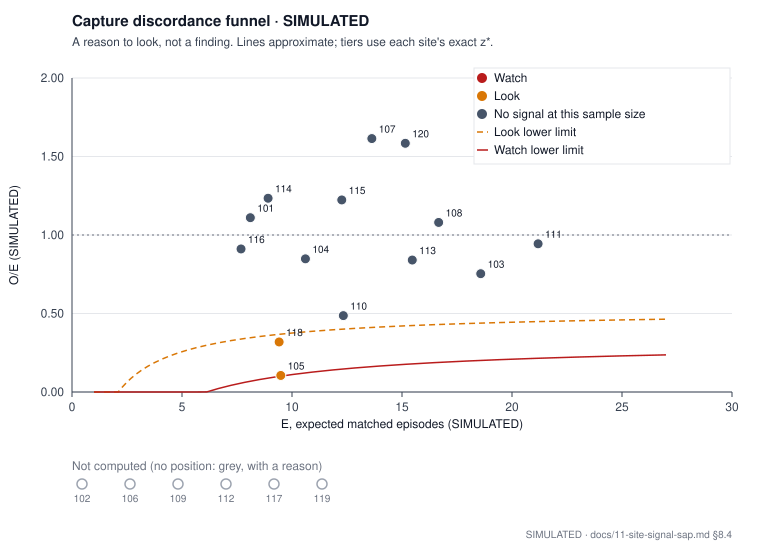

# Site Signal: committed evaluation study

`SIMULATED` · capture discordance is **a reason to look, not a finding**.

Every number on this page is SIMULATED: both streams of every site, the planted site behaviours and the answer key come from the simulation of the pre-registered analysis plan [docs/11-site-signal-sap.md](../../docs/11-site-signal-sap.md) (tag `sap-v1`, §11). It describes simulated sites only and says nothing about any real site. Numbers come from `monitoring/out/*.json` of the same run; they are rounded here for display only (§15 rule 6). Operating characteristics (false-flag rates, power, the failure case) are in `validation/site_signal/summary.json`, never on this page.

## Provenance · `SIMULATED`

| Field | Value |
|---|---|
| Run | `sr_committed` |
| Seed | `eval` |
| sap_tag_commit | `68838978bb305e0f730d30e5cbf3c00bceca5a25` |
| eval_seed | `92794863` |
| beacon_round | `6542582` |
| code_commit | `9204a1e025443d19150cc4bb7c41c02d485fb620` |
| generated_at (commit time of code_commit) | `2026-10-11T12:18:52Z` |
| numpy / scipy | `2.5.4` / `1.18.1` |
| thresholds.json sha256 | `2f3b8c4dc13c123c8a125d8bfa77114a2314103d262824dd78acfa3f61b666a0` |

## Design and thresholds · `SIMULATED`

| Quantity | Value | Data |
|---|---|---|
| Sites | 20 | `SIMULATED` |
| Patients per site (design range) | 40–80 | `SIMULATED` |
| Data cut | 2026-09-14 (36 weeks) | `SIMULATED` |
| Episode rate μ (grade ≥ 2 per patient window) | 1.50 | `SIMULATED` |
| Gross planted capture loss f | 0.90 | `SIMULATED` |
| Computed sites K (capture discordance) | 14 | `SIMULATED` |
| Study not computed | no | `SIMULATED` |
| φ̂ (winsorized dispersion, §8.2) | 2.40 | `SIMULATED` |
| τ̂² (additive between-site variance, §8.2) | 0.076 | `SIMULATED` |
| Expected false Look flags per study (calibration mean, §8.3) | 0.77 | `SIMULATED` |
| Null studies behind the thresholds (§9.2) | 2000 | `SIMULATED` |

Thresholds are read from `thresholds.json` (calibrated once from the pre-registered null, §9), never computed by this run. Watch is nested in Look; a missing threshold is never assigned (§9.3).

| Indicator | Look | Watch | Flagged when | Data |
|---|---|---|---|---|
| Capture discordance | -1.73 | -2.47 | z* ≤ threshold | `SIMULATED` |
| gsm-style rate KRI | -1.69 | -2.44 | z* ≤ threshold | `SIMULATED` |
| simaerep classic (legacy) | 0.994 | 0.996 | prob ≥ threshold | `SIMULATED` |

Tier labels: **Watch**, **Look**, **No signal at this sample size** (neutral, never green) and **Not computed** (grey, always with its reason). A reason to look, not a finding.

## Ranked sites: capture discordance · `SIMULATED`

Primary indicator (§8): matched site AEs O against the leave-one-site-out expectation E for the site's evaluable, non-paged Diarrhea and Dyspnea grade 2 episodes, with the overdispersion-adjusted score z*. Computed sites by rank (z* ascending), then the sites that are not computed, by site.

| Rank | Site | Tier | O | E | V | O/E | z | z* | Evaluable | Pending | Paged | Call completion | Data |
|---|---|---|---|---|---|---|---|---|---|---|---|---|---|
| 1 | 105 Elm Hollow Cancer Care (fictional) | Look | 1 | 9.5 | 7.8 | 0.11 | -3.05 | -2.22 | 19 | 6 | 45 | 0.85 | `SIMULATED` |
| 2 | 118 Saltmarsh Oncology Partners (fictional) | Look | 3 | 9.4 | 5.0 | 0.32 | -2.87 | -1.88 | 19 | 5 | 44 | 0.87 | `SIMULATED` |
| 3 | 110 Juniper Flats Oncology (fictional) | No signal at this sample size | 6 | 12.3 | 8.0 | 0.49 | -2.23 | -1.43 | 25 | 5 | 48 | 0.86 | `SIMULATED` |
| 4 | 103 Cobblestone Cancer Clinic (fictional) | No signal at this sample size | 14 | 18.6 | 9.5 | 0.75 | -1.49 | -0.77 | 38 | 4 | 80 | 0.86 | `SIMULATED` |
| 5 | 113 Lantern Hill Cancer Center (fictional) | No signal at this sample size | 13 | 15.5 | 8.0 | 0.84 | -0.87 | -0.48 | 32 | 7 | 79 | 0.85 | `SIMULATED` |
| 6 | 104 Driftwood Bay Oncology (fictional) | No signal at this sample size | 9 | 10.6 | 5.5 | 0.85 | -0.69 | -0.43 | 22 | 3 | 36 | 0.84 | `SIMULATED` |
| 7 | 116 Orchard Lane Oncology (fictional) | No signal at this sample size | 7 | 7.7 | 4.7 | 0.91 | -0.31 | -0.22 | 16 | 4 | 45 | 0.84 | `SIMULATED` |
| 8 | 111 Kestrel Point Cancer Care (fictional) | No signal at this sample size | 20 | 21.2 | 15.7 | 0.94 | -0.30 | -0.17 | 44 | 6 | 77 | 0.85 | `SIMULATED` |
| 9 | 108 Heron Creek Oncology (fictional) | No signal at this sample size | 18 | 16.7 | 9.1 | 1.08 | 0.44 | 0.24 | 35 | 9 | 66 | 0.86 | `SIMULATED` |
| 10 | 101 Hillside Cancer Center (fictional) | No signal at this sample size | 9 | 8.1 | 4.6 | 1.11 | 0.42 | 0.29 | 17 | 3 | 41 | 0.85 | `SIMULATED` |
| 11 | 114 Mossbank Oncology Group (fictional) | No signal at this sample size | 11 | 8.9 | 4.7 | 1.23 | 0.96 | 0.64 | 19 | 6 | 46 | 0.86 | `SIMULATED` |
| 12 | 115 Nettlefield Cancer Clinic (fictional) | No signal at this sample size | 15 | 12.3 | 6.5 | 1.22 | 1.08 | 0.65 | 26 | 6 | 57 | 0.85 | `SIMULATED` |
| 13 | 120 Willowmere Oncology (fictional) | No signal at this sample size | 24 | 15.2 | 11.8 | 1.58 | 2.58 | 1.64 | 33 | 4 | 49 | 0.86 | `SIMULATED` |
| 14 | 107 Granite Pass Cancer Center (fictional) | No signal at this sample size | 22 | 13.6 | 11.9 | 1.61 | 2.43 | 1.64 | 30 | 2 | 41 | 0.87 | `SIMULATED` |
| — | 102 Bluebell Valley Oncology (fictional) | Not computed: `insufficient_episodes` | — | — | — | — | — | — | 14 | 3 | 40 | 0.87 | `SIMULATED` |
| — | 106 Foxglove Regional Oncology (fictional) | Not computed: `insufficient_episodes` | — | — | — | — | — | — | 13 | 1 | 23 | 0.85 | `SIMULATED` |
| — | 109 Indigo Meadow Cancer Clinic (fictional) | Not computed: `insufficient_episodes` | — | — | — | — | — | — | 12 | 0 | 16 | 0.86 | `SIMULATED` |
| — | 112 Maple Ridge Oncology (fictional) | Not computed: `insufficient_patients` | — | — | — | — | — | — | 1 | 0 | 6 | 0.84 | `SIMULATED` |
| — | 117 Quillfeather Cancer Care (fictional) | Not computed: `low_coverage` | — | — | — | — | — | — | 15 | 3 | 22 | 0.53 | `SIMULATED` |
| — | 119 Tamarack Bend Cancer Center (fictional) | Not computed: `insufficient_episodes` | — | — | — | — | — | — | 13 | 3 | 34 | 0.86 | `SIMULATED` |

Not-computed reasons (§7):

| Reason | Meaning |
|---|---|
| `insufficient_episodes` | This site has fewer than 15 evaluable episodes outside the paged stratum, or no variation to measure, so a site-level comparison is not possible. |
| `insufficient_patients` | This site has fewer than 10 patients, too few for a site-level comparison. |
| `low_coverage` | Fewer than 60% of scheduled calls were completed at this site, too few to compare its AE log with the patient reports. |

## Three indicators on the identical study · `SIMULATED`

Both comparators use only the site AE log of the same simulated study (§10, REQ-028) and are calibrated on the same null studies. They have no coverage guard; they apply `min_patients`.

| Site | Discordance z* | Tier | Rate KRI z* | Tier | simaerep prob | BH p-value | Tier | Data |
|---|---|---|---|---|---|---|---|---|
| 105 | -2.22 | Look | -2.81 | Watch | 0.993 | 0.000 | No signal at this sample size | `SIMULATED` |
| 118 | -1.88 | Look | -2.57 | Watch | 0.993 | 0.000 | No signal at this sample size | `SIMULATED` |
| 110 | -1.43 | No signal at this sample size | -0.30 | No signal at this sample size | 0.625 | 0.359 | No signal at this sample size | `SIMULATED` |
| 103 | -0.77 | No signal at this sample size | 0.21 | No signal at this sample size | 0.000 | 1.000 | No signal at this sample size | `SIMULATED` |
| 113 | -0.48 | No signal at this sample size | 4.30 | No signal at this sample size | 0.000 | 1.000 | No signal at this sample size | `SIMULATED` |
| 104 | -0.43 | No signal at this sample size | -0.46 | No signal at this sample size | 0.625 | 0.275 | No signal at this sample size | `SIMULATED` |
| 116 | -0.22 | No signal at this sample size | -0.47 | No signal at this sample size | 0.529 | 0.423 | No signal at this sample size | `SIMULATED` |
| 111 | -0.17 | No signal at this sample size | 1.05 | No signal at this sample size | 0.000 | 1.000 | No signal at this sample size | `SIMULATED` |
| 108 | 0.24 | No signal at this sample size | 1.65 | No signal at this sample size | 0.000 | 1.000 | No signal at this sample size | `SIMULATED` |
| 101 | 0.29 | No signal at this sample size | -0.64 | No signal at this sample size | 0.710 | 0.101 | No signal at this sample size | `SIMULATED` |
| 114 | 0.64 | No signal at this sample size | 0.89 | No signal at this sample size | 0.000 | 1.000 | No signal at this sample size | `SIMULATED` |
| 115 | 0.65 | No signal at this sample size | 0.49 | No signal at this sample size | 0.000 | 1.000 | No signal at this sample size | `SIMULATED` |
| 120 | 1.64 | No signal at this sample size | 1.01 | No signal at this sample size | 0.000 | 1.000 | No signal at this sample size | `SIMULATED` |
| 107 | 1.64 | No signal at this sample size | 0.25 | No signal at this sample size | 0.000 | 1.000 | No signal at this sample size | `SIMULATED` |
| 102 | — | Not computed: `insufficient_episodes` | 1.05 | No signal at this sample size | 0.000 | 1.000 | No signal at this sample size | `SIMULATED` |
| 106 | — | Not computed: `insufficient_episodes` | -1.58 | No signal at this sample size | 0.993 | 0.000 | No signal at this sample size | `SIMULATED` |
| 109 | — | Not computed: `insufficient_episodes` | -0.82 | No signal at this sample size | 0.710 | 0.047 | No signal at this sample size | `SIMULATED` |
| 112 | — | Not computed: `insufficient_patients` | — | Not computed | — | — | Not computed | `SIMULATED` |
| 117 | — | Not computed: `low_coverage` | -0.90 | No signal at this sample size | 0.970 | 0.000 | No signal at this sample size | `SIMULATED` |
| 119 | — | Not computed: `insufficient_episodes` | 0.80 | No signal at this sample size | 0.000 | 1.000 | No signal at this sample size | `SIMULATED` |

## Funnel · `SIMULATED`

Each computed site at (E, O/E); the Look and Watch lines are the §8.4 lower limits, which approximate V by E(1 − p̄) and are drawn for orientation only. Tiers always use each site's exact z*. Not-computed sites are the hollow grey points below the axis.

| Quantity | Value | Data |
|---|---|---|
| p̄ (pooled matched share of computed sites) | 0.46 | `SIMULATED` |

## Secondary analysis: calibrated p-values with Benjamini-Hochberg q-values · `SIMULATED`

Report only, never used for tiers (§8.3): p = (1 + #{null pooled z* ≤ z*}) / (1 + M) over the Look pool of the calibration (M = 30889 SIMULATED null site values), with BH q-values across computed sites. Normal-approximation p-values are not used.

| Site | z* | Calibrated p | BH q | Data |
|---|---|---|---|---|
| 105 | -2.22 | 0.014 | 0.202 | `SIMULATED` |
| 118 | -1.88 | 0.037 | 0.260 | `SIMULATED` |
| 110 | -1.43 | 0.091 | 0.424 | `SIMULATED` |
| 103 | -0.77 | 0.245 | 0.764 | `SIMULATED` |
| 113 | -0.48 | 0.331 | 0.764 | `SIMULATED` |
| 104 | -0.43 | 0.347 | 0.764 | `SIMULATED` |
| 116 | -0.22 | 0.416 | 0.764 | `SIMULATED` |
| 111 | -0.17 | 0.437 | 0.764 | `SIMULATED` |
| 108 | 0.24 | 0.580 | 0.826 | `SIMULATED` |
| 101 | 0.29 | 0.596 | 0.826 | `SIMULATED` |
| 114 | 0.64 | 0.705 | 0.826 | `SIMULATED` |
| 115 | 0.65 | 0.708 | 0.826 | `SIMULATED` |
| 120 | 1.64 | 0.934 | 0.935 | `SIMULATED` |
| 107 | 1.64 | 0.935 | 0.935 | `SIMULATED` |
| 102 | — | — | — | `SIMULATED` |
| 106 | — | — | — | `SIMULATED` |
| 109 | — | — | — | `SIMULATED` |
| 112 | — | — | — | `SIMULATED` |
| 117 | — | — | — | `SIMULATED` |
| 119 | — | — | — | `SIMULATED` |

## Ablation: AE-to-report ratio · `SIMULATED`

Validation and report only, never a UI column (§10.3): the site's AE rows that map to a primary term against its evaluable non-paged episodes, leave-one-site-out, with no episode-level matching. It separates the value of matching from the value of a patient-reported denominator.

| Site | U | E^U | z | z* | Tier | Data |
|---|---|---|---|---|---|---|
| 105 | 4 | 27.0 | -4.42 | -2.17 | Look | `SIMULATED` |
| 118 | 3 | 28.0 | -4.72 | -2.31 | Look | `SIMULATED` |
| 110 | 28 | 35.1 | -1.20 | -0.59 | No signal at this sample size | `SIMULATED` |
| 103 | 36 | 54.0 | -2.45 | -1.20 | No signal at this sample size | `SIMULATED` |
| 113 | 54 | 43.0 | 1.67 | 0.82 | No signal at this sample size | `SIMULATED` |
| 104 | 20 | 30.7 | -1.94 | -0.95 | No signal at this sample size | `SIMULATED` |
| 116 | 21 | 22.4 | -0.29 | -0.14 | No signal at this sample size | `SIMULATED` |
| 111 | 50 | 63.4 | -1.69 | -0.83 | No signal at this sample size | `SIMULATED` |
| 108 | 59 | 46.9 | 1.76 | 0.86 | No signal at this sample size | `SIMULATED` |
| 101 | 29 | 24.1 | 1.00 | 0.49 | No signal at this sample size | `SIMULATED` |
| 114 | 42 | 24.9 | 3.44 | 1.68 | No signal at this sample size | `SIMULATED` |
| 115 | 43 | 34.9 | 1.37 | 0.67 | No signal at this sample size | `SIMULATED` |
| 120 | 56 | 44.9 | 1.66 | 0.81 | No signal at this sample size | `SIMULATED` |
| 107 | 38 | 42.4 | -0.68 | -0.33 | No signal at this sample size | `SIMULATED` |
| 102 | — | — | — | — | Not computed: `insufficient_episodes` | `SIMULATED` |
| 106 | — | — | — | — | Not computed: `insufficient_episodes` | `SIMULATED` |
| 109 | — | — | — | — | Not computed: `insufficient_episodes` | `SIMULATED` |
| 112 | — | — | — | — | Not computed: `insufficient_patients` | `SIMULATED` |
| 117 | — | — | — | — | Not computed: `low_coverage` | `SIMULATED` |
| 119 | — | — | — | — | Not computed: `insufficient_episodes` | `SIMULATED` |

| Quantity | Value | Data |
|---|---|---|
| φ̂ of the ablation (multiplicative) | 4.17 | `SIMULATED` |
| Look threshold | -1.87 | `SIMULATED` |
| Watch threshold | -2.77 | `SIMULATED` |

## Paged stratum and ungraded primary-term reports · `SIMULATED`

Descriptive only. Paged episodes (an urgent or emergency page on a folded call, §6.2) are matched but never enter O, E or V: the site was told in real time. Ungraded primary-term reports are completed calls on which a primary term was reported without a gradable answer (§4.1); they open and close no episode.

| Site | Paged episodes | Paged, matched | Ungraded primary-term reports | Data |
|---|---|---|---|---|
| 101 | 41 | 25 | 242 | `SIMULATED` |
| 102 | 40 | 26 | 169 | `SIMULATED` |
| 103 | 80 | 32 | 222 | `SIMULATED` |
| 104 | 36 | 16 | 198 | `SIMULATED` |
| 105 | 45 | 3 | 289 | `SIMULATED` |
| 106 | 23 | 14 | 278 | `SIMULATED` |
| 107 | 41 | 26 | 247 | `SIMULATED` |
| 108 | 66 | 49 | 263 | `SIMULATED` |
| 109 | 16 | 10 | 237 | `SIMULATED` |
| 110 | 48 | 24 | 276 | `SIMULATED` |
| 111 | 77 | 38 | 296 | `SIMULATED` |
| 112 | 6 | 4 | 14 | `SIMULATED` |
| 113 | 79 | 46 | 171 | `SIMULATED` |
| 114 | 46 | 40 | 199 | `SIMULATED` |
| 115 | 57 | 32 | 268 | `SIMULATED` |
| 116 | 45 | 25 | 300 | `SIMULATED` |
| 117 | 22 | 16 | 139 | `SIMULATED` |
| 118 | 44 | 0 | 243 | `SIMULATED` |
| 119 | 34 | 24 | 134 | `SIMULATED` |
| 120 | 49 | 38 | 214 | `SIMULATED` |

## Answer key and confusion: illustration only · `SIMULATED`

**Illustration only, never evidence of performance** (§12.7). With five planted positives these counts carry little information; the evidence is the operating characteristics in `validation/site_signal/summary.json` (§12.1–§12.6). Positives are the planted capture losses; a positive that is not computed counts as missed. The two must-be-grey sites are reported separately and are in no cell. A site at Watch also counts at Look. Honest sites with low capture are planted on purpose: low capture can come from honest practice.

| Site | Answer key | Planted f | Discordance | Rate KRI | simaerep classic | Data |
|---|---|---|---|---|---|---|
| 101 | Honest | — | No signal at this sample size | No signal at this sample size | No signal at this sample size | `SIMULATED` |
| 102 | Honest | — | Not computed | No signal at this sample size | No signal at this sample size | `SIMULATED` |
| 103 | Planted: 50% capture loss | 0.50 | No signal at this sample size | No signal at this sample size | No signal at this sample size | `SIMULATED` |
| 104 | Planted: 25% capture loss | 0.25 | No signal at this sample size | No signal at this sample size | No signal at this sample size | `SIMULATED` |
| 105 | Planted: large capture loss | 0.90 | Look | Watch | No signal at this sample size | `SIMULATED` |
| 106 | Honest (healthier patients) | — | Not computed | No signal at this sample size | No signal at this sample size | `SIMULATED` |
| 107 | Honest | — | No signal at this sample size | No signal at this sample size | No signal at this sample size | `SIMULATED` |
| 108 | Honest | — | No signal at this sample size | No signal at this sample size | No signal at this sample size | `SIMULATED` |
| 109 | Honest | — | Not computed | No signal at this sample size | No signal at this sample size | `SIMULATED` |
| 110 | Honest | — | No signal at this sample size | No signal at this sample size | No signal at this sample size | `SIMULATED` |
| 111 | Honest (low diligence) | — | No signal at this sample size | No signal at this sample size | No signal at this sample size | `SIMULATED` |
| 112 | Honest (small site) | — | Not computed | Not computed | Not computed | `SIMULATED` |
| 113 | Honest | — | No signal at this sample size | No signal at this sample size | No signal at this sample size | `SIMULATED` |
| 114 | Honest | — | No signal at this sample size | No signal at this sample size | No signal at this sample size | `SIMULATED` |
| 115 | Honest | — | No signal at this sample size | No signal at this sample size | No signal at this sample size | `SIMULATED` |
| 116 | Honest | — | No signal at this sample size | No signal at this sample size | No signal at this sample size | `SIMULATED` |
| 117 | Honest (low call completion) | — | Not computed | No signal at this sample size | No signal at this sample size | `SIMULATED` |
| 118 | Planted: large capture loss | 0.90 | Look | Watch | No signal at this sample size | `SIMULATED` |
| 119 | Planted: lower capture for Spanish speakers | — | Not computed | No signal at this sample size | No signal at this sample size | `SIMULATED` |
| 120 | Honest | — | No signal at this sample size | No signal at this sample size | No signal at this sample size | `SIMULATED` |

| Indicator | Tier | TP | FP | FN | TN | Data |
|---|---|---|---|---|---|---|
| Capture discordance | Watch | 0 | 0 | 5 | 13 | `SIMULATED` |
| Capture discordance | Look | 2 | 0 | 3 | 13 | `SIMULATED` |
| gsm-style rate KRI | Watch | 2 | 0 | 3 | 13 | `SIMULATED` |
| gsm-style rate KRI | Look | 2 | 0 | 3 | 13 | `SIMULATED` |
| simaerep classic (legacy) | Watch | 0 | 0 | 5 | 13 | `SIMULATED` |
| simaerep classic (legacy) | Look | 0 | 0 | 5 | 13 | `SIMULATED` |

| Site | Answer key | Indicator | Tier | Must be | As expected | Data |
|---|---|---|---|---|---|---|
| 112 | Honest (small site) | Capture discordance | Not computed: `insufficient_patients` | `insufficient_patients` | yes | `SIMULATED` |
| 112 | Honest (small site) | gsm-style rate KRI | Not computed: `insufficient_patients` | `insufficient_patients` | yes | `SIMULATED` |
| 112 | Honest (small site) | simaerep classic (legacy) | Not computed: `insufficient_patients` | `insufficient_patients` | yes | `SIMULATED` |
| 117 | Honest (low call completion) | Capture discordance | Not computed: `low_coverage` | `low_coverage` | yes | `SIMULATED` |
| 117 | Honest (low call completion) | gsm-style rate KRI | No signal at this sample size | — | — | `SIMULATED` |
| 117 | Honest (low call completion) | simaerep classic (legacy) | No signal at this sample size | — | — | `SIMULATED` |

## Equity: capture by language and pace within sites · `SIMULATED`

Mantel-Haenszel odds ratios within sites (§14); below 1 means that group's episodes were found in the site AE log less often. Power is low at these sample sizes; pace is a built-in negative control.

| Comparison | MH odds ratio | 95% CI (patient bootstrap) | Sites used | Data |
|---|---|---|---|---|
| Spanish vs English | 1.00 | 0.580 to 1.846 | 11 | `SIMULATED` |
| Extra-time vs standard pace | 0.69 | 0.288 to 1.724 | 6 | `SIMULATED` |

| Single-language counterfactual | Value | Data |
|---|---|---|
| Sites whose tier changes with English-only calls | 3 | `SIMULATED` |

Full equity results: `monitoring/out/equity.json`.

## Deviations and clarifications (docs/11 §17)

Deviations from the pre-specified analysis that apply to this run: none. Clarifications are listed for completeness; the full rows are in [docs/11 §17](../../docs/11-site-signal-sap.md#17-deviations).

| ID | Type | SAP section | Date/time (ET) | Eval outputs seen? |
|---|---|---|---|---|
| C1 | clarification | §1.2 step 6, §1.3 | 2026-10-11 04:50 ET | No |
| C2 | clarification | §1.2 step 7, §1.3 | 2026-10-11 04:50 ET | No |
| C3 | clarification | §8.3, §9.2, §10.2, §10.3 | 2026-10-11 06:00 ET | No |
| C4 | clarification | §1.2 steps 2, 3 and 5; REQ-022 | 2026-10-11 07:35 ET | No |
| C5 | clarification | §15 rule 7, §8.3, §10.3, §12.7 | 2026-10-11 07:50 ET | No |
| C6 | clarification | §14, §1.3, §12.3 | 2026-10-11 08:15 ET | No |
| C7 | clarification | §12, §12.1, §12.3, §12.8, §14 | 2026-10-11 08:30 ET | No |

## Next step

**Next step.** The only non-circular validation of Site Signal is retrospective analysis of trials with paired patient-reported and clinician-reported (CTCAE) adverse-event data and site IDs. Every number here comes from a simulation in which both streams and the answer key share one model family (docs/11 §16).

A reason to look, not a finding. `SIMULATED`
